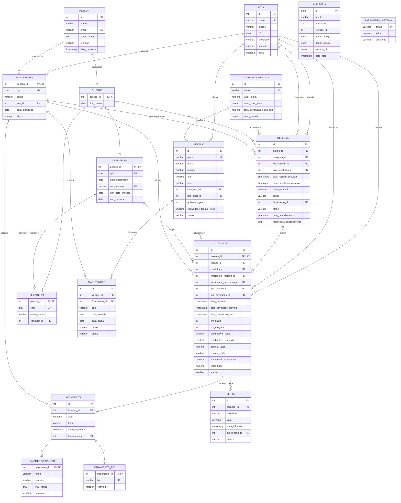
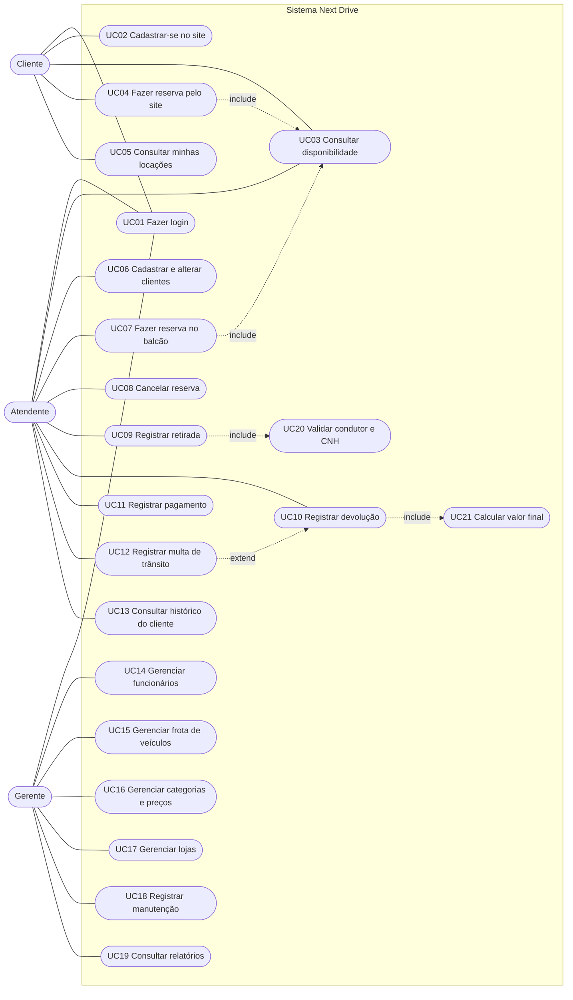
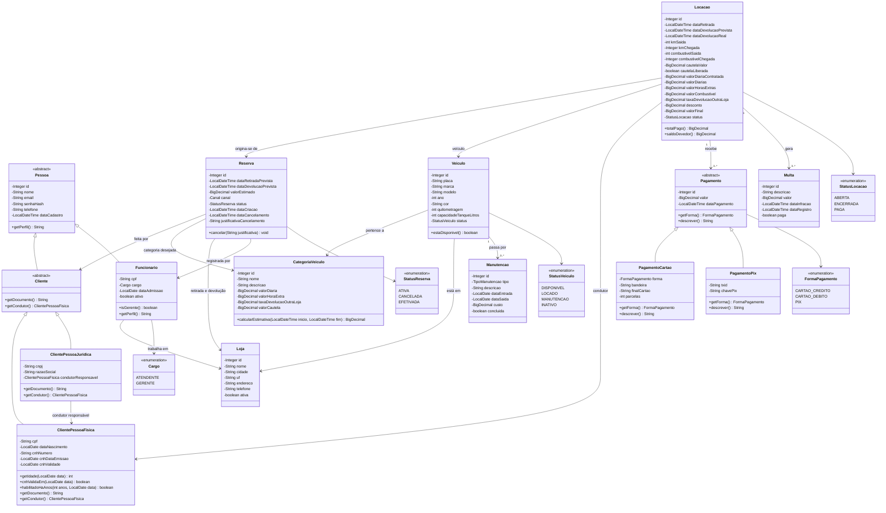
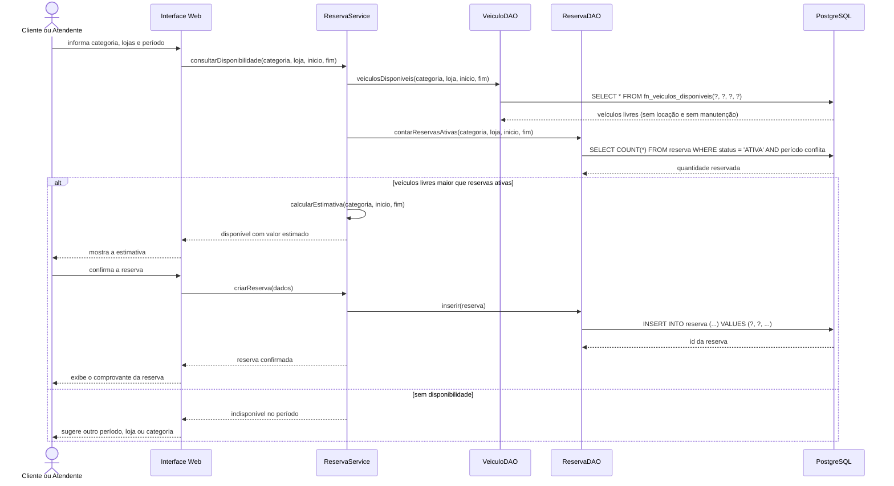
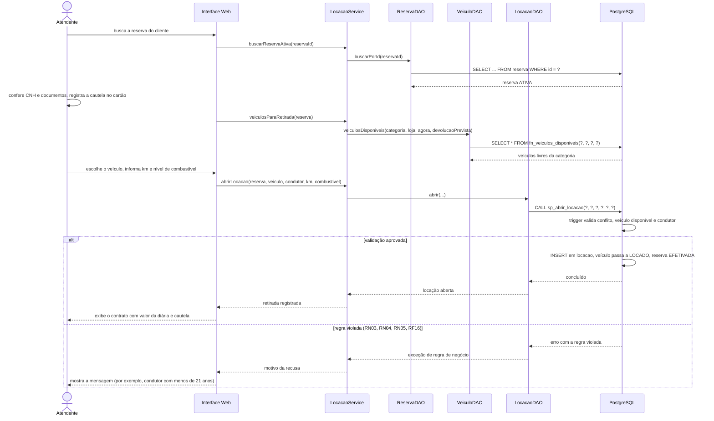
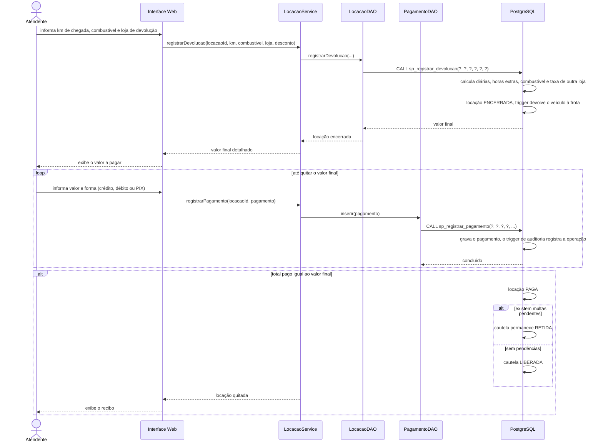
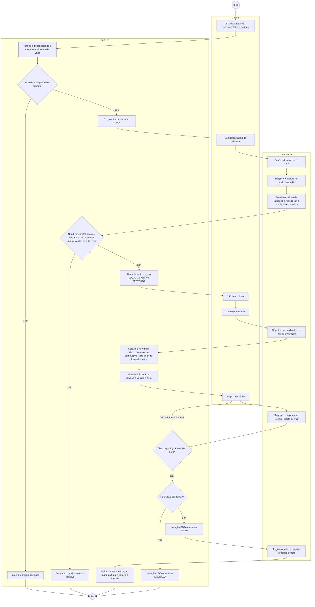
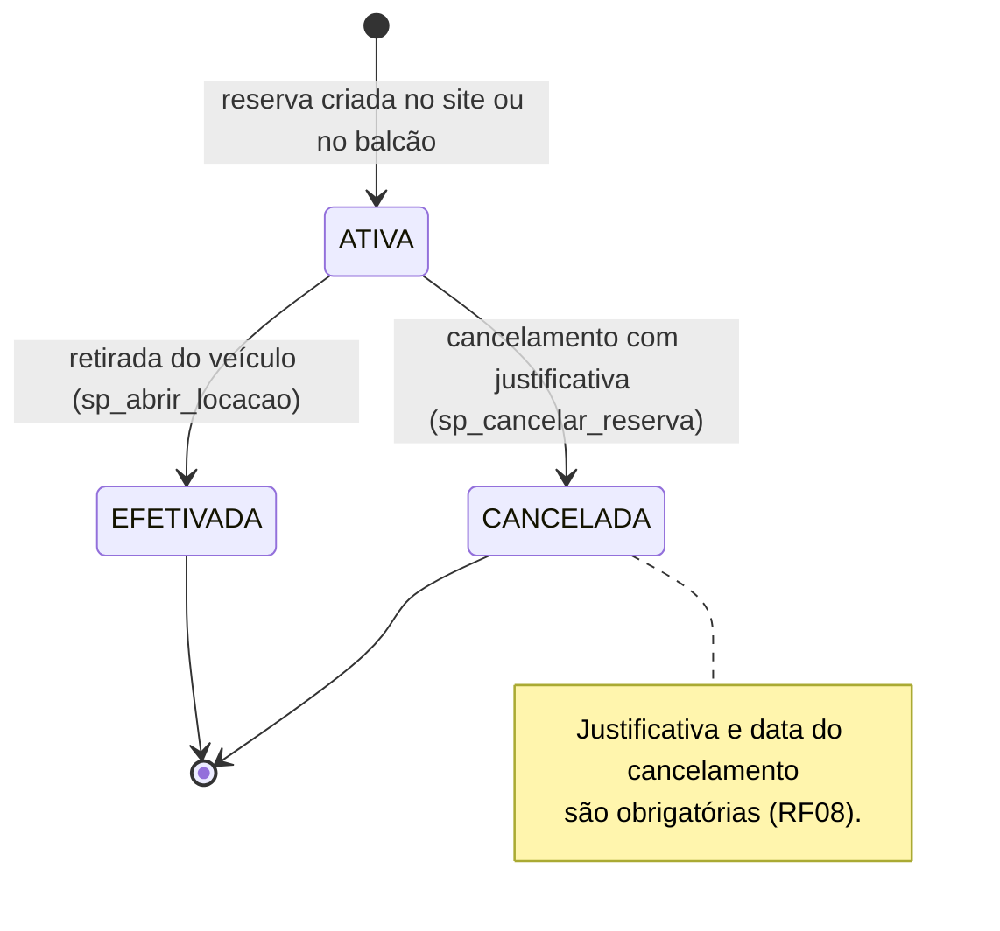
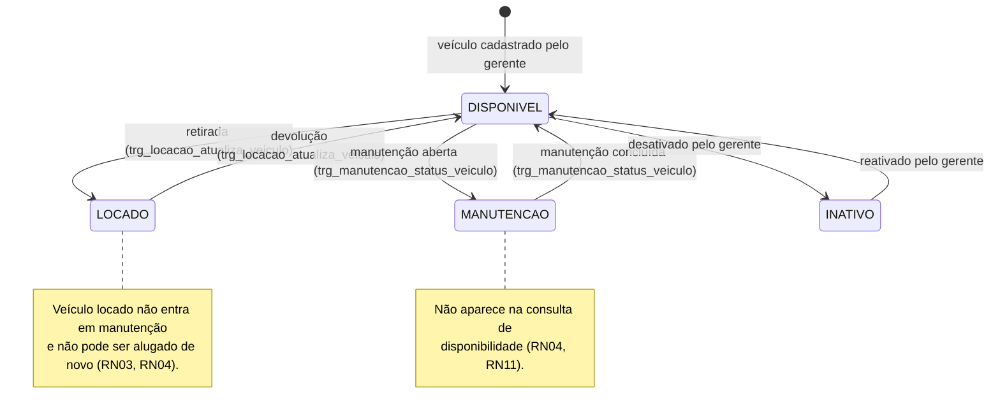
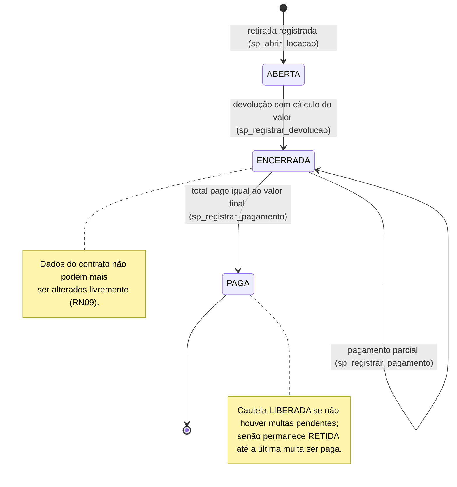

# Next Drive — Sistema de Locação de Veículos

**Trabalho Final Integrado de Programação II, Engenharia de Software I e Banco de Dados II** — Ciência da Computação, Universidade do Oeste de Santa Catarina (Unoesc), 4º semestre, 2026/02.

**Autores:** _[Nome do integrante 1]_, _[Nome do integrante 2]_, _[Nome do integrante 3]_, _[Nome do integrante 4]_
**Professores:** _[Programação II]_, _[Engenharia de Software I]_, _[Banco de Dados II]_
**Repositório:** <https://github.com/lucasorlandi7/NextDrive>

---

## Resumo

Este trabalho apresenta o **Next Drive**, um sistema web para uma locadora de veículos com várias lojas, que cobre o processo completo de locação: reserva, retirada, devolução, pagamento e pós-locação (multas de trânsito e liberação da cautela). O sistema foi desenvolvido em Java, sem frameworks, sobre um banco de dados PostgreSQL. O banco concentra as regras de negócio críticas (conflito de locações, idade e habilitação do condutor, imutabilidade de locações finalizadas, auditoria) em *triggers* e *procedures*, e o acesso é separado por perfis de usuário (gerente, atendente, auditor e site). A modelagem seguiu UML (casos de uso, classes, sequência, atividades e estados) e o modelo relacional foi normalizado até a terceira forma normal. O planejamento foi feito em sprints, com versionamento no GitHub. O resultado é um sistema funcional, verificado por 34 testes de regras no banco e por testes de fluxo ponta a ponta na aplicação web.

**Palavras-chave:** locação de veículos; PostgreSQL; Java; UML; banco de dados.

---

## Sumário

1. [Introdução](#1-introdução)
2. [Modelo de negócio](#2-modelo-de-negócio)
3. [Metodologia e planejamento](#3-metodologia-e-planejamento)
4. [Modelagem do banco de dados](#4-modelagem-do-banco-de-dados)
5. [Scripts do banco de dados](#5-scripts-do-banco-de-dados)
6. [Modelagem UML](#6-modelagem-uml)
7. [Implementação em Java](#7-implementação-em-java)
8. [Telas do sistema](#8-telas-do-sistema)
9. [Testes e validação](#9-testes-e-validação)
10. [Como executar](#10-como-executar)
11. [Conclusões](#11-conclusões)
12. [Referências](#referências)

---

## 1 Introdução

Locadoras de veículos lidam com um processo em que erros custam caro: um carro entregue para dois clientes no mesmo período, um contrato alterado depois de fechado, um pagamento registrado sem rastro. Em sistemas pequenos, essas regras costumam ficar espalhadas pelas telas, e basta uma tela esquecer de validar para o dado errado entrar.

O objetivo deste trabalho é construir o **Next Drive**, sistema de gestão de uma locadora com várias lojas, em que cliente, atendente e gerente usam o mesmo sistema com permissões diferentes. O trabalho é integrado e atende três disciplinas ao mesmo tempo:

| Disciplina | O que o trabalho entrega |
|---|---|
| **Banco de Dados II** | Modelo relacional normalizado, scripts com índices e *constraints*, *views*, relatórios com junções, *triggers*, *procedures*, políticas de acesso, backup e restauração. |
| **Engenharia de Software I** | Levantamento de requisitos, diagramas UML (casos de uso, classes, sequência, atividades e estados), planejamento em sprints e uso de Git/GitHub. |
| **Programação II** | Aplicação web em Java com orientação a objetos (herança, polimorfismo, classes abstratas, enumerações), JDBC, JavaDoc e funcionalidade extra. |

A decisão de projeto que organiza todo o trabalho é **colocar as regras de negócio no banco**. A aplicação Java valida o que ajuda o usuário (mensagens claras, campos obrigatórios), mas a garantia final é do PostgreSQL. Assim, qualquer caminho de acesso (a aplicação, um script, outro sistema no futuro) respeita as mesmas regras.

---

## 2 Modelo de negócio

### 2.1 Processo de locação

O processo tem cinco etapas:

1. **Reserva.** O cliente escolhe categoria de veículo, lojas de retirada e devolução e o período. O sistema consulta a disponibilidade e informa uma estimativa de valor. A reserva pode ser feita pelo próprio cliente no site ou por um atendente no balcão, e pode ser cancelada com justificativa.
2. **Retirada.** O cliente comparece à loja. O atendente confere os documentos e a CNH, registra a **cautela** no cartão de crédito, escolhe um veículo da categoria reservada e anota quilometragem e nível de combustível de saída. A reserva passa a *efetivada* e o veículo a *locado*.
3. **Devolução.** O atendente registra quilometragem, combustível e loja de devolução. O sistema calcula o **valor final**: diárias, horas extras por atraso, combustível faltante, taxa por devolução em outra loja e desconto. O veículo volta à frota.
4. **Pagamento.** O pagamento é registrado em cartão de crédito, cartão de débito ou PIX, podendo ser parcial. Quando o total pago iguala o valor final, a locação fica *paga*.
5. **Pós-locação.** Multas de trânsito recebidas depois são vinculadas à locação. A cautela é liberada quando a locação está paga e não há multas pendentes; se houver, permanece retida até o pagamento da última.

### 2.2 Atores

| Ator | Responsabilidades |
|---|---|
| **Cliente** | Pessoa física (CPF e CNH) ou jurídica (CNPJ e condutor responsável). Cadastra-se no site, consulta disponibilidade, faz reservas e acompanha suas locações. |
| **Atendente** | Opera o balcão: cadastra clientes, faz e cancela reservas, registra retirada, devolução, pagamentos e multas. |
| **Gerente** | Tudo o que o atendente faz, mais: gerencia funcionários, frota, categorias, preços, lojas e manutenções; consulta relatórios e a auditoria. |

### 2.3 Requisitos

Os requisitos completos (RF01 a RF24, RNF01 a RNF09 e regras de negócio RN01 a RN12) estão na documentação da equipe. A tabela abaixo mostra **onde cada um foi atendido**.

**Requisitos funcionais**

| Requisito | Descrição resumida | Onde foi atendido |
|---|---|---|
| RF01 | Índices nas colunas mais consultadas | `sql/03_indexes.sql` e índices únicos de `02_create_tables.sql` |
| RF02 | Login com e-mail e senha | `fn_autenticar`; `AutenticacaoService`; tela de login |
| RF03 | Gerente gerencia funcionários | `GerenteControlador` (/gerente/funcionarios); privilégios do grupo gerente |
| RF04 | Cadastro de clientes PF e PJ, inclusive pelo site | Cadastro no site (`/cadastro`) e no balcão (`/atendente/cliente/novo`) |
| RF05 | Veículos, categorias e lojas | Telas de frota e categorias do gerente |
| RF06 | Disponibilidade por categoria, loja e período | View `vw_disponibilidade_frota` e função `fn_veiculos_disponiveis` |
| RF07 | Reservas pelo site e pelo balcão | `ReservaService` com bloqueio por transação |
| RF08 | Cancelamento com justificativa | Procedure `sp_cancelar_reserva` |
| RF09 | Retirada com veículo, km, combustível e cautela | Procedure `sp_abrir_locacao` |
| RF10 | Devolução com cálculo do valor | Procedure `sp_registrar_devolucao` |
| RF11 | Pagamento por crédito, débito ou PIX | Procedure `sp_registrar_pagamento`; herança `Pagamento` |
| RF12 | Manutenção de veículos | Tabela `manutencao`; trigger `trg_manutencao_status_veiculo` |
| RF13 | Histórico de locações do cliente | View `vw_historico_cliente`; área do cliente |
| RF14 | Relatórios a partir de views | Relatórios R01 a R13; painel gerencial |
| RF15 | Impedir locações conflitantes | Trigger `trg_locacao_conflito` e `trg_locacao_atualiza_veiculo` |
| RF16 | Condutor com 21 anos ou mais e CNH com 2 anos ou mais | Trigger `trg_locacao_valida_condutor` |
| RF17 | Auditoria de pagamentos e preços | Triggers `trg_auditoria_pagamento` e `trg_auditoria_preco` |
| RF18 | Perfis de acesso, backup e restauração | `07_roles_privilegios.sql`; `10_backup_restore.sh` |
| RF19 a RF23 | Diagramas UML | Seção 6 |
| RF24 | Multas de trânsito vinculadas à locação | Tabela `multa`; trigger `trg_multa_libera_cautela` |

**Requisitos não funcionais**

| Requisito | Como foi atendido |
|---|---|
| RNF01 / RNF02 | Java 17 com interface web acessada pelo navegador. |
| RNF03 | Todos os dados em PostgreSQL. |
| RNF04 | Todo acesso usa `PreparedStatement` e `CallableStatement`; nenhuma consulta concatena entrada do usuário. |
| RNF05 | Senhas guardadas com *bcrypt* (`pgcrypto`); nenhum perfil consegue ler a coluna `senha_hash`. |
| RNF06 / RNF07 | Pacotes e nomes padrão Java; JavaDoc gerado sem erros. |
| RNF08 | Plano de sprints em [`docs/plano-de-sprints.md`](docs/plano-de-sprints.md). |
| RNF09 | Diagramas UML em `docs/uml/`, conferidos com o código e o banco (seção 6). |

**Regras de negócio**

| Regra | Onde é garantida |
|---|---|
| RN01 CPF/CNPJ único | Restrições `UNIQUE` em `cliente_pf` e `cliente_pj` |
| RN02 Placa única | `uq_veiculo_placa` e `ck_veiculo_placa` |
| RN03 Sem locações conflitantes | Trigger `trg_locacao_conflito` |
| RN04 / RN11 Veículo indisponível ou em manutenção não é oferecido | `fn_veiculos_disponiveis` e trigger de manutenção |
| RN05 CNH válida | Trigger `trg_locacao_valida_condutor` |
| RN06 Devolução posterior à retirada | `ck_reserva_periodo`, `ck_locacao_prevista`, `ck_locacao_real` |
| RN07 / RN08 Valor por diária e período; atraso cobrado | Procedure `sp_registrar_devolucao` |
| RN09 Locação finalizada não é alterada livremente | Trigger `trg_locacao_imutavel` |
| RN10 Só gerente gerencia funcionários | Privilégios do banco e controle de rotas na aplicação |
| RN12 Forma de pagamento informada | `ck_pagamento_forma`, tabelas `pagamento_cartao` e `pagamento_pix` |

---

## 3 Metodologia e planejamento

O desenvolvimento seguiu **Scrum simplificado** com quadro **Kanban no GitHub Projects**, em cinco sprints de uma semana:

| Sprint | Objetivo |
|---|---|
| 1 | Fundamentos e banco de dados: requisitos, modelo relacional, tabelas, índices, views e relatórios. |
| 2 | Regras no banco e segurança: *triggers*, *procedures*, perfis de acesso, backup e testes das regras. |
| 3 | Modelagem de software: casos de uso, classes, sequência, atividades e estados. |
| 4 | Sistema em Java: domínio, acesso a dados, login, telas, cadastros e relatórios. |
| 5 | Entrega: README/artigo, revisão cruzada, ensaio da apresentação e autoavaliação. |

As regras de trabalho: toda tarefa vira uma *issue* com responsável; ninguém altera a `main` diretamente (cada tarefa tem um *branch* e um *pull request* revisado por um colega); mensagens de commit descrevem a mudança; e uma tarefa só está pronta quando funciona, passou nos testes, está documentada e foi revisada. O plano completo, com as tarefas de cada sprint, está em [`docs/plano-de-sprints.md`](docs/plano-de-sprints.md).


*Figura — Quadro do projeto no GitHub Projects.*

---

## 4 Modelagem do banco de dados

O modelo tem 17 tabelas, implementadas em PostgreSQL 16. O diagrama abaixo mostra as entidades, os relacionamentos e as cardinalidades.

Modelo lógico relacional do sistema, implementado em PostgreSQL (`sql/02_create_tables.sql`).

### 4.1 Diagrama entidade-relacionamento



> `AUDITORIA` e `PARAMETRO_SISTEMA` não têm chave estrangeira: a auditoria guarda o histórico
> mesmo que o registro original mude, e os parâmetros são constantes de cálculo.
> Os atributos de `LOCACAO` que detalham a composição do valor (diárias, horas extras, combustível,
> taxa de devolução e desconto) foram omitidos do desenho por espaço; estão no dicionário de dados.

### 4.2 Decisões de modelagem

| Decisão | Motivo |
|---|---|
| **Herança de `Pessoa`** em tabelas separadas (`cliente`, `cliente_pf`, `cliente_pj`, `funcionario`) | Atende o RF20 e evita colunas nulas: CPF/CNH só existem para PF, CNPJ/condutor só para PJ. |
| **Chave estrangeira composta** `(pessoa_id, tipo_cliente)` nas subclasses | Garante pelo próprio banco que um cliente `PJ` não tenha linha em `cliente_pf` e vice-versa. |
| **Herança de `Pagamento`** (`pagamento_cartao`, `pagamento_pix`) | Atende o RF20. A coluna `forma` repetida na subclasse, com FK composta `(id, forma)`, impede um PIX ter detalhes de cartão. |
| `locacao` **não guarda `cliente_id`** | O cliente já é obtido por `locacao.reserva_id → reserva.cliente_id`; guardar de novo criaria dependência transitiva (fere a 3FN). |
| `locacao.condutor_id` referencia `cliente_pf` | Quem dirige é sempre pessoa física com CNH, mesmo quando o contratante é PJ (RF04, RF16). |
| `locacao.valor_diaria_contratada` | Guarda o preço vigente na retirada. Se o gerente alterar a categoria depois, as locações antigas não mudam. |
| Componentes de `valor_final` armazenados | São uma "foto" do cálculo feito na devolução (RN09). Uma constraint (`ck_locacao_total`) garante que o total sempre fecha com as parcelas. |
| `auditoria` com `JSONB` | Uma única tabela audita pagamentos e preços (RF17), guardando valores antigos e novos de qualquer tabela. |
| `veiculo.status` e `veiculo.loja_atual_id` | Estado atual da frota, mantido por triggers (RF15, RN04, RN11). |

### 4.3 Normalização

- **1FN:** todas as colunas são atômicas; não há campos repetidos ou listas. Parcelas de pagamento ficam em colunas únicas.
- **2FN:** todas as tabelas com chave composta (as subclasses usam `pessoa_id` simples como PK) dependem da chave inteira; os atributos não-chave dependem da PK completa.
- **3FN:** não há dependências transitivas. Exemplos: o cliente da locação vem da reserva; nome da loja, da categoria e da pessoa ficam apenas nas suas tabelas e são trazidos por junção (views do `04_views.sql`).

Única redundância intencional: `locacao.valor_final` e seus componentes, justificada na tabela acima.

### 4.4 Restrições principais

| Regra | Onde é garantida |
|---|---|
| RN01 — CPF/CNPJ único | `uq_cliente_pf_cpf`, `uq_cliente_pj_cnpj` |
| RN02 — placa única e válida | `uq_veiculo_placa`, `ck_veiculo_placa` |
| RN03 / RN04 — conflito e indisponibilidade | trigger `trg_locacao_conflito` (script 08) |
| RN05 — CNH válida | trigger `trg_locacao_valida_condutor` (script 08) |
| RN06 — devolução posterior à retirada | `ck_reserva_periodo`, `ck_locacao_prevista`, `ck_locacao_real` |
| RN09 — locação finalizada imutável | trigger `trg_locacao_imutavel` (script 08) |
| RN12 — forma de pagamento | `ck_pagamento_forma` + tabelas `pagamento_cartao` e `pagamento_pix` |


### 4.5 Dicionário de dados

O dicionário abaixo foi gerado a partir do banco real (tipos, nulidade, chaves e valores padrão refletem o que está no PostgreSQL). Também está disponível em [`docs/dicionario-de-dados.md`](docs/dicionario-de-dados.md).

<details>
<summary>Abrir o dicionário de dados completo (17 tabelas)</summary>

Gerado a partir do banco PostgreSQL criado pelos scripts de `sql/` (tipos, nulidade, chaves e valores padrão refletem o banco real). Legenda de chaves: **PK** chave primária, **FK** chave estrangeira, **UK** valor único.

#### loja

Lojas (pontos de retirada e devolução).

| Coluna | Tipo | Obrigatório | Chave | Padrão | Descrição |
|---|---|---|---|---|---|
| `id` | INTEGER | sim | PK | gerado (identity) | Identificador único do registro (gerado automaticamente). |
| `nome` | VARCHAR(80) | sim | UK |  | Nome da loja (único). |
| `cidade` | VARCHAR(80) | sim |  |  | Cidade onde a loja está localizada. |
| `uf` | CHAR(2) | sim |  |  | Sigla do estado, com 2 letras maiúsculas. |
| `endereco` | VARCHAR(150) | sim |  |  | Endereço da loja. |
| `telefone` | VARCHAR(20) | não |  |  | Telefone de contato. |
| `ativa` | BOOLEAN | sim |  | true | Indica se a loja está em funcionamento. |

**Regras (CHECK):**

- `ck_loja_uf`: `((uf ~ '^[A-Z]{2}$'::text))`

#### categoria_veiculo

Categorias de veículos com preços e taxas.

| Coluna | Tipo | Obrigatório | Chave | Padrão | Descrição |
|---|---|---|---|---|---|
| `id` | INTEGER | sim | PK | gerado (identity) | Identificador único do registro (gerado automaticamente). |
| `nome` | VARCHAR(40) | sim | UK |  | Nome da categoria (Econômico, SUV etc.), único. |
| `descricao` | VARCHAR(200) | não |  |  | Descrição resumida da categoria. |
| `valor_diaria` | NUMERIC(10,2) | sim |  |  | Valor da diária em reais (RN07). Maior que zero. |
| `valor_hora_extra` | NUMERIC(10,2) | sim |  |  | Valor cobrado por hora de atraso na devolução (RN08). |
| `taxa_devolucao_outra_loja` | NUMERIC(10,2) | sim |  | 0 | Taxa cobrada quando o veículo é devolvido em loja diferente da retirada. |
| `valor_cautela` | NUMERIC(10,2) | sim |  | 0 | Valor retido no cartão de crédito como caução na retirada. |

**Regras (CHECK):**

- `ck_categoria_cautela`: `((valor_cautela >= (0)::numeric))`
- `ck_categoria_diaria`: `((valor_diaria > (0)::numeric))`
- `ck_categoria_hora`: `((valor_hora_extra >= (0)::numeric))`
- `ck_categoria_taxa`: `((taxa_devolucao_outra_loja >= (0)::numeric))`

#### veiculo

Frota de veículos.

| Coluna | Tipo | Obrigatório | Chave | Padrão | Descrição |
|---|---|---|---|---|---|
| `id` | INTEGER | sim | PK | gerado (identity) | Identificador único do registro (gerado automaticamente). |
| `placa` | VARCHAR(7) | sim | UK |  | Placa do veículo, padrão Mercosul (ex.: ABC1D23). Única (RN02). |
| `marca` | VARCHAR(40) | sim |  |  | Fabricante do veículo. |
| `modelo` | VARCHAR(60) | sim |  |  | Modelo do veículo. |
| `ano` | SMALLINT | sim |  |  | Ano de fabricação. |
| `cor` | VARCHAR(30) | sim |  |  | Cor do veículo. |
| `categoria_id` | INTEGER | sim | FK → categoria_veiculo |  | Categoria do veículo (define preços). |
| `loja_atual_id` | INTEGER | sim | FK → loja |  | Loja onde o veículo se encontra no momento. |
| `quilometragem` | INTEGER | sim |  | 0 | Quilometragem atual do odômetro. |
| `capacidade_tanque_litros` | SMALLINT | sim |  |  | Capacidade do tanque, usada no cálculo da diferença de combustível. |
| `status` | VARCHAR(12) | sim |  | 'DISPONIVEL'::character varying | DISPONIVEL, LOCADO, MANUTENCAO ou INATIVO. Mantido por triggers (RF15). |

**Regras (CHECK):**

- `ck_veiculo_ano`: `(((ano >= 1990) AND (ano <= 2100)))`
- `ck_veiculo_km`: `((quilometragem >= 0))`
- `ck_veiculo_placa`: `(((placa)::text ~ '^[A-Z]{3}[0-9][A-Z0-9][0-9]{2}$'::text))`
- `ck_veiculo_status`: `(((status)::text = ANY ((ARRAY['DISPONIVEL'::character varying, 'LOCADO'::character varying, 'MANUTENCAO'::character varying, 'INATIVO'::character varying])::text[])))`
- `ck_veiculo_tanque`: `((capacidade_tanque_litros > 0))`

#### pessoa

Superclasse de clientes e funcionários (login por e-mail e senha).

| Coluna | Tipo | Obrigatório | Chave | Padrão | Descrição |
|---|---|---|---|---|---|
| `id` | INTEGER | sim | PK | gerado (identity) | Identificador único do registro (gerado automaticamente). |
| `nome` | VARCHAR(120) | sim |  |  | Nome completo da pessoa ou nome fantasia da empresa. |
| `email` | VARCHAR(120) | sim | UK |  | E-mail, usado como login (RF02). Único. |
| `senha_hash` | TEXT | sim |  |  | Hash bcrypt da senha (RNF05). Nunca texto puro. |
| `telefone` | VARCHAR(20) | não |  |  | Telefone de contato. |
| `data_cadastro` | TIMESTAMP | sim |  | now() | Data e hora do cadastro. |

**Regras (CHECK):**

- `ck_pessoa_email`: `(((email)::text ~ '^[^@\s]+@[^@\s]+\.[^@\s]+$'::text))`

#### funcionario

Funcionários: atendentes e gerentes.

| Coluna | Tipo | Obrigatório | Chave | Padrão | Descrição |
|---|---|---|---|---|---|
| `pessoa_id` | INTEGER | sim | FK → pessoa, PK |  | Pessoa que é funcionário (herança de pessoa). |
| `cpf` | CHAR(11) | sim | UK |  | CPF do funcionário (11 dígitos, sem pontuação). Único. |
| `cargo` | VARCHAR(10) | sim |  |  | ATENDENTE ou GERENTE (RN10). |
| `loja_id` | INTEGER | sim | FK → loja |  | Loja onde o funcionário trabalha. |
| `data_admissao` | DATE | sim |  | CURRENT_DATE | Data de admissão. |
| `ativo` | BOOLEAN | sim |  | true | Indica se o funcionário está ativo. |

**Regras (CHECK):**

- `ck_funcionario_cargo`: `(((cargo)::text = ANY ((ARRAY['ATENDENTE'::character varying, 'GERENTE'::character varying])::text[])))`
- `ck_funcionario_cpf`: `((cpf ~ '^[0-9]{11}$'::text))`

#### cliente

Generalização de clientes PF e PJ.

| Coluna | Tipo | Obrigatório | Chave | Padrão | Descrição |
|---|---|---|---|---|---|
| `pessoa_id` | INTEGER | sim | FK → pessoa, PK |  | Pessoa que é cliente (herança de pessoa). |
| `tipo_cliente` | CHAR(2) | sim |  |  | PF (pessoa física) ou PJ (pessoa jurídica). |

**Regras (CHECK):**

- `ck_cliente_tipo`: `((tipo_cliente = ANY (ARRAY['PF'::bpchar, 'PJ'::bpchar])))`

#### cliente_pf

Cliente pessoa física (CPF e CNH).

| Coluna | Tipo | Obrigatório | Chave | Padrão | Descrição |
|---|---|---|---|---|---|
| `pessoa_id` | INTEGER | sim | PK |  | Cliente pessoa física. |
| `tipo_cliente` | CHAR(2) | sim | FK → cliente (composta) | 'PF'::bpchar | Sempre 'PF'; garante a consistência com a tabela cliente. |
| `cpf` | CHAR(11) | sim | UK |  | CPF (11 dígitos, sem pontuação). Único (RN01). |
| `data_nascimento` | DATE | sim |  |  | Data de nascimento; usada para exigir idade mínima de 21 anos (RF16). |
| `cnh_numero` | VARCHAR(11) | sim | UK |  | Número da CNH (11 dígitos). Único. |
| `cnh_data_emissao` | DATE | sim |  |  | Data de emissão da CNH; exige 2 anos de habilitação (RF16). |
| `cnh_validade` | DATE | sim |  |  | Validade da CNH; deve estar válida na retirada (RN05). |

**Regras (CHECK):**

- `ck_cliente_pf_cnh`: `(((cnh_numero)::text ~ '^[0-9]{11}$'::text))`
- `ck_cliente_pf_cpf`: `((cpf ~ '^[0-9]{11}$'::text))`
- `ck_cliente_pf_datas`: `(((cnh_data_emissao > data_nascimento) AND (cnh_validade > cnh_data_emissao)))`
- `ck_cliente_pf_tipo`: `((tipo_cliente = 'PF'::bpchar))`

#### cliente_pj

Cliente pessoa jurídica (CNPJ e condutor responsável).

| Coluna | Tipo | Obrigatório | Chave | Padrão | Descrição |
|---|---|---|---|---|---|
| `pessoa_id` | INTEGER | sim | PK |  | Cliente pessoa jurídica. |
| `tipo_cliente` | CHAR(2) | sim | FK → cliente (composta) | 'PJ'::bpchar | Sempre 'PJ'; garante a consistência com a tabela cliente. |
| `cnpj` | CHAR(14) | sim | UK |  | CNPJ (14 dígitos, sem pontuação). Único (RN01). |
| `razao_social` | VARCHAR(150) | sim |  |  | Razão social da empresa. |
| `condutor_id` | INTEGER | sim | FK → cliente_pf |  | Pessoa física responsável por dirigir os veículos da empresa (RF04). |

**Regras (CHECK):**

- `ck_cliente_pj_cnpj`: `((cnpj ~ '^[0-9]{14}$'::text))`
- `ck_cliente_pj_tipo`: `((tipo_cliente = 'PJ'::bpchar))`

#### reserva

Reservas de veículos por categoria.

| Coluna | Tipo | Obrigatório | Chave | Padrão | Descrição |
|---|---|---|---|---|---|
| `id` | INTEGER | sim | PK | gerado (identity) | Identificador único do registro (gerado automaticamente). |
| `cliente_id` | INTEGER | sim | FK → cliente |  | Cliente que fez a reserva. |
| `categoria_id` | INTEGER | sim | FK → categoria_veiculo |  | Categoria de veículo desejada. |
| `loja_retirada_id` | INTEGER | sim | FK → loja |  | Loja de retirada. |
| `loja_devolucao_id` | INTEGER | sim | FK → loja |  | Loja de devolução prevista. |
| `data_retirada_prevista` | TIMESTAMP | sim |  |  | Data e hora previstas para a retirada. |
| `data_devolucao_prevista` | TIMESTAMP | sim |  |  | Data e hora previstas para a devolução; posterior à retirada (RN06). |
| `valor_estimado` | NUMERIC(10,2) | sim |  |  | Estimativa de valor calculada na reserva. |
| `canal` | VARCHAR(6) | sim |  |  | SITE (cliente) ou BALCAO (atendente). BALCAO exige funcionário. |
| `funcionario_id` | INTEGER | não | FK → funcionario |  | Atendente que registrou a reserva no balcão; nulo para reservas pelo site. |
| `status` | VARCHAR(10) | sim |  | 'ATIVA'::character varying | ATIVA, CANCELADA ou EFETIVADA (virou locação). |
| `data_criacao` | TIMESTAMP | sim |  | now() | Data e hora em que a reserva foi criada. |
| `data_cancelamento` | TIMESTAMP | não |  |  | Data e hora do cancelamento (RF08). |
| `justificativa_cancelamento` | TEXT | não |  |  | Motivo do cancelamento; obrigatório quando CANCELADA (RF08). |

**Regras (CHECK):**

- `ck_reserva_canal`: `(((canal)::text = ANY ((ARRAY['SITE'::character varying, 'BALCAO'::character varying])::text[])))`
- `ck_reserva_canal_func`: `((((canal)::text = 'BALCAO'::text) = (funcionario_id IS NOT NULL)))`
- `ck_reserva_cancelamento`: `((((status)::text <> 'CANCELADA'::text) OR ((justificativa_cancelamento IS NOT NULL) AND (btrim(justificativa_cancelamento) <> ''::text) AND (data_cancelamento IS NOT NULL))))`
- `ck_reserva_periodo`: `((data_devolucao_prevista > data_retirada_prevista))`
- `ck_reserva_status`: `(((status)::text = ANY ((ARRAY['ATIVA'::character varying, 'CANCELADA'::character varying, 'EFETIVADA'::character varying])::text[])))`
- `ck_reserva_valor`: `((valor_estimado >= (0)::numeric))`

#### locacao

Locações: retirada, devolução e valores calculados.

| Coluna | Tipo | Obrigatório | Chave | Padrão | Descrição |
|---|---|---|---|---|---|
| `id` | INTEGER | sim | PK | gerado (identity) | Identificador único do registro (gerado automaticamente). |
| `reserva_id` | INTEGER | sim | FK → reserva, UK |  | Reserva que originou a locação (uma reserva gera no máximo uma locação). O cliente vem da reserva. |
| `veiculo_id` | INTEGER | sim | FK → veiculo |  | Veículo entregue ao cliente. |
| `condutor_id` | INTEGER | sim | FK → cliente_pf |  | Pessoa física que dirige o veículo (validada por trigger, RF16). |
| `funcionario_retirada_id` | INTEGER | sim | FK → funcionario |  | Atendente que registrou a retirada. |
| `funcionario_devolucao_id` | INTEGER | não | FK → funcionario |  | Atendente que registrou a devolução; nulo enquanto aberta. |
| `loja_retirada_id` | INTEGER | sim | FK → loja |  | Loja onde o veículo foi retirado. |
| `loja_devolucao_id` | INTEGER | não | FK → loja |  | Loja onde o veículo foi devolvido; nulo enquanto aberta. |
| `data_retirada` | TIMESTAMP | sim |  |  | Data e hora reais da retirada. |
| `data_devolucao_prevista` | TIMESTAMP | sim |  |  | Data e hora combinadas para a devolução. |
| `data_devolucao_real` | TIMESTAMP | não |  |  | Data e hora reais da devolução; posterior à retirada (RN06). |
| `km_saida` | INTEGER | sim |  |  | Quilometragem do veículo na retirada. |
| `km_chegada` | INTEGER | não |  |  | Quilometragem do veículo na devolução. |
| `combustivel_saida` | SMALLINT | sim |  |  | Nível de combustível na retirada, de 0 a 100 (% do tanque). |
| `combustivel_chegada` | SMALLINT | não |  |  | Nível de combustível na devolução, de 0 a 100 (% do tanque). |
| `cautela_valor` | NUMERIC(10,2) | sim |  | 0 | Valor retido no cartão de crédito (cautela). |
| `cautela_status` | VARCHAR(9) | sim |  | 'RETIDA'::character varying | RETIDA ou LIBERADA. |
| `valor_diaria_contratada` | NUMERIC(10,2) | sim |  |  | Valor da diária no momento da retirada (não muda se o preço da categoria mudar). |
| `valor_diarias` | NUMERIC(10,2) | não |  |  | Total das diárias contratadas (calculado na devolução). |
| `valor_horas_extras` | NUMERIC(10,2) | não |  |  | Cobrança por atraso na devolução (RN08). |
| `valor_combustivel` | NUMERIC(10,2) | não |  |  | Cobrança pela diferença de combustível. |
| `taxa_devolucao_outra_loja` | NUMERIC(10,2) | não |  |  | Taxa por devolução em loja diferente da retirada. |
| `desconto` | NUMERIC(10,2) | não |  |  | Desconto concedido pelo atendente. |
| `valor_final` | NUMERIC(10,2) | não |  |  | Valor final = diárias + horas extras + combustível + taxa - desconto. |
| `status` | VARCHAR(9) | sim |  | 'ABERTA'::character varying | ABERTA, ENCERRADA (devolvida) ou PAGA. Locação finalizada não é alterada livremente (RN09). |

**Regras (CHECK):**

- `ck_locacao_cautela`: `(((cautela_valor >= (0)::numeric) AND ((cautela_status)::text = ANY ((ARRAY['RETIDA'::character varying, 'LIBERADA'::character varying])::text[]))))`
- `ck_locacao_comb`: `((((combustivel_saida >= 0) AND (combustivel_saida <= 100)) AND ((combustivel_chegada IS NULL) OR ((combustivel_chegada >= 0) AND (combustivel_chegada <= 100)))))`
- `ck_locacao_encerrada`: `((((status)::text = 'ABERTA'::text) OR ((data_devolucao_real IS NOT NULL) AND (km_chegada IS NOT NULL) AND (combustivel_chegada IS NOT NULL) AND (loja_devolucao_id IS NOT NULL) AND (funcionario_devolucao_id IS NOT NULL) AND (valor_final IS NOT NULL))))`
- `ck_locacao_km`: `(((km_saida >= 0) AND ((km_chegada IS NULL) OR (km_chegada >= km_saida))))`
- `ck_locacao_prevista`: `((data_devolucao_prevista > data_retirada))`
- `ck_locacao_real`: `(((data_devolucao_real IS NULL) OR (data_devolucao_real > data_retirada)))`
- `ck_locacao_status`: `(((status)::text = ANY ((ARRAY['ABERTA'::character varying, 'ENCERRADA'::character varying, 'PAGA'::character varying])::text[])))`
- `ck_locacao_total`: `(((valor_final IS NULL) OR (valor_final = ((((valor_diarias + valor_horas_extras) + valor_combustivel) + taxa_devolucao_outra_loja) - desconto))))`
- `ck_locacao_valores`: `(((valor_diaria_contratada > (0)::numeric) AND (COALESCE(valor_diarias, (0)::numeric) >= (0)::numeric) AND (COALESCE(valor_horas_extras, (0)::numeric) >= (0)::numeric) AND (COALESCE(valor_combustivel, (0)::numeric) >= (0)::numeric) AND (COALESCE(taxa_devolucao_outra_loja, (0)::numeric) >= (0)::numeric) AND (COALESCE(desconto, (0)::numeric) >= (0)::numeric)))`

#### pagamento

Pagamentos de locações (superclasse).

| Coluna | Tipo | Obrigatório | Chave | Padrão | Descrição |
|---|---|---|---|---|---|
| `id` | INTEGER | sim | PK | gerado (identity) | Identificador único do registro (gerado automaticamente). |
| `locacao_id` | INTEGER | sim | FK → locacao |  | Locação paga. |
| `valor` | NUMERIC(10,2) | sim |  |  | Valor pago, maior que zero. |
| `forma` | VARCHAR(14) | sim |  |  | CARTAO_CREDITO, CARTAO_DEBITO ou PIX (RN12). |
| `data_pagamento` | TIMESTAMP | sim |  | now() | Data e hora do pagamento. |
| `funcionario_id` | INTEGER | sim | FK → funcionario |  | Atendente que registrou o pagamento. |

**Regras (CHECK):**

- `ck_pagamento_forma`: `(((forma)::text = ANY ((ARRAY['CARTAO_CREDITO'::character varying, 'CARTAO_DEBITO'::character varying, 'PIX'::character varying])::text[])))`
- `ck_pagamento_valor`: `((valor > (0)::numeric))`

#### pagamento_cartao

Detalhes de pagamentos em cartão de crédito ou débito.

| Coluna | Tipo | Obrigatório | Chave | Padrão | Descrição |
|---|---|---|---|---|---|
| `pagamento_id` | INTEGER | sim | PK |  | Pagamento em cartão (herança de pagamento). |
| `forma` | VARCHAR(14) | sim | FK → pagamento (composta) |  | CARTAO_CREDITO ou CARTAO_DEBITO; igual à forma do pagamento. |
| `bandeira` | VARCHAR(20) | sim |  |  | Bandeira do cartão (Visa, Mastercard, Elo...). |
| `final_cartao` | CHAR(4) | sim |  |  | Últimos 4 dígitos do cartão (o número completo nunca é guardado). |
| `parcelas` | SMALLINT | sim |  | 1 | Número de parcelas (1 a 12); débito é sempre 1. |

**Regras (CHECK):**

- `ck_pag_cartao_final`: `((final_cartao ~ '^[0-9]{4}$'::text))`
- `ck_pag_cartao_forma`: `(((forma)::text = ANY ((ARRAY['CARTAO_CREDITO'::character varying, 'CARTAO_DEBITO'::character varying])::text[])))`
- `ck_pag_cartao_parcelas`: `((((parcelas >= 1) AND (parcelas <= 12)) AND (((forma)::text = 'CARTAO_CREDITO'::text) OR (parcelas = 1))))`

#### pagamento_pix

Detalhes de pagamentos via PIX.

| Coluna | Tipo | Obrigatório | Chave | Padrão | Descrição |
|---|---|---|---|---|---|
| `pagamento_id` | INTEGER | sim | PK |  | Pagamento via PIX (herança de pagamento). |
| `forma` | VARCHAR(14) | sim | FK → pagamento (composta) | 'PIX'::character varying | Sempre 'PIX'. |
| `txid` | VARCHAR(35) | sim | UK |  | Identificador da transação PIX. Único. |
| `chave_pix` | VARCHAR(100) | não |  |  | Chave PIX que recebeu o valor. |

**Regras (CHECK):**

- `ck_pag_pix_forma`: `(((forma)::text = 'PIX'::text))`

#### multa

Multas de trânsito vinculadas a uma locação.

| Coluna | Tipo | Obrigatório | Chave | Padrão | Descrição |
|---|---|---|---|---|---|
| `id` | INTEGER | sim | PK | gerado (identity) | Identificador único do registro (gerado automaticamente). |
| `locacao_id` | INTEGER | sim | FK → locacao |  | Locação em que a infração ocorreu (RF24). |
| `descricao` | VARCHAR(200) | sim |  |  | Descrição da infração. |
| `valor` | NUMERIC(10,2) | sim |  |  | Valor da multa. |
| `data_infracao` | TIMESTAMP | sim |  |  | Data e hora da infração. |
| `data_registro` | TIMESTAMP | sim |  | now() | Data e hora em que a multa foi registrada no sistema. |
| `funcionario_id` | INTEGER | sim | FK → funcionario |  | Atendente que registrou a multa. |
| `status` | VARCHAR(8) | sim |  | 'PENDENTE'::character varying | PENDENTE ou PAGA. |

**Regras (CHECK):**

- `ck_multa_datas`: `((data_registro >= data_infracao))`
- `ck_multa_status`: `(((status)::text = ANY ((ARRAY['PENDENTE'::character varying, 'PAGA'::character varying])::text[])))`
- `ck_multa_valor`: `((valor > (0)::numeric))`

#### manutencao

Manutenções de veículos.

| Coluna | Tipo | Obrigatório | Chave | Padrão | Descrição |
|---|---|---|---|---|---|
| `id` | INTEGER | sim | PK | gerado (identity) | Identificador único do registro (gerado automaticamente). |
| `veiculo_id` | INTEGER | sim | FK → veiculo |  | Veículo em manutenção. |
| `funcionario_id` | INTEGER | sim | FK → funcionario |  | Funcionário que registrou a manutenção. |
| `tipo` | VARCHAR(10) | sim |  |  | PREVENTIVA ou CORRETIVA. |
| `descricao` | VARCHAR(200) | sim |  |  | Serviço realizado ou a realizar. |
| `data_entrada` | DATE | sim |  |  | Data em que o veículo entrou na oficina. |
| `data_saida` | DATE | não |  |  | Data em que o veículo saiu; nula enquanto em andamento. |
| `custo` | NUMERIC(10,2) | não |  |  | Custo da manutenção; informado ao concluir. |
| `status` | VARCHAR(12) | sim |  | 'EM_ANDAMENTO'::character varying | EM_ANDAMENTO ou CONCLUIDA. |

**Regras (CHECK):**

- `ck_manutencao_conclusao`: `((((status)::text = 'CONCLUIDA'::text) = ((data_saida IS NOT NULL) AND (custo IS NOT NULL))))`
- `ck_manutencao_custo`: `(((custo IS NULL) OR (custo >= (0)::numeric)))`
- `ck_manutencao_datas`: `(((data_saida IS NULL) OR (data_saida >= data_entrada)))`
- `ck_manutencao_status`: `(((status)::text = ANY ((ARRAY['EM_ANDAMENTO'::character varying, 'CONCLUIDA'::character varying])::text[])))`
- `ck_manutencao_tipo`: `(((tipo)::text = ANY ((ARRAY['PREVENTIVA'::character varying, 'CORRETIVA'::character varying])::text[])))`

#### auditoria

Trilha de auditoria de pagamentos e preços (preenchida por triggers).

| Coluna | Tipo | Obrigatório | Chave | Padrão | Descrição |
|---|---|---|---|---|---|
| `id` | BIGINT | sim | PK | gerado (identity) | Identificador único do registro (gerado automaticamente). |
| `tabela` | VARCHAR(40) | sim |  |  | Tabela auditada (pagamento ou categoria_veiculo). |
| `operacao` | CHAR(1) | sim |  |  | I (inserção), U (alteração) ou D (exclusão). |
| `registro_id` | INTEGER | sim |  |  | Identificador do registro alterado na tabela auditada. |
| `dados_antigos` | JSONB | não |  |  | Registro antes da alteração, em JSON. |
| `dados_novos` | JSONB | não |  |  | Registro depois da alteração, em JSON. |
| `usuario_db` | NAME | sim |  | SESSION_USER | Usuário do banco que fez a alteração (RF17). |
| `data_hora` | TIMESTAMP | sim |  | now() | Data e hora da alteração. |

**Regras (CHECK):**

- `ck_auditoria_oper`: `((operacao = ANY (ARRAY['I'::bpchar, 'U'::bpchar, 'D'::bpchar])))`

#### parametro_sistema

Parâmetros usados nos cálculos de devolução.

| Coluna | Tipo | Obrigatório | Chave | Padrão | Descrição |
|---|---|---|---|---|---|
| `chave` | VARCHAR(40) | sim | PK |  | Nome do parâmetro. |
| `valor` | NUMERIC(12,2) | sim |  |  | Valor numérico do parâmetro. |
| `descricao` | VARCHAR(150) | sim |  |  | Para que o parâmetro é usado. |

</details>

---

## 5 Scripts do banco de dados

Os scripts ficam em [`sql/`](sql/) e devem ser executados na ordem abaixo (veja [`sql/README.md`](sql/README.md)).

| Ordem | Script | Conteúdo |
|---|---|---|
| 1 | `01_create_database.sql` | Criação do banco de dados |
| 2 | `02_create_tables.sql` | Tabelas, chaves, *constraints* de domínio |
| 3 | `03_indexes.sql` | Índices (RF01) |
| 4 | `04_views.sql` | Views e função de disponibilidade |
| 5 | `05_dados_exemplo.sql` | Dados de teste |
| 6 | `06_consultas_relatorios.sql` | SELECTs dos relatórios R01 a R13 |
| 7 | `07_roles_privilegios.sql` | Perfis e privilégios |
| 8 | `08_triggers.sql` | 8 *triggers* |
| 9 | `09_procedures.sql` | 4 *procedures* e função de login |
| 10 | `10_backup_restore.sh` | Backup e restauração |
| 11 | `11_testes_regras.sql` | 34 verificações automáticas das regras |

### 5.1 Criação da base

<details>
<summary>01_create_database.sql</summary>

```sql
-- =====================================================================
-- Next Drive - Sistema de Aluguel de Veículos
-- 01_create_database.sql : criação do banco de dados
-- Executar conectado ao banco "postgres" com um usuário administrador:
--   psql -U postgres -f sql/01_create_database.sql
-- =====================================================================

-- Encerra conexões abertas para permitir recriar o banco do zero (RNF06)
SELECT pg_terminate_backend(pid)
  FROM pg_stat_activity
 WHERE datname = 'next_drive'
   AND pid <> pg_backend_pid();

DROP DATABASE IF EXISTS next_drive;

CREATE DATABASE next_drive
    ENCODING 'UTF8'
    TEMPLATE template0;

COMMENT ON DATABASE next_drive IS
    'Next Drive - sistema de gerenciamento de locadora de veículos (Unoesc 2026/02)';
```

</details>

<details>
<summary>02_create_tables.sql — tabelas e constraints</summary>

```sql
-- =====================================================================
-- Next Drive - Sistema de Aluguel de Veículos
-- 02_create_tables.sql : criação das tabelas, chaves e restrições
-- Executar:  psql -U postgres -d next_drive -f sql/02_create_tables.sql
--
-- Modelo normalizado até a 3FN. Herança modelada como "uma tabela por
-- subclasse" (Class Table Inheritance):
--   Pessoa    -> Cliente (PF | PJ) e Funcionário
--   Pagamento -> PagamentoCartão (crédito/débito) e PagamentoPix
-- =====================================================================

CREATE EXTENSION IF NOT EXISTS pgcrypto;   -- hash de senha (RNF05)

-- Recria o esquema do zero (RNF06)
DROP TABLE IF EXISTS auditoria            CASCADE;
DROP TABLE IF EXISTS parametro_sistema    CASCADE;
DROP TABLE IF EXISTS manutencao           CASCADE;
DROP TABLE IF EXISTS multa                CASCADE;
DROP TABLE IF EXISTS pagamento_pix        CASCADE;
DROP TABLE IF EXISTS pagamento_cartao     CASCADE;
DROP TABLE IF EXISTS pagamento            CASCADE;
DROP TABLE IF EXISTS locacao              CASCADE;
DROP TABLE IF EXISTS reserva              CASCADE;
DROP TABLE IF EXISTS veiculo              CASCADE;
DROP TABLE IF EXISTS categoria_veiculo    CASCADE;
DROP TABLE IF EXISTS cliente_pj           CASCADE;
DROP TABLE IF EXISTS cliente_pf           CASCADE;
DROP TABLE IF EXISTS cliente              CASCADE;
DROP TABLE IF EXISTS funcionario          CASCADE;
DROP TABLE IF EXISTS pessoa               CASCADE;
DROP TABLE IF EXISTS loja                 CASCADE;

-- ---------------------------------------------------------------------
-- LOJA
-- ---------------------------------------------------------------------
CREATE TABLE loja (
    id        INTEGER GENERATED BY DEFAULT AS IDENTITY,
    nome      VARCHAR(80)  NOT NULL,
    cidade    VARCHAR(80)  NOT NULL,
    uf        CHAR(2)      NOT NULL,
    endereco  VARCHAR(150) NOT NULL,
    telefone  VARCHAR(20),
    ativa     BOOLEAN      NOT NULL DEFAULT TRUE,
    CONSTRAINT pk_loja      PRIMARY KEY (id),
    CONSTRAINT uq_loja_nome UNIQUE (nome),
    CONSTRAINT ck_loja_uf   CHECK (uf ~ '^[A-Z]{2}$')
);

-- ---------------------------------------------------------------------
-- CATEGORIA DE VEÍCULO (preços e taxas: RN07, RN08)
-- ---------------------------------------------------------------------
CREATE TABLE categoria_veiculo (
    id                        INTEGER GENERATED BY DEFAULT AS IDENTITY,
    nome                      VARCHAR(40)   NOT NULL,
    descricao                 VARCHAR(200),
    valor_diaria              NUMERIC(10,2) NOT NULL,
    valor_hora_extra          NUMERIC(10,2) NOT NULL,
    taxa_devolucao_outra_loja NUMERIC(10,2) NOT NULL DEFAULT 0,
    valor_cautela             NUMERIC(10,2) NOT NULL DEFAULT 0,
    CONSTRAINT pk_categoria_veiculo PRIMARY KEY (id),
    CONSTRAINT uq_categoria_nome    UNIQUE (nome),
    CONSTRAINT ck_categoria_diaria  CHECK (valor_diaria > 0),
    CONSTRAINT ck_categoria_hora    CHECK (valor_hora_extra >= 0),
    CONSTRAINT ck_categoria_taxa    CHECK (taxa_devolucao_outra_loja >= 0),
    CONSTRAINT ck_categoria_cautela CHECK (valor_cautela >= 0)
);

-- ---------------------------------------------------------------------
-- VEÍCULO (RN02: placa única)
-- ---------------------------------------------------------------------
CREATE TABLE veiculo (
    id                      INTEGER GENERATED BY DEFAULT AS IDENTITY,
    placa                   VARCHAR(7)  NOT NULL,
    marca                   VARCHAR(40) NOT NULL,
    modelo                  VARCHAR(60) NOT NULL,
    ano                     SMALLINT    NOT NULL,
    cor                     VARCHAR(30) NOT NULL,
    categoria_id            INTEGER     NOT NULL,
    loja_atual_id           INTEGER     NOT NULL,
    quilometragem           INTEGER     NOT NULL DEFAULT 0,
    capacidade_tanque_litros SMALLINT   NOT NULL,
    status                  VARCHAR(12) NOT NULL DEFAULT 'DISPONIVEL',
    CONSTRAINT pk_veiculo           PRIMARY KEY (id),
    CONSTRAINT uq_veiculo_placa     UNIQUE (placa),
    CONSTRAINT fk_veiculo_categoria FOREIGN KEY (categoria_id)  REFERENCES categoria_veiculo (id),
    CONSTRAINT fk_veiculo_loja      FOREIGN KEY (loja_atual_id) REFERENCES loja (id),
    CONSTRAINT ck_veiculo_placa     CHECK (placa ~ '^[A-Z]{3}[0-9][A-Z0-9][0-9]{2}$'),
    CONSTRAINT ck_veiculo_ano       CHECK (ano BETWEEN 1990 AND 2100),
    CONSTRAINT ck_veiculo_km        CHECK (quilometragem >= 0),
    CONSTRAINT ck_veiculo_tanque    CHECK (capacidade_tanque_litros > 0),
    CONSTRAINT ck_veiculo_status    CHECK (status IN ('DISPONIVEL','LOCADO','MANUTENCAO','INATIVO'))
);

-- ---------------------------------------------------------------------
-- PESSOA (superclasse) e subclasses
-- ---------------------------------------------------------------------
CREATE TABLE pessoa (
    id            INTEGER GENERATED BY DEFAULT AS IDENTITY,
    nome          VARCHAR(120) NOT NULL,
    email         VARCHAR(120) NOT NULL,
    senha_hash    TEXT         NOT NULL,          -- bcrypt via pgcrypto (RNF05)
    telefone      VARCHAR(20),
    data_cadastro TIMESTAMP    NOT NULL DEFAULT now(),
    CONSTRAINT pk_pessoa       PRIMARY KEY (id),
    CONSTRAINT uq_pessoa_email UNIQUE (email),
    CONSTRAINT ck_pessoa_email CHECK (email ~ '^[^@\s]+@[^@\s]+\.[^@\s]+$')
);

CREATE TABLE funcionario (
    pessoa_id      INTEGER     NOT NULL,
    cpf            CHAR(11)    NOT NULL,
    cargo          VARCHAR(10) NOT NULL,
    loja_id        INTEGER     NOT NULL,
    data_admissao  DATE        NOT NULL DEFAULT CURRENT_DATE,
    ativo          BOOLEAN     NOT NULL DEFAULT TRUE,
    CONSTRAINT pk_funcionario        PRIMARY KEY (pessoa_id),
    CONSTRAINT uq_funcionario_cpf    UNIQUE (cpf),
    CONSTRAINT fk_funcionario_pessoa FOREIGN KEY (pessoa_id) REFERENCES pessoa (id),
    CONSTRAINT fk_funcionario_loja   FOREIGN KEY (loja_id)   REFERENCES loja (id),
    CONSTRAINT ck_funcionario_cpf    CHECK (cpf ~ '^[0-9]{11}$'),
    CONSTRAINT ck_funcionario_cargo  CHECK (cargo IN ('ATENDENTE','GERENTE'))
);

-- Cliente: generalização de pessoa física (PF) e jurídica (PJ)
CREATE TABLE cliente (
    pessoa_id    INTEGER NOT NULL,
    tipo_cliente CHAR(2) NOT NULL,
    CONSTRAINT pk_cliente        PRIMARY KEY (pessoa_id),
    CONSTRAINT fk_cliente_pessoa FOREIGN KEY (pessoa_id) REFERENCES pessoa (id),
    CONSTRAINT ck_cliente_tipo   CHECK (tipo_cliente IN ('PF','PJ')),
    -- necessário para a chave estrangeira composta das subclasses
    CONSTRAINT uq_cliente_pessoa_tipo UNIQUE (pessoa_id, tipo_cliente)
);

CREATE TABLE cliente_pf (
    pessoa_id        INTEGER     NOT NULL,
    tipo_cliente     CHAR(2)     NOT NULL DEFAULT 'PF',
    cpf              CHAR(11)    NOT NULL,        -- RN01
    data_nascimento  DATE        NOT NULL,
    cnh_numero       VARCHAR(11) NOT NULL,
    cnh_data_emissao DATE        NOT NULL,
    cnh_validade     DATE        NOT NULL,
    CONSTRAINT pk_cliente_pf         PRIMARY KEY (pessoa_id),
    CONSTRAINT uq_cliente_pf_cpf     UNIQUE (cpf),
    CONSTRAINT uq_cliente_pf_cnh     UNIQUE (cnh_numero),
    -- garante que só exista linha PF para cliente do tipo 'PF'
    CONSTRAINT fk_cliente_pf_cliente FOREIGN KEY (pessoa_id, tipo_cliente)
                                     REFERENCES cliente (pessoa_id, tipo_cliente),
    CONSTRAINT ck_cliente_pf_tipo    CHECK (tipo_cliente = 'PF'),
    CONSTRAINT ck_cliente_pf_cpf     CHECK (cpf ~ '^[0-9]{11}$'),
    CONSTRAINT ck_cliente_pf_cnh     CHECK (cnh_numero ~ '^[0-9]{11}$'),
    CONSTRAINT ck_cliente_pf_datas   CHECK (cnh_data_emissao > data_nascimento
                                        AND cnh_validade > cnh_data_emissao)
);

CREATE TABLE cliente_pj (
    pessoa_id     INTEGER      NOT NULL,
    tipo_cliente  CHAR(2)      NOT NULL DEFAULT 'PJ',
    cnpj          CHAR(14)     NOT NULL,          -- RN01
    razao_social  VARCHAR(150) NOT NULL,
    condutor_id   INTEGER      NOT NULL,          -- condutor responsável (RF04)
    CONSTRAINT pk_cliente_pj          PRIMARY KEY (pessoa_id),
    CONSTRAINT uq_cliente_pj_cnpj     UNIQUE (cnpj),
    CONSTRAINT fk_cliente_pj_cliente  FOREIGN KEY (pessoa_id, tipo_cliente)
                                      REFERENCES cliente (pessoa_id, tipo_cliente),
    CONSTRAINT fk_cliente_pj_condutor FOREIGN KEY (condutor_id) REFERENCES cliente_pf (pessoa_id),
    CONSTRAINT ck_cliente_pj_tipo     CHECK (tipo_cliente = 'PJ'),
    CONSTRAINT ck_cliente_pj_cnpj     CHECK (cnpj ~ '^[0-9]{14}$')
);

-- ---------------------------------------------------------------------
-- RESERVA
-- ---------------------------------------------------------------------
CREATE TABLE reserva (
    id                       INTEGER GENERATED BY DEFAULT AS IDENTITY,
    cliente_id               INTEGER      NOT NULL,
    categoria_id             INTEGER      NOT NULL,
    loja_retirada_id         INTEGER      NOT NULL,
    loja_devolucao_id        INTEGER      NOT NULL,
    data_retirada_prevista   TIMESTAMP    NOT NULL,
    data_devolucao_prevista  TIMESTAMP    NOT NULL,
    valor_estimado           NUMERIC(10,2) NOT NULL,
    canal                    VARCHAR(6)   NOT NULL,
    funcionario_id           INTEGER,
    status                   VARCHAR(10)  NOT NULL DEFAULT 'ATIVA',
    data_criacao             TIMESTAMP    NOT NULL DEFAULT now(),
    data_cancelamento        TIMESTAMP,
    justificativa_cancelamento TEXT,
    CONSTRAINT pk_reserva              PRIMARY KEY (id),
    CONSTRAINT fk_reserva_cliente      FOREIGN KEY (cliente_id)        REFERENCES cliente (pessoa_id),
    CONSTRAINT fk_reserva_categoria    FOREIGN KEY (categoria_id)      REFERENCES categoria_veiculo (id),
    CONSTRAINT fk_reserva_loja_ret     FOREIGN KEY (loja_retirada_id)  REFERENCES loja (id),
    CONSTRAINT fk_reserva_loja_dev     FOREIGN KEY (loja_devolucao_id) REFERENCES loja (id),
    CONSTRAINT fk_reserva_funcionario  FOREIGN KEY (funcionario_id)    REFERENCES funcionario (pessoa_id),
    CONSTRAINT ck_reserva_periodo      CHECK (data_devolucao_prevista > data_retirada_prevista),   -- RN06
    CONSTRAINT ck_reserva_valor        CHECK (valor_estimado >= 0),
    CONSTRAINT ck_reserva_canal        CHECK (canal IN ('SITE','BALCAO')),
    CONSTRAINT ck_reserva_canal_func   CHECK ((canal = 'BALCAO') = (funcionario_id IS NOT NULL)),
    CONSTRAINT ck_reserva_status       CHECK (status IN ('ATIVA','CANCELADA','EFETIVADA')),
    CONSTRAINT ck_reserva_cancelamento CHECK (status <> 'CANCELADA'
                                          OR (justificativa_cancelamento IS NOT NULL
                                              AND btrim(justificativa_cancelamento) <> ''
                                              AND data_cancelamento IS NOT NULL))
);

-- ---------------------------------------------------------------------
-- LOCAÇÃO (retirada + devolução)
-- O cliente é obtido pela reserva (evita redundância - 3FN). Os valores
-- calculados na devolução ficam gravados como "foto" do contrato (RN09).
-- ---------------------------------------------------------------------
CREATE TABLE locacao (
    id                         INTEGER GENERATED BY DEFAULT AS IDENTITY,
    reserva_id                 INTEGER       NOT NULL,
    veiculo_id                 INTEGER       NOT NULL,
    condutor_id                INTEGER       NOT NULL,
    funcionario_retirada_id    INTEGER       NOT NULL,
    funcionario_devolucao_id   INTEGER,
    loja_retirada_id           INTEGER       NOT NULL,
    loja_devolucao_id          INTEGER,
    data_retirada              TIMESTAMP     NOT NULL,
    data_devolucao_prevista    TIMESTAMP     NOT NULL,
    data_devolucao_real        TIMESTAMP,
    km_saida                   INTEGER       NOT NULL,
    km_chegada                 INTEGER,
    combustivel_saida          SMALLINT      NOT NULL,        -- % do tanque
    combustivel_chegada        SMALLINT,
    cautela_valor              NUMERIC(10,2) NOT NULL DEFAULT 0,
    cautela_status             VARCHAR(9)    NOT NULL DEFAULT 'RETIDA',
    valor_diaria_contratada    NUMERIC(10,2) NOT NULL,
    valor_diarias              NUMERIC(10,2),
    valor_horas_extras         NUMERIC(10,2),
    valor_combustivel          NUMERIC(10,2),
    taxa_devolucao_outra_loja  NUMERIC(10,2),
    desconto                   NUMERIC(10,2),
    valor_final                NUMERIC(10,2),
    status                     VARCHAR(9)    NOT NULL DEFAULT 'ABERTA',
    CONSTRAINT pk_locacao             PRIMARY KEY (id),
    CONSTRAINT uq_locacao_reserva     UNIQUE (reserva_id),
    CONSTRAINT fk_locacao_reserva     FOREIGN KEY (reserva_id)               REFERENCES reserva (id),
    CONSTRAINT fk_locacao_veiculo     FOREIGN KEY (veiculo_id)               REFERENCES veiculo (id),
    CONSTRAINT fk_locacao_condutor    FOREIGN KEY (condutor_id)              REFERENCES cliente_pf (pessoa_id),
    CONSTRAINT fk_locacao_func_ret    FOREIGN KEY (funcionario_retirada_id)  REFERENCES funcionario (pessoa_id),
    CONSTRAINT fk_locacao_func_dev    FOREIGN KEY (funcionario_devolucao_id) REFERENCES funcionario (pessoa_id),
    CONSTRAINT fk_locacao_loja_ret    FOREIGN KEY (loja_retirada_id)         REFERENCES loja (id),
    CONSTRAINT fk_locacao_loja_dev    FOREIGN KEY (loja_devolucao_id)        REFERENCES loja (id),
    CONSTRAINT ck_locacao_prevista    CHECK (data_devolucao_prevista > data_retirada),
    CONSTRAINT ck_locacao_real        CHECK (data_devolucao_real IS NULL OR data_devolucao_real > data_retirada), -- RN06
    CONSTRAINT ck_locacao_km          CHECK (km_saida >= 0 AND (km_chegada IS NULL OR km_chegada >= km_saida)),
    CONSTRAINT ck_locacao_comb        CHECK (combustivel_saida BETWEEN 0 AND 100
                                         AND (combustivel_chegada IS NULL OR combustivel_chegada BETWEEN 0 AND 100)),
    CONSTRAINT ck_locacao_cautela     CHECK (cautela_valor >= 0 AND cautela_status IN ('RETIDA','LIBERADA')),
    CONSTRAINT ck_locacao_valores     CHECK (valor_diaria_contratada > 0
                                         AND COALESCE(valor_diarias, 0)             >= 0
                                         AND COALESCE(valor_horas_extras, 0)        >= 0
                                         AND COALESCE(valor_combustivel, 0)         >= 0
                                         AND COALESCE(taxa_devolucao_outra_loja, 0) >= 0
                                         AND COALESCE(desconto, 0)                  >= 0),
    CONSTRAINT ck_locacao_total       CHECK (valor_final IS NULL
                                          OR valor_final = valor_diarias + valor_horas_extras + valor_combustivel
                                                         + taxa_devolucao_outra_loja - desconto),
    CONSTRAINT ck_locacao_status      CHECK (status IN ('ABERTA','ENCERRADA','PAGA')),
    CONSTRAINT ck_locacao_encerrada   CHECK (status = 'ABERTA'
                                          OR (data_devolucao_real IS NOT NULL AND km_chegada IS NOT NULL
                                              AND combustivel_chegada IS NOT NULL AND loja_devolucao_id IS NOT NULL
                                              AND funcionario_devolucao_id IS NOT NULL AND valor_final IS NOT NULL))
);

-- ---------------------------------------------------------------------
-- PAGAMENTO (superclasse) e subclasses (RN12)
-- ---------------------------------------------------------------------
CREATE TABLE pagamento (
    id              INTEGER GENERATED BY DEFAULT AS IDENTITY,
    locacao_id      INTEGER       NOT NULL,
    valor           NUMERIC(10,2) NOT NULL,
    forma           VARCHAR(14)   NOT NULL,
    data_pagamento  TIMESTAMP     NOT NULL DEFAULT now(),
    funcionario_id  INTEGER       NOT NULL,
    CONSTRAINT pk_pagamento             PRIMARY KEY (id),
    CONSTRAINT fk_pagamento_locacao     FOREIGN KEY (locacao_id)     REFERENCES locacao (id),
    CONSTRAINT fk_pagamento_funcionario FOREIGN KEY (funcionario_id) REFERENCES funcionario (pessoa_id),
    CONSTRAINT ck_pagamento_valor       CHECK (valor > 0),
    CONSTRAINT ck_pagamento_forma       CHECK (forma IN ('CARTAO_CREDITO','CARTAO_DEBITO','PIX')),
    CONSTRAINT uq_pagamento_id_forma    UNIQUE (id, forma)
);

CREATE TABLE pagamento_cartao (
    pagamento_id  INTEGER     NOT NULL,
    forma         VARCHAR(14) NOT NULL,
    bandeira      VARCHAR(20) NOT NULL,
    final_cartao  CHAR(4)     NOT NULL,
    parcelas      SMALLINT    NOT NULL DEFAULT 1,
    CONSTRAINT pk_pagamento_cartao      PRIMARY KEY (pagamento_id),
    CONSTRAINT fk_pagamento_cartao_pag  FOREIGN KEY (pagamento_id, forma)
                                        REFERENCES pagamento (id, forma),
    CONSTRAINT ck_pag_cartao_forma      CHECK (forma IN ('CARTAO_CREDITO','CARTAO_DEBITO')),
    CONSTRAINT ck_pag_cartao_final      CHECK (final_cartao ~ '^[0-9]{4}$'),
    CONSTRAINT ck_pag_cartao_parcelas   CHECK (parcelas BETWEEN 1 AND 12
                                           AND (forma = 'CARTAO_CREDITO' OR parcelas = 1))
);

CREATE TABLE pagamento_pix (
    pagamento_id  INTEGER     NOT NULL,
    forma         VARCHAR(14) NOT NULL DEFAULT 'PIX',
    txid          VARCHAR(35) NOT NULL,
    chave_pix     VARCHAR(100),
    CONSTRAINT pk_pagamento_pix      PRIMARY KEY (pagamento_id),
    CONSTRAINT uq_pagamento_pix_txid UNIQUE (txid),
    CONSTRAINT fk_pagamento_pix_pag  FOREIGN KEY (pagamento_id, forma)
                                     REFERENCES pagamento (id, forma),
    CONSTRAINT ck_pag_pix_forma      CHECK (forma = 'PIX')
);

-- ---------------------------------------------------------------------
-- MULTA DE TRÂNSITO (RF24) e MANUTENÇÃO (RF12)
-- ---------------------------------------------------------------------
CREATE TABLE multa (
    id              INTEGER GENERATED BY DEFAULT AS IDENTITY,
    locacao_id      INTEGER       NOT NULL,
    descricao       VARCHAR(200)  NOT NULL,
    valor           NUMERIC(10,2) NOT NULL,
    data_infracao   TIMESTAMP     NOT NULL,
    data_registro   TIMESTAMP     NOT NULL DEFAULT now(),
    funcionario_id  INTEGER       NOT NULL,
    status          VARCHAR(8)    NOT NULL DEFAULT 'PENDENTE',
    CONSTRAINT pk_multa             PRIMARY KEY (id),
    CONSTRAINT fk_multa_locacao     FOREIGN KEY (locacao_id)     REFERENCES locacao (id),
    CONSTRAINT fk_multa_funcionario FOREIGN KEY (funcionario_id) REFERENCES funcionario (pessoa_id),
    CONSTRAINT ck_multa_valor       CHECK (valor > 0),
    CONSTRAINT ck_multa_status      CHECK (status IN ('PENDENTE','PAGA')),
    CONSTRAINT ck_multa_datas       CHECK (data_registro >= data_infracao)
);

CREATE TABLE manutencao (
    id              INTEGER GENERATED BY DEFAULT AS IDENTITY,
    veiculo_id      INTEGER       NOT NULL,
    funcionario_id  INTEGER       NOT NULL,
    tipo            VARCHAR(10)   NOT NULL,
    descricao       VARCHAR(200)  NOT NULL,
    data_entrada    DATE          NOT NULL,
    data_saida      DATE,
    custo           NUMERIC(10,2),
    status          VARCHAR(12)   NOT NULL DEFAULT 'EM_ANDAMENTO',
    CONSTRAINT pk_manutencao             PRIMARY KEY (id),
    CONSTRAINT fk_manutencao_veiculo     FOREIGN KEY (veiculo_id)     REFERENCES veiculo (id),
    CONSTRAINT fk_manutencao_funcionario FOREIGN KEY (funcionario_id) REFERENCES funcionario (pessoa_id),
    CONSTRAINT ck_manutencao_tipo        CHECK (tipo IN ('PREVENTIVA','CORRETIVA')),
    CONSTRAINT ck_manutencao_status      CHECK (status IN ('EM_ANDAMENTO','CONCLUIDA')),
    CONSTRAINT ck_manutencao_datas       CHECK (data_saida IS NULL OR data_saida >= data_entrada),
    CONSTRAINT ck_manutencao_custo       CHECK (custo IS NULL OR custo >= 0),
    CONSTRAINT ck_manutencao_conclusao   CHECK ((status = 'CONCLUIDA') = (data_saida IS NOT NULL AND custo IS NOT NULL))
);

-- ---------------------------------------------------------------------
-- AUDITORIA (RF17) e PARÂMETROS DO SISTEMA
-- ---------------------------------------------------------------------
CREATE TABLE auditoria (
    id              BIGINT GENERATED ALWAYS AS IDENTITY,
    tabela          VARCHAR(40) NOT NULL,
    operacao        CHAR(1)     NOT NULL,
    registro_id     INTEGER     NOT NULL,
    dados_antigos   JSONB,
    dados_novos     JSONB,
    usuario_db      NAME        NOT NULL DEFAULT session_user,
    data_hora       TIMESTAMP   NOT NULL DEFAULT now(),
    CONSTRAINT pk_auditoria       PRIMARY KEY (id),
    CONSTRAINT ck_auditoria_oper  CHECK (operacao IN ('I','U','D'))
);

CREATE TABLE parametro_sistema (
    chave      VARCHAR(40)   NOT NULL,
    valor      NUMERIC(12,2) NOT NULL,
    descricao  VARCHAR(150)  NOT NULL,
    CONSTRAINT pk_parametro_sistema PRIMARY KEY (chave)
);

-- ---------------------------------------------------------------------
-- Comentários (alimentam o dicionário de dados)
-- ---------------------------------------------------------------------
COMMENT ON TABLE loja              IS 'Lojas (pontos de retirada e devolução)';
COMMENT ON TABLE categoria_veiculo IS 'Categorias de veículos com preços e taxas';
COMMENT ON TABLE veiculo           IS 'Frota de veículos';
COMMENT ON TABLE pessoa            IS 'Superclasse de clientes e funcionários (login por e-mail e senha)';
COMMENT ON TABLE funcionario       IS 'Funcionários: atendentes e gerentes';
COMMENT ON TABLE cliente           IS 'Generalização de clientes PF e PJ';
COMMENT ON TABLE cliente_pf        IS 'Cliente pessoa física (CPF e CNH)';
COMMENT ON TABLE cliente_pj        IS 'Cliente pessoa jurídica (CNPJ e condutor responsável)';
COMMENT ON TABLE reserva           IS 'Reservas de veículos por categoria';
COMMENT ON TABLE locacao           IS 'Locações: retirada, devolução e valores calculados';
COMMENT ON TABLE pagamento         IS 'Pagamentos de locações (superclasse)';
COMMENT ON TABLE pagamento_cartao  IS 'Detalhes de pagamentos em cartão de crédito ou débito';
COMMENT ON TABLE pagamento_pix     IS 'Detalhes de pagamentos via PIX';
COMMENT ON TABLE multa             IS 'Multas de trânsito vinculadas a uma locação';
COMMENT ON TABLE manutencao        IS 'Manutenções de veículos';
COMMENT ON TABLE auditoria         IS 'Trilha de auditoria de pagamentos e preços (preenchida por triggers)';
COMMENT ON TABLE parametro_sistema IS 'Parâmetros usados nos cálculos de devolução';

COMMENT ON COLUMN locacao.combustivel_saida        IS 'Nível de combustível na retirada, em % do tanque';
COMMENT ON COLUMN locacao.valor_diaria_contratada  IS 'Valor da diária da categoria no momento da retirada';
COMMENT ON COLUMN locacao.cautela_valor            IS 'Valor retido no cartão de crédito (cautela)';
COMMENT ON COLUMN pessoa.senha_hash                IS 'Hash bcrypt da senha (nunca texto puro)';
```

</details>


### 5.2 Índices

Além dos índices únicos criados pelas restrições (placa, CPF, CNPJ, e-mail), foram criados índices para o período de reservas, chaves estrangeiras usadas em junções e índices parciais para os filtros mais frequentes (por exemplo, apenas reservas ativas).

<details>
<summary>03_indexes.sql</summary>

```sql
-- =====================================================================
-- Next Drive - 03_indexes.sql : índices (RF01)
-- Executar:  psql -U postgres -d next_drive -f sql/03_indexes.sql
--
-- Já existem índices únicos criados automaticamente pelas constraints
-- UNIQUE do script 02 e cobrem as colunas mais consultadas do RF01:
--   uq_veiculo_placa     -> placa do veículo       (RN02)
--   uq_cliente_pf_cpf    -> CPF do cliente PF       (RN01)
--   uq_cliente_pj_cnpj   -> CNPJ do cliente PJ      (RN01)
--   uq_pessoa_email      -> e-mail (login, RF02)
-- Abaixo ficam os índices adicionais: dados das reservas, chaves
-- estrangeiras usadas em junções e índices parciais para os filtros
-- mais frequentes.
-- =====================================================================

-- Reservas: busca por período e loja de retirada (consulta de disponibilidade)
CREATE INDEX idx_reserva_loja_periodo
    ON reserva (loja_retirada_id, data_retirada_prevista, data_devolucao_prevista);

CREATE INDEX idx_reserva_cliente    ON reserva (cliente_id);
CREATE INDEX idx_reserva_categoria  ON reserva (categoria_id);

-- Só reservas ativas participam da disponibilidade
CREATE INDEX idx_reserva_ativas
    ON reserva (categoria_id, loja_retirada_id, data_retirada_prevista)
 WHERE status = 'ATIVA';

-- Veículos: filtro por loja, categoria e situação
CREATE INDEX idx_veiculo_disponibilidade
    ON veiculo (loja_atual_id, categoria_id, status);

-- Locações: conflito de períodos por veículo e histórico por condutor
CREATE INDEX idx_locacao_veiculo_periodo
    ON locacao (veiculo_id, data_retirada, data_devolucao_prevista);

CREATE INDEX idx_locacao_abertas
    ON locacao (veiculo_id)
 WHERE status = 'ABERTA';

CREATE INDEX idx_locacao_condutor   ON locacao (condutor_id);
CREATE INDEX idx_locacao_devolucao  ON locacao (data_devolucao_real);

-- Pagamentos, multas e manutenções
CREATE INDEX idx_pagamento_locacao  ON pagamento (locacao_id);
CREATE INDEX idx_pagamento_data     ON pagamento (data_pagamento);

CREATE INDEX idx_multa_locacao      ON multa (locacao_id);
CREATE INDEX idx_multa_pendentes    ON multa (locacao_id) WHERE status = 'PENDENTE';

CREATE INDEX idx_manutencao_veiculo ON manutencao (veiculo_id, data_entrada);

-- Funcionários por loja
CREATE INDEX idx_funcionario_loja   ON funcionario (loja_id);

-- Auditoria: consulta por tabela e período
CREATE INDEX idx_auditoria_tabela_data ON auditoria (tabela, data_hora);

-- Conferência dos índices das colunas do RF01
-- SELECT tablename, indexname FROM pg_indexes
--  WHERE schemaname = 'public' AND indexname IN
--        ('uq_veiculo_placa','uq_cliente_pf_cpf','uq_cliente_pj_cnpj','idx_reserva_loja_periodo');
```

</details>


### 5.3 Views

<details>
<summary>04_views.sql — 8 views e a função fn_veiculos_disponiveis</summary>

```sql
-- =====================================================================
-- Next Drive - 04_views.sql : visualizações (views) e função de apoio
-- Executar:  psql -U postgres -d next_drive -f sql/04_views.sql
-- Atende RF06 (disponibilidade), RF13 (histórico) e RF14 (relatórios).
-- =====================================================================

-- ---------------------------------------------------------------------
-- RF06: disponibilidade da frota por loja e categoria (situação atual)
-- ---------------------------------------------------------------------
CREATE OR REPLACE VIEW vw_disponibilidade_frota AS
SELECT l.id                                                   AS loja_id,
       l.nome                                                 AS loja,
       c.id                                                   AS categoria_id,
       c.nome                                                 AS categoria,
       c.valor_diaria,
       COUNT(v.id)                                            AS total_veiculos,
       COUNT(v.id) FILTER (WHERE v.status = 'DISPONIVEL')     AS disponiveis,
       COUNT(v.id) FILTER (WHERE v.status = 'LOCADO')         AS locados,
       COUNT(v.id) FILTER (WHERE v.status = 'MANUTENCAO')     AS em_manutencao
  FROM loja l
  JOIN veiculo v            ON v.loja_atual_id = l.id
  JOIN categoria_veiculo c  ON c.id = v.categoria_id
 WHERE v.status <> 'INATIVO'
 GROUP BY l.id, l.nome, c.id, c.nome, c.valor_diaria;

COMMENT ON VIEW vw_disponibilidade_frota IS
    'RF06 - Veículos por loja e categoria, separados por situação. RN04/RN11: em manutenção não conta como disponível.';

-- ---------------------------------------------------------------------
-- RF06 (por período): veículos livres de locação e manutenção no intervalo
-- Uma view não recebe parâmetros; esta função complementa a view acima.
-- SECURITY DEFINER: lê locacao e manutencao em nome do chamador, que só precisa de EXECUTE
-- (o atendente e o site não têm SELECT em manutencao).
-- ---------------------------------------------------------------------
CREATE OR REPLACE FUNCTION fn_veiculos_disponiveis(
    p_categoria_id INTEGER,
    p_loja_id      INTEGER,
    p_inicio       TIMESTAMP,
    p_fim          TIMESTAMP)
RETURNS TABLE (veiculo_id INTEGER, placa VARCHAR, marca VARCHAR, modelo VARCHAR, valor_diaria NUMERIC)
LANGUAGE sql STABLE SECURITY DEFINER SET search_path = public, pg_temp AS $$
    SELECT v.id, v.placa, v.marca, v.modelo, c.valor_diaria
      FROM veiculo v
      JOIN categoria_veiculo c ON c.id = v.categoria_id
     WHERE v.categoria_id  = p_categoria_id
       AND v.loja_atual_id = p_loja_id
       AND v.status IN ('DISPONIVEL','LOCADO')            -- exclui MANUTENCAO e INATIVO
       AND NOT EXISTS (                                   -- sem locação aberta no período (RN03)
             SELECT 1 FROM locacao lo
              WHERE lo.veiculo_id = v.id
                AND lo.status = 'ABERTA'
                AND lo.data_retirada < p_fim
                AND p_inicio < lo.data_devolucao_prevista)
       AND NOT EXISTS (                                   -- sem manutenção no período (RN11)
             SELECT 1 FROM manutencao m
              WHERE m.veiculo_id = v.id
                AND m.status = 'EM_ANDAMENTO'
                AND m.data_entrada < p_fim::date)
     ORDER BY v.placa;
$$;

-- ---------------------------------------------------------------------
-- RF14: reservas com dados do cliente, categoria e lojas
-- ---------------------------------------------------------------------
CREATE OR REPLACE VIEW vw_reservas_detalhadas AS
SELECT r.id                       AS reserva_id,
       p.nome                     AS cliente,
       cl.tipo_cliente,
       COALESCE(pf.cpf, pj.cnpj)  AS documento,
       cat.nome                   AS categoria,
       lr.nome                    AS loja_retirada,
       ld.nome                    AS loja_devolucao,
       r.data_retirada_prevista,
       r.data_devolucao_prevista,
       r.valor_estimado,
       r.canal,
       f.nome                     AS atendente,
       r.status
  FROM reserva r
  JOIN cliente cl            ON cl.pessoa_id = r.cliente_id
  JOIN pessoa p              ON p.id = cl.pessoa_id
  LEFT JOIN cliente_pf pf    ON pf.pessoa_id = cl.pessoa_id
  LEFT JOIN cliente_pj pj    ON pj.pessoa_id = cl.pessoa_id
  JOIN categoria_veiculo cat ON cat.id = r.categoria_id
  JOIN loja lr               ON lr.id = r.loja_retirada_id
  JOIN loja ld               ON ld.id = r.loja_devolucao_id
  LEFT JOIN pessoa f         ON f.id = r.funcionario_id;

-- ---------------------------------------------------------------------
-- RF14: locações completas
-- ---------------------------------------------------------------------
CREATE OR REPLACE VIEW vw_locacoes_detalhadas AS
SELECT lo.id                      AS locacao_id,
       lo.reserva_id,
       pc.nome                    AS cliente,
       pcond.nome                 AS condutor,
       v.placa,
       v.marca || ' ' || v.modelo AS veiculo,
       cat.nome                   AS categoria,
       lr.nome                    AS loja_retirada,
       ld.nome                    AS loja_devolucao,
       lo.data_retirada,
       lo.data_devolucao_prevista,
       lo.data_devolucao_real,
       lo.km_chegada - lo.km_saida AS km_rodados,
       lo.valor_diarias,
       lo.valor_horas_extras,
       lo.valor_combustivel,
       lo.taxa_devolucao_outra_loja,
       lo.desconto,
       lo.valor_final,
       lo.cautela_valor,
       lo.cautela_status,
       lo.status
  FROM locacao lo
  JOIN reserva r             ON r.id = lo.reserva_id
  JOIN pessoa pc             ON pc.id = r.cliente_id
  JOIN pessoa pcond          ON pcond.id = lo.condutor_id
  JOIN veiculo v             ON v.id = lo.veiculo_id
  JOIN categoria_veiculo cat ON cat.id = v.categoria_id
  JOIN loja lr               ON lr.id = lo.loja_retirada_id
  LEFT JOIN loja ld          ON ld.id = lo.loja_devolucao_id;

-- ---------------------------------------------------------------------
-- RF14: saldo financeiro de cada locação encerrada (valor - pago)
-- ---------------------------------------------------------------------
CREATE OR REPLACE VIEW vw_saldo_locacao AS
SELECT lo.id                                   AS locacao_id,
       pc.nome                                 AS cliente,
       lo.valor_final,
       COALESCE(SUM(pg.valor), 0)              AS total_pago,
       lo.valor_final - COALESCE(SUM(pg.valor), 0) AS saldo_devedor,
       lo.status
  FROM locacao lo
  JOIN reserva r        ON r.id = lo.reserva_id
  JOIN pessoa pc        ON pc.id = r.cliente_id
  LEFT JOIN pagamento pg ON pg.locacao_id = lo.id
 WHERE lo.status <> 'ABERTA'
 GROUP BY lo.id, pc.nome, lo.valor_final, lo.status;

-- ---------------------------------------------------------------------
-- RF14: faturamento mensal por forma de pagamento
-- ---------------------------------------------------------------------
CREATE OR REPLACE VIEW vw_faturamento_mensal AS
SELECT to_char(date_trunc('month', pg.data_pagamento), 'YYYY-MM')       AS mes,
       COUNT(*)                                                         AS qtd_pagamentos,
       SUM(pg.valor)                                                    AS total_recebido,
       SUM(pg.valor) FILTER (WHERE pg.forma = 'CARTAO_CREDITO')         AS total_credito,
       SUM(pg.valor) FILTER (WHERE pg.forma = 'CARTAO_DEBITO')          AS total_debito,
       SUM(pg.valor) FILTER (WHERE pg.forma = 'PIX')                    AS total_pix
  FROM pagamento pg
 GROUP BY date_trunc('month', pg.data_pagamento);

-- ---------------------------------------------------------------------
-- RF13: histórico de locações dos clientes
-- ---------------------------------------------------------------------
CREATE OR REPLACE VIEW vw_historico_cliente AS
SELECT r.cliente_id,
       pc.nome                    AS cliente,
       lo.id                      AS locacao_id,
       v.placa,
       v.marca || ' ' || v.modelo AS veiculo,
       lo.data_retirada,
       lo.data_devolucao_real,
       lo.valor_final,
       lo.status
  FROM locacao lo
  JOIN reserva r ON r.id = lo.reserva_id
  JOIN pessoa pc ON pc.id = r.cliente_id
  JOIN veiculo v ON v.id = lo.veiculo_id;

-- ---------------------------------------------------------------------
-- RF14: utilização da frota (locações, km rodados e receita por veículo)
-- ---------------------------------------------------------------------
CREATE OR REPLACE VIEW vw_utilizacao_frota AS
SELECT v.id                                   AS veiculo_id,
       v.placa,
       v.marca || ' ' || v.modelo             AS veiculo,
       cat.nome                               AS categoria,
       l.nome                                 AS loja_atual,
       v.status,
       COUNT(lo.id)                           AS qtd_locacoes,
       COALESCE(SUM(lo.km_chegada - lo.km_saida), 0) AS km_rodados,
       COALESCE(SUM(lo.valor_final), 0)       AS receita_total
  FROM veiculo v
  JOIN categoria_veiculo cat ON cat.id = v.categoria_id
  JOIN loja l                ON l.id = v.loja_atual_id
  LEFT JOIN locacao lo       ON lo.veiculo_id = v.id AND lo.status <> 'ABERTA'
 GROUP BY v.id, v.placa, v.marca, v.modelo, cat.nome, l.nome, v.status;

-- ---------------------------------------------------------------------
-- RF24/RF14: multas pendentes de pagamento
-- ---------------------------------------------------------------------
CREATE OR REPLACE VIEW vw_multas_pendentes AS
SELECT m.id                       AS multa_id,
       pc.nome                    AS cliente,
       v.placa,
       m.descricao,
       m.data_infracao,
       m.valor,
       lo.id                      AS locacao_id,
       lo.cautela_status
  FROM multa m
  JOIN locacao lo ON lo.id = m.locacao_id
  JOIN reserva r  ON r.id = lo.reserva_id
  JOIN pessoa pc  ON pc.id = r.cliente_id
  JOIN veiculo v  ON v.id = lo.veiculo_id
 WHERE m.status = 'PENDENTE';
```

</details>


A função `fn_veiculos_disponiveis` é `SECURITY DEFINER`: o atendente e o site precisam saber quais veículos estão livres, mas não têm permissão de ler a tabela `manutencao`. A função executa com o privilégio do dono e devolve apenas o resultado.

### 5.4 Dados de exemplo

<details>
<summary>05_dados_exemplo.sql</summary>

```sql
-- =====================================================================
-- Next Drive - 05_dados_exemplo.sql : dados fictícios para testes
-- Executar:  psql -U postgres -d next_drive -f sql/05_dados_exemplo.sql
-- Todos os usuários de exemplo usam a senha  Senha@123  (guardada como hash).
-- Documentos (CPF/CNPJ/CNH) são fictícios. O estado final dos veículos e das
-- locações já é consistente com as regras dos triggers (script 08).
-- =====================================================================

-- Parâmetros de cálculo da devolução
INSERT INTO parametro_sistema (chave, valor, descricao) VALUES
    ('preco_litro_combustivel', 6.20, 'Preço do litro de combustível cobrado na diferença de tanque (R$)');

-- Lojas
INSERT INTO loja (id, nome, cidade, uf, endereco, telefone) VALUES
    (1, 'Next Drive Centro',  'São Miguel do Oeste', 'SC', 'Av. Getúlio Vargas, 1200', '(49) 3622-1000'),
    (2, 'Next Drive Chapecó', 'Chapecó',             'SC', 'Av. Fernando Machado, 800', '(49) 3322-2000'),
    (3, 'Next Drive Joaçaba', 'Joaçaba',             'SC', 'Rua XV de Novembro, 450',   '(49) 3522-3000');

-- Categorias
INSERT INTO categoria_veiculo (id, nome, descricao, valor_diaria, valor_hora_extra, taxa_devolucao_outra_loja, valor_cautela) VALUES
    (1, 'Econômico',     'Carros compactos para uso urbano',          120.00, 15.00,  80.00,  500.00),
    (2, 'Intermediário', 'Sedãs e hatches médios',                    170.00, 20.00, 100.00,  800.00),
    (3, 'SUV',           'Utilitários esportivos',                    260.00, 30.00, 150.00, 1500.00),
    (4, 'Executivo',     'Sedãs de luxo para viagens a trabalho',     380.00, 45.00, 200.00, 2500.00);

-- Veículos (estado em 09/11/2026)
INSERT INTO veiculo (id, placa, marca, modelo, ano, cor, categoria_id, loja_atual_id, quilometragem, capacidade_tanque_litros, status) VALUES
    ( 1, 'ABC1D23', 'Fiat',       'Mobi',              2024, 'Branco',  1, 1, 12480, 47, 'DISPONIVEL'),
    ( 2, 'BCD2E34', 'Volkswagen', 'Gol',               2023, 'Prata',   1, 2, 30210, 55, 'DISPONIVEL'),
    ( 3, 'CDE3F45', 'Chevrolet',  'Onix',              2025, 'Preto',   2, 1, 20640, 44, 'LOCADO'),
    ( 4, 'DEF4G56', 'Hyundai',    'HB20',              2024, 'Cinza',   2, 2, 18700, 50, 'DISPONIVEL'),
    ( 5, 'EFG5H67', 'Fiat',       'Cronos',            2023, 'Branco',  2, 3, 41000, 48, 'MANUTENCAO'),
    ( 6, 'FGH6I78', 'Jeep',       'Compass',           2025, 'Azul',    3, 1,  8900, 60, 'DISPONIVEL'),
    ( 7, 'GHI7J89', 'Toyota',     'Corolla Cross',     2025, 'Prata',   3, 2,  5000, 47, 'LOCADO'),
    ( 8, 'HIJ8K90', 'Honda',      'HR-V',              2024, 'Vermelho',3, 3, 22100, 40, 'DISPONIVEL'),
    ( 9, 'IJK9L01', 'Toyota',     'Corolla',           2025, 'Preto',   4, 1,  9800, 50, 'DISPONIVEL'),
    (10, 'JKL0M12', 'Renault',    'Kwid',              2024, 'Laranja', 1, 3, 14500, 38, 'DISPONIVEL');

-- Pessoas: funcionários (1,2,3,10) e clientes (4 a 9)
INSERT INTO pessoa (id, nome, email, senha_hash, telefone) VALUES
    ( 1, 'Marcos Almeida',          'marcos.almeida@nextdrive.example',   crypt('Senha@123', gen_salt('bf')), '(49) 99111-0001'),
    ( 2, 'Juliana Prado',           'juliana.prado@nextdrive.example',    crypt('Senha@123', gen_salt('bf')), '(49) 99111-0002'),
    ( 3, 'Rafael Souza',            'rafael.souza@nextdrive.example',     crypt('Senha@123', gen_salt('bf')), '(49) 99111-0003'),
    (10, 'Luciana Ferreira',        'luciana.ferreira@nextdrive.example', crypt('Senha@123', gen_salt('bf')), '(49) 99111-0010'),
    ( 4, 'Ana Beatriz Lima',        'ana.lima@example.com',               crypt('Senha@123', gen_salt('bf')), '(49) 98801-0004'),
    ( 5, 'Carlos Eduardo Pereira',  'carlos.pereira@example.com',         crypt('Senha@123', gen_salt('bf')), '(49) 98801-0005'),
    ( 6, 'Fernanda Rocha',          'fernanda.rocha@example.com',         crypt('Senha@123', gen_salt('bf')), '(49) 98801-0006'),
    ( 7, 'Pedro Henrique Dias',     'pedro.dias@example.com',             crypt('Senha@123', gen_salt('bf')), '(49) 98801-0007'),
    ( 8, 'João Vitor Martins',      'joao.martins@example.com',           crypt('Senha@123', gen_salt('bf')), '(49) 98801-0008'),
    ( 9, 'Transportes Oeste',       'contato@transportesoeste.example',   crypt('Senha@123', gen_salt('bf')), '(49) 3622-9090');

INSERT INTO funcionario (pessoa_id, cpf, cargo, loja_id, data_admissao) VALUES
    ( 1, '90000000001', 'GERENTE',   1, '2022-03-01'),
    ( 2, '90000000002', 'ATENDENTE', 1, '2023-05-15'),
    ( 3, '90000000003', 'ATENDENTE', 2, '2024-01-10'),
    (10, '90000000010', 'ATENDENTE', 3, '2025-02-03');

INSERT INTO cliente (pessoa_id, tipo_cliente) VALUES
    (4,'PF'), (5,'PF'), (6,'PF'), (7,'PF'), (8,'PF'), (9,'PJ');

INSERT INTO cliente_pf (pessoa_id, cpf, data_nascimento, cnh_numero, cnh_data_emissao, cnh_validade) VALUES
    (4, '10000000004', '1992-03-14', '10000000004', '2012-05-20', '2030-05-20'),
    (5, '10000000005', '1985-07-02', '10000000005', '2005-09-10', '2029-09-10'),
    (6, '10000000006', '1998-11-25', '10000000006', '2018-02-01', '2028-02-01'),
    (7, '10000000007', '2003-08-09', '10000000007', '2022-01-15', '2031-01-15'),
    (8, '10000000008', '2006-12-01', '10000000008', '2025-06-10', '2035-06-10');   -- menor de 21 anos e CNH com menos de 2 anos (testa RF16)

INSERT INTO cliente_pj (pessoa_id, cnpj, razao_social, condutor_id) VALUES
    (9, '12345678000190', 'Transportes Oeste Ltda', 5);

-- Reservas
INSERT INTO reserva (id, cliente_id, categoria_id, loja_retirada_id, loja_devolucao_id, data_retirada_prevista, data_devolucao_prevista, valor_estimado, canal, funcionario_id, status, data_criacao, data_cancelamento, justificativa_cancelamento) VALUES
    (1, 4, 1, 1, 1, '2026-09-05 09:00', '2026-09-08 09:00',  360.00, 'SITE',   NULL, 'EFETIVADA', '2026-09-01 10:00', NULL, NULL),
    (2, 5, 3, 2, 1, '2026-09-18 10:00', '2026-09-21 10:00',  780.00, 'BALCAO', 3,    'EFETIVADA', '2026-09-18 09:30', NULL, NULL),
    (3, 6, 2, 1, 1, '2026-10-02 08:00', '2026-10-06 08:00',  680.00, 'SITE',   NULL, 'EFETIVADA', '2026-09-28 20:15', NULL, NULL),
    (4, 9, 2, 1, 1, '2026-11-06 08:00', '2026-11-12 08:00', 1020.00, 'BALCAO', 2,    'EFETIVADA', '2026-11-05 16:40', NULL, NULL),
    (5, 7, 3, 2, 2, '2026-11-07 14:00', '2026-11-11 14:00', 1040.00, 'SITE',   NULL, 'EFETIVADA', '2026-11-04 11:20', NULL, NULL),
    (6, 4, 4, 1, 1, '2026-11-20 09:00', '2026-11-23 09:00', 1140.00, 'SITE',   NULL, 'ATIVA',     '2026-11-08 19:05', NULL, NULL),
    (7, 6, 1, 2, 2, '2026-10-15 09:00', '2026-10-18 09:00',  360.00, 'SITE',   NULL, 'CANCELADA', '2026-10-08 08:00', '2026-10-10 15:30', 'Mudança de planos de viagem'),
    (8, 7, 2, 1, 1, '2026-11-28 10:00', '2026-12-01 10:00',  510.00, 'BALCAO', 2,    'ATIVA',     '2026-11-09 09:15', NULL, NULL),
    (9, 6, 1, 3, 3, '2026-10-20 10:00', '2026-10-23 10:00',  360.00, 'BALCAO', 10,   'EFETIVADA', '2026-10-19 17:00', NULL, NULL);

-- Locações (quatro encerradas/pagas e duas abertas)
INSERT INTO locacao (id, reserva_id, veiculo_id, condutor_id, funcionario_retirada_id, funcionario_devolucao_id,
                     loja_retirada_id, loja_devolucao_id, data_retirada, data_devolucao_prevista, data_devolucao_real,
                     km_saida, km_chegada, combustivel_saida, combustivel_chegada, cautela_valor, cautela_status,
                     valor_diaria_contratada, valor_diarias, valor_horas_extras, valor_combustivel,
                     taxa_devolucao_outra_loja, desconto, valor_final, status) VALUES
    (1, 1,  1, 4, 2, 2, 1, 1, '2026-09-05 09:10', '2026-09-08 09:00', '2026-09-08 08:50',
        12000, 12480,  90,  75,  500.00, 'LIBERADA', 120.00,  360.00,   0.00,  43.71,   0.00,  0.00,  403.71, 'PAGA'),
    (2, 2,  6, 5, 3, 2, 2, 1, '2026-09-18 10:00', '2026-09-21 10:00', '2026-09-21 13:30',
         8000,  8900,  80,  60, 1500.00, 'LIBERADA', 260.00,  780.00, 120.00,  74.40, 150.00, 50.00, 1074.40, 'PAGA'),
    (3, 3,  3, 6, 2, 2, 1, 1, '2026-10-02 08:05', '2026-10-06 08:00', '2026-10-06 07:50',
        20000, 20640, 100,  50,  800.00, 'LIBERADA', 170.00,  680.00,   0.00, 136.40,   0.00,  0.00,  816.40, 'PAGA'),
    (6, 9, 10, 6, 10, 10, 3, 3, '2026-10-20 10:00', '2026-10-23 10:00', '2026-10-23 09:40',
        14000, 14500, 100,  80,  500.00, 'RETIDA',   120.00,  360.00,   0.00,  47.12,   0.00,  0.00,  407.12, 'PAGA');

INSERT INTO locacao (id, reserva_id, veiculo_id, condutor_id, funcionario_retirada_id, loja_retirada_id,
                     data_retirada, data_devolucao_prevista, km_saida, combustivel_saida,
                     cautela_valor, valor_diaria_contratada, status) VALUES
    (4, 4, 3, 5, 2, 1, '2026-11-06 08:20', '2026-11-12 08:00', 20640, 100,  800.00, 170.00, 'ABERTA'),
    (5, 5, 7, 7, 3, 2, '2026-11-07 14:15', '2026-11-11 14:00',  5000, 100, 1500.00, 260.00, 'ABERTA');

-- Pagamentos (superclasse + subclasses)
INSERT INTO pagamento (id, locacao_id, valor, forma, data_pagamento, funcionario_id) VALUES
    (1, 1,  403.71, 'CARTAO_DEBITO',  '2026-09-08 09:15', 2),
    (2, 2, 1074.40, 'CARTAO_CREDITO', '2026-09-21 14:00', 2),
    (3, 3,  400.00, 'PIX',            '2026-10-06 08:10', 2),
    (4, 3,  416.40, 'CARTAO_CREDITO', '2026-10-06 08:12', 2),
    (5, 6,  407.12, 'PIX',            '2026-10-23 09:55', 10);

INSERT INTO pagamento_cartao (pagamento_id, forma, bandeira, final_cartao, parcelas) VALUES
    (1, 'CARTAO_DEBITO',  'Visa',       '4321', 1),
    (2, 'CARTAO_CREDITO', 'Mastercard', '8765', 3),
    (4, 'CARTAO_CREDITO', 'Elo',        '1111', 2);

INSERT INTO pagamento_pix (pagamento_id, txid, chave_pix) VALUES
    (3, 'E0000000020261006081000001', 'pagamentos@nextdrive.example'),
    (5, 'E0000000020261023095500002', 'pagamentos@nextdrive.example');

-- Multas
INSERT INTO multa (id, locacao_id, descricao, valor, data_infracao, data_registro, funcionario_id, status) VALUES
    (1, 2, 'Excesso de velocidade (até 20%)', 195.23, '2026-09-19 14:20', '2026-10-02 09:00', 2,  'PAGA'),
    (2, 6, 'Estacionamento em local proibido', 130.16, '2026-10-21 16:05', '2026-11-03 10:00', 10, 'PENDENTE');

-- Manutenções
INSERT INTO manutencao (id, veiculo_id, funcionario_id, tipo, descricao, data_entrada, data_saida, custo, status) VALUES
    (1, 9, 1, 'PREVENTIVA', 'Revisão dos 10.000 km',          '2026-09-10', '2026-09-11', 450.00, 'CONCLUIDA'),
    (2, 6, 1, 'PREVENTIVA', 'Troca de óleo e pastilhas',      '2026-10-12', '2026-10-13', 650.00, 'CONCLUIDA'),
    (3, 5, 1, 'CORRETIVA',  'Troca de embreagem',             '2026-11-03', NULL,          NULL,   'EM_ANDAMENTO');

-- Ajusta as sequências das colunas IDENTITY após inserir ids explícitos
SELECT setval(pg_get_serial_sequence('loja','id'),              (SELECT MAX(id) FROM loja));
SELECT setval(pg_get_serial_sequence('categoria_veiculo','id'), (SELECT MAX(id) FROM categoria_veiculo));
SELECT setval(pg_get_serial_sequence('veiculo','id'),           (SELECT MAX(id) FROM veiculo));
SELECT setval(pg_get_serial_sequence('pessoa','id'),            (SELECT MAX(id) FROM pessoa));
SELECT setval(pg_get_serial_sequence('reserva','id'),           (SELECT MAX(id) FROM reserva));
SELECT setval(pg_get_serial_sequence('locacao','id'),           (SELECT MAX(id) FROM locacao));
SELECT setval(pg_get_serial_sequence('pagamento','id'),         (SELECT MAX(id) FROM pagamento));
SELECT setval(pg_get_serial_sequence('multa','id'),             (SELECT MAX(id) FROM multa));
SELECT setval(pg_get_serial_sequence('manutencao','id'),        (SELECT MAX(id) FROM manutencao));
```

</details>


### 5.5 Relatórios (SELECTs)

Todos os relatórios usam junções e/ou as views da seção 5.3 (RF14). O arquivo completo é `sql/06_consultas_relatorios.sql`.

**R01 — Disponibilidade atual da frota por loja e categoria (RF06)**

```sql
SELECT loja, categoria, valor_diaria, total_veiculos, disponiveis, locados, em_manutencao
  FROM vw_disponibilidade_frota
 ORDER BY loja, categoria;
```

**R02 — Veículos livres para um período (categoria SUV, loja Centro) (RF06)**

```sql
SELECT *
  FROM fn_veiculos_disponiveis(3, 1, TIMESTAMP '2026-11-15 09:00', TIMESTAMP '2026-11-18 09:00');
```

**R03 — Reservas ativas (futuras), com cliente, categoria e lojas**

```sql
SELECT reserva_id, cliente, tipo_cliente, categoria, loja_retirada, loja_devolucao,
       data_retirada_prevista, data_devolucao_prevista, valor_estimado, canal
  FROM vw_reservas_detalhadas
 WHERE status = 'ATIVA'
 ORDER BY data_retirada_prevista;
```

**R04 — Locações em aberto e quantos dias faltam para a devolução prevista**

```sql
SELECT locacao_id, cliente, condutor, placa, veiculo, loja_retirada,
       data_retirada, data_devolucao_prevista,
       ROUND(EXTRACT(EPOCH FROM (data_devolucao_prevista - CURRENT_TIMESTAMP)) / 86400.0, 1) AS dias_para_devolver
  FROM vw_locacoes_detalhadas
 WHERE status = 'ABERTA'
 ORDER BY data_devolucao_prevista;
```

**R05 — Faturamento mensal por forma de pagamento (RF14)**

```sql
SELECT mes, qtd_pagamentos, total_recebido,
       COALESCE(total_credito, 0) AS credito,
       COALESCE(total_debito,  0) AS debito,
       COALESCE(total_pix,     0) AS pix
  FROM vw_faturamento_mensal
 ORDER BY mes;
```

**R06 — Locações encerradas com saldo devedor**

```sql
SELECT locacao_id, cliente, valor_final, total_pago, saldo_devedor, status
  FROM vw_saldo_locacao
 WHERE saldo_devedor > 0
 ORDER BY saldo_devedor DESC;
```

**R07 — Histórico de locações de um cliente (RF13) - exemplo: cliente 6**

```sql
SELECT locacao_id, placa, veiculo, data_retirada, data_devolucao_real, valor_final, status
  FROM vw_historico_cliente
 WHERE cliente_id = 6
 ORDER BY data_retirada DESC;
```

**R08 — Ranking de utilização da frota (locações, km rodados e receita)**

```sql
SELECT placa, veiculo, categoria, loja_atual, qtd_locacoes, km_rodados, receita_total
  FROM vw_utilizacao_frota
 ORDER BY receita_total DESC, qtd_locacoes DESC;
```

**R09 — Receita por categoria de veículo (junção direta + agrupamento)**

```sql
SELECT cat.nome                      AS categoria,
       COUNT(lo.id)                  AS locacoes,
       ROUND(AVG(lo.valor_final), 2) AS ticket_medio,
       SUM(lo.valor_final)           AS receita_total
  FROM locacao lo
  JOIN veiculo v             ON v.id = lo.veiculo_id
  JOIN categoria_veiculo cat ON cat.id = v.categoria_id
 WHERE lo.status <> 'ABERTA'
 GROUP BY cat.nome
 ORDER BY receita_total DESC;
```

**R10 — Multas pendentes de pagamento (RF24)**

```sql
SELECT multa_id, cliente, placa, descricao, data_infracao, valor, cautela_status
  FROM vw_multas_pendentes
 ORDER BY data_infracao;
```

**R11 — Manutenções: veículo, tipo, responsável e custo**

```sql
SELECT m.id AS manutencao_id, v.placa, v.marca || ' ' || v.modelo AS veiculo,
       m.tipo, m.descricao, m.data_entrada, m.data_saida,
       COALESCE(m.custo, 0) AS custo, m.status, p.nome AS registrado_por
  FROM manutencao m
  JOIN veiculo v    ON v.id = m.veiculo_id
  JOIN pessoa p     ON p.id = m.funcionario_id
 ORDER BY m.data_entrada DESC;
```

**R12 — Desempenho por loja de retirada (locações e receita)**

```sql
SELECT l.nome                         AS loja,
       COUNT(lo.id)                   AS locacoes,
       COALESCE(SUM(lo.valor_final), 0) AS receita
  FROM loja l
  LEFT JOIN locacao lo ON lo.loja_retirada_id = l.id AND lo.status <> 'ABERTA'
 GROUP BY l.nome
 ORDER BY receita DESC;
```

**R13 — Trilha de auditoria de pagamentos e preços (RF17) - preenchida pelos triggers**

```sql
SELECT id, tabela, operacao, registro_id, usuario_db, data_hora
  FROM auditoria
 ORDER BY data_hora DESC, id DESC
 LIMIT 50;
```


### 5.6 Triggers

São oito gatilhos, que implementam as regras que o banco precisa garantir sozinho:

| Trigger | Tabela | Regra |
|---|---|---|
| `trg_locacao_conflito` | `locacao` | Impede duas locações no mesmo período para o mesmo veículo e veículo indisponível (RN03, RN04, RF15) |
| `trg_locacao_valida_condutor` | `locacao` | Condutor com 21 anos ou mais e CNH válida, emitida há 2 anos ou mais (RN05, RF16) |
| `trg_locacao_atualiza_veiculo` | `locacao` | Marca o veículo como locado na retirada e disponível na devolução (RF15) |
| `trg_locacao_imutavel` | `locacao` | Bloqueia alteração de locação encerrada ou paga (RN09) |
| `trg_auditoria_pagamento` | `pagamento` | Grava na auditoria toda inclusão e alteração de pagamento (RF17) |
| `trg_auditoria_preco` | `categoria_veiculo` | Grava na auditoria toda alteração de preços (RF17) |
| `trg_manutencao_status_veiculo` | `manutencao` | Coloca o veículo em manutenção e o devolve à frota ao concluir (RN04, RN11) |
| `trg_multa_libera_cautela` | `multa` | Libera a cautela quando a última multa pendente é paga |

<details>
<summary>08_triggers.sql</summary>

```sql
-- =====================================================================
-- Next Drive - 08_triggers.sql : gatilhos (triggers) de integridade e auditoria
-- Executar:  psql -U postgres -d next_drive -f sql/08_triggers.sql
--
-- Triggers implementados:
--   1. trg_locacao_conflito          RF15 / RN03 / RN04  impede locações conflitantes
--   2. trg_locacao_valida_condutor   RF16 / RN05 / RF04  idade >= 21, CNH >= 2 anos e válida
--   3. trg_locacao_atualiza_veiculo  RF15                mantém o status do veículo atualizado
--   4. trg_locacao_imutavel          RN09                locação finalizada não é alterada livremente
--   5. trg_auditoria_pagamento       RF17                auditoria de pagamentos
--   6. trg_auditoria_preco           RF17                auditoria de preços das categorias
--   7. trg_manutencao_status_veiculo RN04 / RN11         veículo em manutenção fica indisponível
--   8. trg_multa_libera_cautela      Processo de negócio libera a cautela quando a última multa é paga
--
-- Funções marcadas SECURITY DEFINER escrevem em tabelas que o perfil do usuário
-- não pode alterar diretamente (auditoria, status do veículo), mantendo a
-- trilha de auditoria imutável (RNF04).
-- =====================================================================

-- ---------------------------------------------------------------------
-- 1. Locações conflitantes e veículo indisponível (RF15, RN03, RN04)
-- ---------------------------------------------------------------------
CREATE OR REPLACE FUNCTION fn_locacao_conflito() RETURNS trigger
LANGUAGE plpgsql SECURITY DEFINER SET search_path = public, pg_temp AS $$
DECLARE
    v_status veiculo.status%TYPE;
BEGIN
    IF NEW.status <> 'ABERTA' THEN
        RETURN NEW;
    END IF;

    -- bloqueia a linha do veículo para evitar duas retiradas simultâneas
    SELECT status INTO v_status FROM veiculo WHERE id = NEW.veiculo_id FOR UPDATE;
    IF NOT FOUND THEN
        RAISE EXCEPTION 'Veículo % não encontrado', NEW.veiculo_id;
    END IF;

    -- RN03: períodos conflitantes para o mesmo veículo
    IF EXISTS (SELECT 1
                 FROM locacao l
                WHERE l.veiculo_id = NEW.veiculo_id
                  AND l.status = 'ABERTA'
                  AND l.id IS DISTINCT FROM NEW.id
                  AND l.data_retirada < NEW.data_devolucao_prevista
                  AND NEW.data_retirada < l.data_devolucao_prevista) THEN
        RAISE EXCEPTION 'RN03: o veículo % já possui locação em período conflitante', NEW.veiculo_id
              USING ERRCODE = 'P0001';
    END IF;

    -- RN04: só é possível abrir locação de veículo disponível
    IF TG_OP = 'INSERT' AND v_status <> 'DISPONIVEL' THEN
        RAISE EXCEPTION 'RN04: o veículo % não está disponível (situação atual: %)', NEW.veiculo_id, v_status
              USING ERRCODE = 'P0001';
    END IF;

    RETURN NEW;
END;
$$;

CREATE TRIGGER trg_locacao_conflito
    BEFORE INSERT OR UPDATE OF veiculo_id, data_retirada, data_devolucao_prevista, status
    ON locacao
    FOR EACH ROW EXECUTE FUNCTION fn_locacao_conflito();

-- ---------------------------------------------------------------------
-- 2. Validação do condutor (RF16, RN05, RF04)
-- ---------------------------------------------------------------------
CREATE OR REPLACE FUNCTION fn_locacao_valida_condutor() RETURNS trigger
LANGUAGE plpgsql SECURITY DEFINER SET search_path = public, pg_temp AS $$
DECLARE
    v_cliente_id   reserva.cliente_id%TYPE;
    v_tipo         cliente.tipo_cliente%TYPE;
    v_condutor_pj  cliente_pj.condutor_id%TYPE;
    v_pf           cliente_pf%ROWTYPE;
    v_data         DATE := NEW.data_retirada::DATE;
    v_idade        INTEGER;
BEGIN
    SELECT cliente_id INTO v_cliente_id FROM reserva WHERE id = NEW.reserva_id;
    IF NOT FOUND THEN
        RAISE EXCEPTION 'Reserva % não encontrada', NEW.reserva_id;
    END IF;

    SELECT tipo_cliente INTO v_tipo FROM cliente WHERE pessoa_id = v_cliente_id;

    -- RF04: PF dirige o próprio carro; PJ usa o condutor responsável cadastrado
    IF v_tipo = 'PF' AND NEW.condutor_id <> v_cliente_id THEN
        RAISE EXCEPTION 'RF04: para cliente pessoa física o condutor deve ser o próprio cliente'
              USING ERRCODE = 'P0001';
    ELSIF v_tipo = 'PJ' THEN
        SELECT condutor_id INTO v_condutor_pj FROM cliente_pj WHERE pessoa_id = v_cliente_id;
        IF NEW.condutor_id <> v_condutor_pj THEN
            RAISE EXCEPTION 'RF04: o condutor deve ser o condutor responsável da pessoa jurídica'
                  USING ERRCODE = 'P0001';
        END IF;
    END IF;

    SELECT * INTO v_pf FROM cliente_pf WHERE pessoa_id = NEW.condutor_id;

    -- RF16: idade mínima de 21 anos
    v_idade := EXTRACT(YEAR FROM age(v_data, v_pf.data_nascimento))::INTEGER;
    IF v_idade < 21 THEN
        RAISE EXCEPTION 'RF16: condutor com menos de 21 anos (idade: %)', v_idade
              USING ERRCODE = 'P0001';
    END IF;

    -- RF16: CNH emitida há pelo menos 2 anos
    IF v_pf.cnh_data_emissao > (v_data - INTERVAL '2 years')::DATE THEN
        RAISE EXCEPTION 'RF16: CNH emitida há menos de 2 anos (emissão: %)', v_pf.cnh_data_emissao
              USING ERRCODE = 'P0001';
    END IF;

    -- RN05: CNH válida na retirada
    IF v_pf.cnh_validade < v_data THEN
        RAISE EXCEPTION 'RN05: CNH vencida em %', v_pf.cnh_validade
              USING ERRCODE = 'P0001';
    END IF;

    RETURN NEW;
END;
$$;

CREATE TRIGGER trg_locacao_valida_condutor
    BEFORE INSERT ON locacao
    FOR EACH ROW EXECUTE FUNCTION fn_locacao_valida_condutor();

-- ---------------------------------------------------------------------
-- 3. Status do veículo acompanha o ciclo da locação (RF15)
-- ---------------------------------------------------------------------
CREATE OR REPLACE FUNCTION fn_locacao_atualiza_veiculo() RETURNS trigger
LANGUAGE plpgsql SECURITY DEFINER SET search_path = public, pg_temp AS $$
BEGIN
    IF TG_OP = 'INSERT' AND NEW.status = 'ABERTA' THEN
        UPDATE veiculo SET status = 'LOCADO' WHERE id = NEW.veiculo_id;

    ELSIF TG_OP = 'UPDATE' AND OLD.status = 'ABERTA' AND NEW.status = 'ENCERRADA' THEN
        -- devolução: veículo volta à frota na loja de devolução, com a nova quilometragem
        UPDATE veiculo
           SET status        = 'DISPONIVEL',
               quilometragem = NEW.km_chegada,
               loja_atual_id = NEW.loja_devolucao_id
         WHERE id = NEW.veiculo_id;
    END IF;
    RETURN NULL;
END;
$$;

CREATE TRIGGER trg_locacao_atualiza_veiculo
    AFTER INSERT OR UPDATE OF status ON locacao
    FOR EACH ROW EXECUTE FUNCTION fn_locacao_atualiza_veiculo();

-- ---------------------------------------------------------------------
-- 4. Locação finalizada não pode ser alterada livremente (RN09)
-- ---------------------------------------------------------------------
CREATE OR REPLACE FUNCTION fn_locacao_imutavel() RETURNS trigger
LANGUAGE plpgsql AS $$
BEGIN
    IF TG_OP = 'DELETE' THEN
        IF OLD.status <> 'ABERTA' THEN
            RAISE EXCEPTION 'RN09: locação % já finalizada não pode ser excluída', OLD.id
                  USING ERRCODE = 'P0001';
        END IF;
        RETURN OLD;
    END IF;

    IF OLD.status = 'PAGA' THEN
        -- única mudança permitida: liberar a cautela depois de quitadas as multas
        IF (to_jsonb(NEW) - 'cautela_status') IS DISTINCT FROM (to_jsonb(OLD) - 'cautela_status')
           OR (OLD.cautela_status = 'LIBERADA' AND NEW.cautela_status <> 'LIBERADA') THEN
            RAISE EXCEPTION 'RN09: locação % está paga e não pode ser alterada', OLD.id
                  USING ERRCODE = 'P0001';
        END IF;

    ELSIF OLD.status = 'ENCERRADA' THEN
        -- permitido apenas quitar (status -> PAGA) e tratar a cautela
        IF NEW.status NOT IN ('ENCERRADA', 'PAGA')
           OR (to_jsonb(NEW) - 'status' - 'cautela_status')
              IS DISTINCT FROM (to_jsonb(OLD) - 'status' - 'cautela_status') THEN
            RAISE EXCEPTION 'RN09: locação % encerrada só pode ser alterada para paga', OLD.id
                  USING ERRCODE = 'P0001';
        END IF;
    END IF;

    RETURN NEW;
END;
$$;

CREATE TRIGGER trg_locacao_imutavel
    BEFORE UPDATE OR DELETE ON locacao
    FOR EACH ROW EXECUTE FUNCTION fn_locacao_imutavel();

-- ---------------------------------------------------------------------
-- 5 e 6. Auditoria de pagamentos e de preços (RF17)
-- ---------------------------------------------------------------------
CREATE OR REPLACE FUNCTION fn_auditar() RETURNS trigger
LANGUAGE plpgsql SECURITY DEFINER SET search_path = public, pg_temp AS $$
BEGIN
    IF TG_OP = 'INSERT' THEN
        INSERT INTO auditoria (tabela, operacao, registro_id, dados_novos)
        VALUES (TG_TABLE_NAME, 'I', NEW.id, to_jsonb(NEW));

    ELSIF TG_OP = 'UPDATE' THEN
        IF to_jsonb(OLD) = to_jsonb(NEW) THEN
            RETURN NULL;                       -- nada mudou de fato
        END IF;
        INSERT INTO auditoria (tabela, operacao, registro_id, dados_antigos, dados_novos)
        VALUES (TG_TABLE_NAME, 'U', NEW.id, to_jsonb(OLD), to_jsonb(NEW));

    ELSE
        INSERT INTO auditoria (tabela, operacao, registro_id, dados_antigos)
        VALUES (TG_TABLE_NAME, 'D', OLD.id, to_jsonb(OLD));
    END IF;
    RETURN NULL;
END;
$$;

CREATE TRIGGER trg_auditoria_pagamento
    AFTER INSERT OR UPDATE OR DELETE ON pagamento
    FOR EACH ROW EXECUTE FUNCTION fn_auditar();

CREATE TRIGGER trg_auditoria_preco
    AFTER INSERT OR DELETE
       OR UPDATE OF valor_diaria, valor_hora_extra, taxa_devolucao_outra_loja, valor_cautela
    ON categoria_veiculo
    FOR EACH ROW EXECUTE FUNCTION fn_auditar();

-- ---------------------------------------------------------------------
-- 7. Manutenção torna o veículo indisponível (RN04, RN11)
-- ---------------------------------------------------------------------
CREATE OR REPLACE FUNCTION fn_manutencao_status_veiculo() RETURNS trigger
LANGUAGE plpgsql SECURITY DEFINER SET search_path = public, pg_temp AS $$
BEGIN
    IF NEW.status = 'EM_ANDAMENTO' AND (TG_OP = 'INSERT' OR OLD.status <> 'EM_ANDAMENTO') THEN
        PERFORM 1 FROM veiculo WHERE id = NEW.veiculo_id AND status = 'LOCADO';
        IF FOUND THEN
            RAISE EXCEPTION 'RN04: veículo % está locado e não pode entrar em manutenção', NEW.veiculo_id
                  USING ERRCODE = 'P0001';
        END IF;
        UPDATE veiculo SET status = 'MANUTENCAO' WHERE id = NEW.veiculo_id;

    ELSIF TG_OP = 'UPDATE' AND OLD.status = 'EM_ANDAMENTO' AND NEW.status = 'CONCLUIDA' THEN
        UPDATE veiculo SET status = 'DISPONIVEL'
         WHERE id = NEW.veiculo_id AND status = 'MANUTENCAO';
    END IF;
    RETURN NULL;
END;
$$;

CREATE TRIGGER trg_manutencao_status_veiculo
    AFTER INSERT OR UPDATE OF status ON manutencao
    FOR EACH ROW EXECUTE FUNCTION fn_manutencao_status_veiculo();

-- ---------------------------------------------------------------------
-- 8. Cautela liberada quando a última multa pendente é paga
-- ---------------------------------------------------------------------
CREATE OR REPLACE FUNCTION fn_multa_libera_cautela() RETURNS trigger
LANGUAGE plpgsql SECURITY DEFINER SET search_path = public, pg_temp AS $$
BEGIN
    IF OLD.status = 'PENDENTE' AND NEW.status = 'PAGA'
       AND NOT EXISTS (SELECT 1 FROM multa m
                        WHERE m.locacao_id = NEW.locacao_id AND m.status = 'PENDENTE') THEN
        UPDATE locacao
           SET cautela_status = 'LIBERADA'
         WHERE id = NEW.locacao_id AND status = 'PAGA' AND cautela_status = 'RETIDA';
    END IF;
    RETURN NULL;
END;
$$;

CREATE TRIGGER trg_multa_libera_cautela
    AFTER UPDATE OF status ON multa
    FOR EACH ROW EXECUTE FUNCTION fn_multa_libera_cautela();

-- Funções de trigger não devem ser chamadas diretamente por usuários
REVOKE ALL ON FUNCTION fn_locacao_conflito(), fn_locacao_valida_condutor(), fn_locacao_atualiza_veiculo(),
                       fn_locacao_imutavel(), fn_auditar(), fn_manutencao_status_veiculo(),
                       fn_multa_libera_cautela() FROM PUBLIC;
```

</details>


### 5.7 Procedures

| Procedure | Função |
|---|---|
| `sp_cancelar_reserva` | Cancela uma reserva ativa exigindo justificativa (RF08) |
| `sp_abrir_locacao` | Registra a retirada: valida a reserva, cria a locação com a diária vigente e a cautela (RF09) |
| `sp_registrar_devolucao` | Registra a devolução e calcula o valor final: diárias, horas extras, combustível, taxa de outra loja e desconto (RF10, RN06 a RN08) |
| `sp_registrar_pagamento` | Registra pagamento em cartão ou PIX, quita a locação e libera a cautela quando cabível (RF11, RN12) |
| `fn_autenticar` | Valida e-mail e senha (bcrypt) e devolve apenas pessoa, nome e perfil (RF02) |

<details>
<summary>09_procedures.sql</summary>

```sql
-- =====================================================================
-- Next Drive - 09_procedures.sql : stored procedures e função de login
-- Executar:  psql -U postgres -d next_drive -f sql/09_procedures.sql
-- Requer PostgreSQL 11 ou superior (CREATE PROCEDURE / CALL).
--
-- Procedures:
--   sp_cancelar_reserva      RF08  cancela reserva com justificativa
--   sp_abrir_locacao         RF09  registra a retirada (abre a locação)
--   sp_registrar_devolucao   RF10  registra a devolução e calcula o valor (RN06, RN07, RN08)
--   sp_registrar_pagamento   RF11  registra pagamento e quita a locação (RN12)
-- Função:
--   fn_autenticar            RF02  login por e-mail e senha (bcrypt)
-- =====================================================================

-- ---------------------------------------------------------------------
-- RF08: cancelamento de reserva com justificativa
--   CALL sp_cancelar_reserva(8, 'Cliente desistiu da viagem');
-- ---------------------------------------------------------------------
CREATE OR REPLACE PROCEDURE sp_cancelar_reserva(
    p_reserva_id    INTEGER,
    p_justificativa TEXT)
LANGUAGE plpgsql AS $$
DECLARE
    v_status reserva.status%TYPE;
BEGIN
    IF p_justificativa IS NULL OR btrim(p_justificativa) = '' THEN
        RAISE EXCEPTION 'RF08: a justificativa do cancelamento é obrigatória';
    END IF;

    SELECT status INTO v_status FROM reserva WHERE id = p_reserva_id FOR UPDATE;
    IF NOT FOUND THEN
        RAISE EXCEPTION 'Reserva % não encontrada', p_reserva_id;
    END IF;
    IF v_status <> 'ATIVA' THEN
        RAISE EXCEPTION 'Somente reservas ativas podem ser canceladas (situação atual: %)', v_status;
    END IF;

    UPDATE reserva
       SET status                     = 'CANCELADA',
           data_cancelamento          = LOCALTIMESTAMP,
           justificativa_cancelamento = btrim(p_justificativa)
     WHERE id = p_reserva_id;
END;
$$;

-- ---------------------------------------------------------------------
-- RF09: retirada do veículo (abertura da locação)
--   CALL sp_abrir_locacao(6, 9, 4, 2, 9800, 100::smallint);
-- As regras de conflito, veículo disponível e condutor são validadas
-- pelos triggers (script 08).
-- ---------------------------------------------------------------------
CREATE OR REPLACE PROCEDURE sp_abrir_locacao(
    p_reserva_id         INTEGER,
    p_veiculo_id         INTEGER,
    p_condutor_id        INTEGER,
    p_funcionario_id     INTEGER,
    p_km_saida           INTEGER,
    p_combustivel_saida  SMALLINT,
    p_data_retirada      TIMESTAMP DEFAULT LOCALTIMESTAMP)
LANGUAGE plpgsql AS $$
DECLARE
    r reserva%ROWTYPE;
    v veiculo%ROWTYPE;
    c categoria_veiculo%ROWTYPE;
BEGIN
    SELECT * INTO r FROM reserva WHERE id = p_reserva_id FOR UPDATE;
    IF NOT FOUND THEN
        RAISE EXCEPTION 'Reserva % não encontrada', p_reserva_id;
    END IF;
    IF r.status <> 'ATIVA' THEN
        RAISE EXCEPTION 'A reserva % não está ativa (situação atual: %)', p_reserva_id, r.status;
    END IF;

    SELECT * INTO v FROM veiculo WHERE id = p_veiculo_id;
    IF NOT FOUND THEN
        RAISE EXCEPTION 'Veículo % não encontrado', p_veiculo_id;
    END IF;
    IF v.categoria_id <> r.categoria_id THEN
        RAISE EXCEPTION 'O veículo % não pertence à categoria reservada', p_veiculo_id;
    END IF;
    IF v.loja_atual_id <> r.loja_retirada_id THEN
        RAISE EXCEPTION 'O veículo % não está na loja de retirada da reserva', p_veiculo_id;
    END IF;
    IF p_km_saida < v.quilometragem THEN
        RAISE EXCEPTION 'Quilometragem de saída (%) menor que a do veículo (%)', p_km_saida, v.quilometragem;
    END IF;

    IF NOT EXISTS (SELECT 1 FROM funcionario WHERE pessoa_id = p_funcionario_id AND ativo) THEN
        RAISE EXCEPTION 'Funcionário % não encontrado ou inativo', p_funcionario_id;
    END IF;

    SELECT * INTO c FROM categoria_veiculo WHERE id = r.categoria_id;

    INSERT INTO locacao (reserva_id, veiculo_id, condutor_id, funcionario_retirada_id, loja_retirada_id,
                         data_retirada, data_devolucao_prevista, km_saida, combustivel_saida,
                         cautela_valor, valor_diaria_contratada)
    VALUES (p_reserva_id, p_veiculo_id, p_condutor_id, p_funcionario_id, r.loja_retirada_id,
            p_data_retirada, r.data_devolucao_prevista, p_km_saida, p_combustivel_saida,
            c.valor_cautela, c.valor_diaria);

    UPDATE reserva SET status = 'EFETIVADA' WHERE id = p_reserva_id;
END;
$$;

-- ---------------------------------------------------------------------
-- RF10: devolução do veículo com cálculo do valor final
--   CALL sp_registrar_devolucao(4, 21500, 60::smallint, 1, 2);
--
-- Regras de cálculo:
--  * diárias (RN07): períodos de 24 h entre retirada e devolução prevista,
--    mínimo de 1, pelo valor da diária contratada na retirada;
--  * atraso (RN08): cada dia completo de atraso cobra uma diária; as horas
--    restantes cobram a hora extra da categoria, limitadas a uma diária;
--  * combustível: se o nível de chegada for menor que o de saída, cobra a
--    diferença (% do tanque x capacidade x preço do litro em parametro_sistema);
--  * taxa de devolução em outra loja, quando a loja de devolução difere da retirada;
--  * desconto informado pelo atendente (não pode superar o total).
-- ---------------------------------------------------------------------
CREATE OR REPLACE PROCEDURE sp_registrar_devolucao(
    p_locacao_id           INTEGER,
    p_km_chegada           INTEGER,
    p_combustivel_chegada  SMALLINT,
    p_loja_devolucao_id    INTEGER,
    p_funcionario_id       INTEGER,
    p_desconto             NUMERIC DEFAULT 0,
    p_data_devolucao_real  TIMESTAMP DEFAULT LOCALTIMESTAMP)
LANGUAGE plpgsql AS $$
DECLARE
    l              locacao%ROWTYPE;
    v              veiculo%ROWTYPE;
    c              categoria_veiculo%ROWTYPE;
    v_preco_litro  NUMERIC;
    v_dias         INTEGER;
    v_exc_seg      NUMERIC;
    v_dias_extra   INTEGER;
    v_horas_extra  INTEGER;
    v_diarias      NUMERIC(10,2);
    v_extras       NUMERIC(10,2) := 0;
    v_combustivel  NUMERIC(10,2) := 0;
    v_taxa         NUMERIC(10,2) := 0;
    v_subtotal     NUMERIC(10,2);
BEGIN
    SELECT * INTO l FROM locacao WHERE id = p_locacao_id FOR UPDATE;
    IF NOT FOUND THEN
        RAISE EXCEPTION 'Locação % não encontrada', p_locacao_id;
    END IF;
    IF l.status <> 'ABERTA' THEN
        RAISE EXCEPTION 'A locação % já foi encerrada', p_locacao_id;
    END IF;
    IF p_data_devolucao_real <= l.data_retirada THEN                       -- RN06
        RAISE EXCEPTION 'RN06: a devolução deve ser posterior à retirada';
    END IF;
    IF p_km_chegada < l.km_saida THEN
        RAISE EXCEPTION 'Quilometragem de chegada (%) menor que a de saída (%)', p_km_chegada, l.km_saida;
    END IF;
    IF p_desconto < 0 THEN
        RAISE EXCEPTION 'O desconto não pode ser negativo';
    END IF;
    IF NOT EXISTS (SELECT 1 FROM funcionario WHERE pessoa_id = p_funcionario_id AND ativo) THEN
        RAISE EXCEPTION 'Funcionário % não encontrado ou inativo', p_funcionario_id;
    END IF;

    SELECT * INTO v FROM veiculo WHERE id = l.veiculo_id;
    SELECT * INTO c FROM categoria_veiculo WHERE id = v.categoria_id;
    SELECT valor INTO v_preco_litro FROM parametro_sistema WHERE chave = 'preco_litro_combustivel';

    -- diárias (RN07)
    v_dias := GREATEST(1, CEIL(EXTRACT(EPOCH FROM (l.data_devolucao_prevista - l.data_retirada)) / 86400.0))::INTEGER;
    v_diarias := v_dias * l.valor_diaria_contratada;

    -- atraso (RN08)
    IF p_data_devolucao_real > l.data_devolucao_prevista THEN
        v_exc_seg     := EXTRACT(EPOCH FROM (p_data_devolucao_real - l.data_devolucao_prevista));
        v_dias_extra  := FLOOR(v_exc_seg / 86400)::INTEGER;
        v_horas_extra := CEIL((v_exc_seg - v_dias_extra * 86400) / 3600.0)::INTEGER;
        v_extras := v_dias_extra * l.valor_diaria_contratada
                  + LEAST(v_horas_extra * c.valor_hora_extra, l.valor_diaria_contratada);
    END IF;

    -- diferença de combustível
    IF p_combustivel_chegada < l.combustivel_saida THEN
        v_combustivel := ROUND((l.combustivel_saida - p_combustivel_chegada) / 100.0
                               * v.capacidade_tanque_litros * v_preco_litro, 2);
    END IF;

    -- taxa de devolução em outra loja
    IF p_loja_devolucao_id <> l.loja_retirada_id THEN
        v_taxa := c.taxa_devolucao_outra_loja;
    END IF;

    v_subtotal := v_diarias + v_extras + v_combustivel + v_taxa;
    IF p_desconto > v_subtotal THEN
        RAISE EXCEPTION 'O desconto (%) não pode ser maior que o total da locação (%)', p_desconto, v_subtotal;
    END IF;

    UPDATE locacao
       SET data_devolucao_real       = p_data_devolucao_real,
           km_chegada                = p_km_chegada,
           combustivel_chegada       = p_combustivel_chegada,
           loja_devolucao_id         = p_loja_devolucao_id,
           funcionario_devolucao_id  = p_funcionario_id,
           valor_diarias             = v_diarias,
           valor_horas_extras        = v_extras,
           valor_combustivel         = v_combustivel,
           taxa_devolucao_outra_loja = v_taxa,
           desconto                  = p_desconto,
           valor_final               = v_subtotal - p_desconto,
           status                    = 'ENCERRADA'
     WHERE id = p_locacao_id;

    RAISE NOTICE 'Locação % encerrada. Valor final: R$ %', p_locacao_id, v_subtotal - p_desconto;
END;
$$;

-- ---------------------------------------------------------------------
-- RF11: registro de pagamento (cartão de crédito, débito ou PIX - RN12)
--   CALL sp_registrar_pagamento(4, 500.00, 'PIX', 2, p_txid => 'E123...');
--   CALL sp_registrar_pagamento(4, 300.00, 'CARTAO_CREDITO', 2, 'Visa', '1234', 2::smallint);
-- Quando o total pago iguala o valor final a locação passa a PAGA; a cautela
-- só é liberada se não houver multas pendentes.
-- ---------------------------------------------------------------------
CREATE OR REPLACE PROCEDURE sp_registrar_pagamento(
    p_locacao_id      INTEGER,
    p_valor           NUMERIC,
    p_forma           VARCHAR,
    p_funcionario_id  INTEGER,
    p_bandeira        VARCHAR  DEFAULT NULL,
    p_final_cartao    VARCHAR  DEFAULT NULL,
    p_parcelas        SMALLINT DEFAULT 1,
    p_txid            VARCHAR  DEFAULT NULL,
    p_chave_pix       VARCHAR  DEFAULT NULL)
LANGUAGE plpgsql AS $$
DECLARE
    l             locacao%ROWTYPE;
    v_pagamento   pagamento.id%TYPE;
    v_total_pago  NUMERIC;
BEGIN
    SELECT * INTO l FROM locacao WHERE id = p_locacao_id FOR UPDATE;
    IF NOT FOUND THEN
        RAISE EXCEPTION 'Locação % não encontrada', p_locacao_id;
    END IF;
    IF l.status <> 'ENCERRADA' THEN
        RAISE EXCEPTION 'Só é possível pagar locações encerradas (situação atual: %)', l.status;
    END IF;
    IF p_forma NOT IN ('CARTAO_CREDITO', 'CARTAO_DEBITO', 'PIX') THEN
        RAISE EXCEPTION 'RN12: forma de pagamento inválida (%). Use CARTAO_CREDITO, CARTAO_DEBITO ou PIX', p_forma;
    END IF;
    IF p_valor IS NULL OR p_valor <= 0 THEN
        RAISE EXCEPTION 'O valor do pagamento deve ser maior que zero';
    END IF;

    SELECT COALESCE(SUM(valor), 0) + p_valor INTO v_total_pago
      FROM pagamento WHERE locacao_id = p_locacao_id;
    IF v_total_pago > l.valor_final THEN
        RAISE EXCEPTION 'O pagamento ultrapassa o valor da locação (valor final: %, total com este pagamento: %)',
                        l.valor_final, v_total_pago;
    END IF;

    INSERT INTO pagamento (locacao_id, valor, forma, funcionario_id)
    VALUES (p_locacao_id, p_valor, p_forma, p_funcionario_id)
    RETURNING id INTO v_pagamento;

    IF p_forma = 'PIX' THEN
        IF p_txid IS NULL THEN
            RAISE EXCEPTION 'Pagamento PIX exige o identificador da transação (txid)';
        END IF;
        INSERT INTO pagamento_pix (pagamento_id, txid, chave_pix)
        VALUES (v_pagamento, p_txid, p_chave_pix);
    ELSE
        IF p_bandeira IS NULL OR p_final_cartao IS NULL THEN
            RAISE EXCEPTION 'Pagamento em cartão exige bandeira e os 4 últimos dígitos';
        END IF;
        INSERT INTO pagamento_cartao (pagamento_id, forma, bandeira, final_cartao, parcelas)
        VALUES (v_pagamento, p_forma, p_bandeira, p_final_cartao, p_parcelas);
    END IF;

    -- quitação: libera a cautela se não houver multas pendentes
    IF v_total_pago = l.valor_final THEN
        UPDATE locacao
           SET status = 'PAGA',
               cautela_status = CASE WHEN EXISTS (SELECT 1 FROM multa m
                                                   WHERE m.locacao_id = p_locacao_id
                                                     AND m.status = 'PENDENTE')
                                     THEN 'RETIDA' ELSE 'LIBERADA' END
         WHERE id = p_locacao_id;
    END IF;
END;
$$;

-- ---------------------------------------------------------------------
-- RF02: autenticação por e-mail e senha (senha guardada com bcrypt - RNF05)
--   SELECT * FROM fn_autenticar('juliana.prado@nextdrive.example', 'Senha@123');
-- Devolve uma linha se as credenciais forem válidas, ou nenhuma linha.
-- SECURITY DEFINER: os perfis da aplicação não leem a coluna senha_hash.
-- ---------------------------------------------------------------------
CREATE OR REPLACE FUNCTION fn_autenticar(p_email VARCHAR, p_senha TEXT)
RETURNS TABLE (pessoa_id INTEGER, nome VARCHAR, perfil VARCHAR)
LANGUAGE sql STABLE SECURITY DEFINER SET search_path = public, pg_temp AS $$
    SELECT p.id, p.nome,
           CASE WHEN f.pessoa_id IS NOT NULL THEN f.cargo::VARCHAR ELSE 'CLIENTE'::VARCHAR END
      FROM pessoa p
      LEFT JOIN funcionario f ON f.pessoa_id = p.id AND f.ativo
     WHERE lower(p.email) = lower(p_email)
       AND p.senha_hash = crypt(p_senha, p.senha_hash);
$$;

-- ---------------------------------------------------------------------
-- Permissões de execução (perfis criados no script 07)
-- ---------------------------------------------------------------------
REVOKE ALL ON ALL PROCEDURES IN SCHEMA public FROM PUBLIC;
REVOKE ALL ON FUNCTION fn_autenticar(VARCHAR, TEXT) FROM PUBLIC;
REVOKE ALL ON FUNCTION fn_veiculos_disponiveis(INTEGER, INTEGER, TIMESTAMP, TIMESTAMP) FROM PUBLIC;

DO $$
BEGIN
    IF EXISTS (SELECT 1 FROM pg_roles WHERE rolname = 'grp_gerente') THEN
        GRANT EXECUTE ON ALL PROCEDURES IN SCHEMA public TO grp_gerente, grp_atendente;
        GRANT EXECUTE ON FUNCTION fn_autenticar(VARCHAR, TEXT)
              TO grp_gerente, grp_atendente, grp_auditor, grp_site;
        GRANT EXECUTE ON FUNCTION fn_veiculos_disponiveis(INTEGER, INTEGER, TIMESTAMP, TIMESTAMP)
              TO grp_gerente, grp_atendente, grp_site;
    END IF;
END $$;
```

</details>


### 5.8 Perfis e políticas de acesso

O acesso ao banco foi planejado pelo princípio do **privilégio mínimo**: tudo é negado por padrão e cada grupo recebe só o que o processo exige. Nenhum perfil pode excluir registros: locações e reservas mudam de status em vez de serem apagadas.

Implementadas em `sql/07_roles_privilegios.sql` (RF18) e testadas com logins reais de cada perfil.

#### Perfis (grupos) e usuários de exemplo

| Grupo | Usuário de exemplo | Quem usa | Função |
|---|---|---|---|
| `grp_gerente` | `usr_gerente` | Gerente da locadora | Gerencia funcionários, frota, categorias, preços e lojas; consulta todos os relatórios. |
| `grp_atendente` | `usr_atendente` | Atendente de balcão | Cadastra clientes e opera reservas, retiradas, devoluções, pagamentos e multas. |
| `grp_auditor` | `usr_auditor` | Auditoria | Somente leitura da trilha de auditoria e dos relatórios. |
| `grp_site` | `usr_site` | Aplicação web (clientes) | Cadastro do próprio cliente e criação de reservas pelo site. |

> As senhas de exemplo (`Trocar@123`) servem só para testes. Troque-as com
> `ALTER ROLE usr_gerente PASSWORD '...';` antes de qualquer uso real.
> Os usuários do banco são diferentes dos usuários do sistema (tabela `pessoa`), que fazem login pela função `fn_autenticar`.

#### Matriz de privilégios

Legenda: **S** = SELECT, **I** = INSERT, **U** = UPDATE, **X** = EXECUTE, — = sem acesso. **Nenhum perfil tem DELETE**.

| Objeto | Gerente | Atendente | Auditor | Site |
|---|---|---|---|---|
| `loja`, `categoria_veiculo`, `veiculo` | S I U | S | — | S (loja e categoria) |
| `parametro_sistema` | S I U | S | — | — |
| `pessoa` (sem `senha_hash`) | S I U* | S I U* | — | S I |
| `funcionario` | S I U | S (apenas `pessoa_id`, `cargo`, `loja_id`, `ativo`) | — | — |
| `cliente`, `cliente_pf`, `cliente_pj` | S I U | S I U | — | I |
| `reserva` | S I U | S I U | — | I |
| `locacao` | S I U | S I U | — | — |
| `pagamento`, `pagamento_cartao`, `pagamento_pix` | S I U | S I U | — | — |
| `multa` | S I U | S I U | — | — |
| `manutencao` | S I U | — | — | — |
| `auditoria` | **S** | — | **S** | — |
| Views de relatório | todas | disponibilidade, reservas, locações, saldo, histórico, multas pendentes | todas | só `vw_disponibilidade_frota` |
| Procedures `sp_*` | X | X | — | — |
| `fn_autenticar` (login) | X | X | X | X |
| `fn_veiculos_disponiveis` | X | X | — | X |

\* Em `pessoa`, o gerente altera nome, e-mail, senha e telefone; o atendente altera apenas nome, e-mail e telefone (cadastro de funcionários é exclusivo do gerente - RN10).

#### Princípios aplicados

1. **Privilégio mínimo:** cada grupo recebe só o que o processo de negócio exige; tudo o mais é negado por padrão (`REVOKE ALL ... FROM PUBLIC`).
2. **Sem exclusão:** nenhuma tabela recebe `DELETE`. Locações e reservas mudam de status (`CANCELADA`, `ENCERRADA`) em vez de serem apagadas.
3. **Auditoria imutável:** só os triggers (`SECURITY DEFINER`) escrevem em `auditoria`. Nem o gerente consegue alterá-la.
4. **Senhas protegidas:** `pessoa.senha_hash` guarda bcrypt (`pgcrypto`) e nenhum perfil consegue ler a coluna. O login é feito por `fn_autenticar`, que devolve apenas pessoa, nome e perfil.
5. **Relatórios por views:** perfis consultam as views e não precisam de acesso direto às tabelas base.
6. **Dados só pelas regras:** o status do veículo é alterado exclusivamente por triggers, e não por usuários.

#### Testes de verificação realizados

| Teste | Resultado esperado |
|---|---|
| Atendente executa `DELETE` em `reserva` | negado |
| Atendente lê `pessoa.senha_hash` | negado |
| Atendente altera preço de categoria | negado |
| Atendente lê `auditoria` | negado |
| Atendente consulta `vw_faturamento_mensal` | negado |
| Atendente executa o fluxo reserva → retirada → devolução → pagamento | permitido |
| Gerente consulta faturamento | permitido |
| Gerente executa `DELETE` em `veiculo` ou `UPDATE` em `auditoria` | negado |
| Auditor lê `auditoria` | permitido |
| Auditor insere reserva | negado |
| Site lê `veiculo` | negado |
| Site consulta disponibilidade e faz login | permitido |
| Site cancela reserva (`sp_cancelar_reserva`) | negado |

#### Consulta dos privilégios no banco

```sql
SELECT grantee, table_name,
       string_agg(privilege_type, ', ' ORDER BY privilege_type) AS privilegios
  FROM information_schema.role_table_grants
 WHERE grantee LIKE 'grp_%' AND table_schema = 'public'
 GROUP BY grantee, table_name
 ORDER BY grantee, table_name;
```


<details>
<summary>07_roles_privilegios.sql</summary>

```sql
-- =====================================================================
-- Next Drive - 07_roles_privilegios.sql : usuários, grupos e privilégios (RF18)
-- Executar com superusuário, DEPOIS dos scripts 02 a 04 e ANTES do 08 e 09:
--   psql -U postgres -d next_drive -f sql/07_roles_privilegios.sql
-- Funciona com qualquer nome de banco (usa current_database()).
--
-- Grupos (roles sem login)   Usuário de exemplo   Perfil
--   grp_gerente              usr_gerente          Gerente da locadora
--   grp_atendente            usr_atendente        Atendente de balcão
--   grp_auditor              usr_auditor          Auditoria (somente leitura)
--   grp_site                 usr_site             Aplicação do site (clientes)
--
-- Regras gerais:
--   * ninguém recebe DELETE em tabelas (RNF03); locações são encerradas, nunca apagadas;
--   * a tabela auditoria é somente leitura para todos (RNF04) - só os triggers escrevem;
--   * a coluna pessoa.senha_hash nunca é legível (o login usa fn_autenticar);
--   * relatórios são acessados por views (o dono das views dá o acesso aos dados).
-- TROQUE as senhas de exemplo antes de usar fora de testes.
-- =====================================================================

-- ---------------------------------------------------------------------
-- Grupos
-- ---------------------------------------------------------------------
DO $$
DECLARE
    r TEXT;
BEGIN
    FOREACH r IN ARRAY ARRAY['grp_gerente', 'grp_atendente', 'grp_auditor', 'grp_site'] LOOP
        IF NOT EXISTS (SELECT 1 FROM pg_roles WHERE rolname = r) THEN
            EXECUTE format('CREATE ROLE %I NOLOGIN', r);
        END IF;
    END LOOP;
END $$;

-- ---------------------------------------------------------------------
-- Usuários de exemplo, cada um membro de um grupo
-- ---------------------------------------------------------------------
DO $$
DECLARE
    u RECORD;
BEGIN
    FOR u IN SELECT * FROM (VALUES
                 ('usr_gerente',   'grp_gerente'),
                 ('usr_atendente', 'grp_atendente'),
                 ('usr_auditor',   'grp_auditor'),
                 ('usr_site',      'grp_site')) AS t(usuario, grupo)
    LOOP
        IF NOT EXISTS (SELECT 1 FROM pg_roles WHERE rolname = u.usuario) THEN
            EXECUTE format('CREATE ROLE %I LOGIN PASSWORD %L IN ROLE %I', u.usuario, 'Trocar@123', u.grupo);
        END IF;
    END LOOP;
END $$;

-- ---------------------------------------------------------------------
-- Banco e esquema
-- ---------------------------------------------------------------------
DO $$
BEGIN
    EXECUTE format('REVOKE ALL ON DATABASE %I FROM PUBLIC', current_database());
    EXECUTE format('GRANT CONNECT ON DATABASE %I TO grp_gerente, grp_atendente, grp_auditor, grp_site',
                   current_database());
END $$;

REVOKE ALL ON SCHEMA public FROM PUBLIC;
GRANT USAGE ON SCHEMA public TO grp_gerente, grp_atendente, grp_auditor, grp_site;

-- Parte de zero: nenhum privilégio herdado
REVOKE ALL ON ALL TABLES    IN SCHEMA public FROM PUBLIC, grp_gerente, grp_atendente, grp_auditor, grp_site;
REVOKE ALL ON ALL SEQUENCES IN SCHEMA public FROM PUBLIC, grp_gerente, grp_atendente, grp_auditor, grp_site;

-- ---------------------------------------------------------------------
-- GERENTE: cadastra e altera funcionários, frota, categorias, preços e lojas;
-- consulta relatórios. Sem DELETE.
-- ---------------------------------------------------------------------
GRANT SELECT, INSERT, UPDATE ON
      loja, categoria_veiculo, veiculo, funcionario, cliente, cliente_pf, cliente_pj,
      reserva, locacao, pagamento, pagamento_cartao, pagamento_pix, multa, manutencao,
      parametro_sistema
   TO grp_gerente;

GRANT SELECT (id, nome, email, telefone, data_cadastro) ON pessoa TO grp_gerente;
GRANT INSERT ON pessoa TO grp_gerente;
GRANT UPDATE (nome, email, senha_hash, telefone) ON pessoa TO grp_gerente;   -- cadastro de funcionários (RN10)
GRANT SELECT ON auditoria TO grp_gerente;
GRANT SELECT ON vw_disponibilidade_frota, vw_reservas_detalhadas, vw_locacoes_detalhadas,
                vw_saldo_locacao, vw_faturamento_mensal, vw_historico_cliente,
                vw_utilizacao_frota, vw_multas_pendentes
   TO grp_gerente;
GRANT USAGE ON ALL SEQUENCES IN SCHEMA public TO grp_gerente;

-- ---------------------------------------------------------------------
-- ATENDENTE: cadastra clientes e opera reservas, retiradas, devoluções,
-- pagamentos e multas. Não altera frota, preços nem funcionários.
-- ---------------------------------------------------------------------
GRANT SELECT ON loja, categoria_veiculo, veiculo, parametro_sistema TO grp_atendente;
GRANT SELECT (pessoa_id, cargo, loja_id, ativo) ON funcionario TO grp_atendente;
GRANT SELECT, INSERT, UPDATE ON
      cliente, cliente_pf, cliente_pj, reserva, locacao, pagamento, pagamento_cartao,
      pagamento_pix, multa
   TO grp_atendente;
GRANT SELECT (id, nome, email, telefone, data_cadastro) ON pessoa TO grp_atendente;
GRANT INSERT ON pessoa TO grp_atendente;
GRANT UPDATE (nome, email, telefone) ON pessoa TO grp_atendente;
GRANT SELECT ON vw_disponibilidade_frota, vw_reservas_detalhadas, vw_locacoes_detalhadas,
                vw_saldo_locacao, vw_historico_cliente, vw_multas_pendentes
   TO grp_atendente;
GRANT USAGE ON ALL SEQUENCES IN SCHEMA public TO grp_atendente;

-- ---------------------------------------------------------------------
-- AUDITOR: somente leitura da trilha de auditoria e dos relatórios
-- ---------------------------------------------------------------------
GRANT SELECT ON auditoria TO grp_auditor;
GRANT SELECT ON vw_disponibilidade_frota, vw_reservas_detalhadas, vw_locacoes_detalhadas,
                vw_saldo_locacao, vw_faturamento_mensal, vw_historico_cliente,
                vw_utilizacao_frota, vw_multas_pendentes
   TO grp_auditor;

-- ---------------------------------------------------------------------
-- SITE: cadastro do próprio cliente e criação de reservas (RF04, RF07)
-- ---------------------------------------------------------------------
GRANT SELECT ON loja, categoria_veiculo TO grp_site;
GRANT SELECT ON vw_disponibilidade_frota TO grp_site;
GRANT SELECT (id, nome, email, telefone, data_cadastro) ON pessoa TO grp_site;
GRANT INSERT ON pessoa, cliente, cliente_pf, cliente_pj, reserva TO grp_site;
GRANT USAGE ON ALL SEQUENCES IN SCHEMA public TO grp_site;

-- Conferência dos privilégios concedidos:
-- SELECT grantee, table_name, string_agg(privilege_type, ', ' ORDER BY privilege_type) AS privilegios
--   FROM information_schema.role_table_grants
--  WHERE grantee LIKE 'grp_%' AND table_schema = 'public'
--  GROUP BY grantee, table_name ORDER BY grantee, table_name;
```

</details>


### 5.9 Backup e restauração

Rotina implementada em `sql/10_backup_restore.sh` (RF18), testada com backup completo e restauração em um banco novo.

#### Política

| Item | Definição |
|---|---|
| **O que é copiado** | Banco `next_drive` completo (tabelas, dados, views, índices, triggers, procedures e privilégios) e, separadamente, os usuários/grupos do servidor (roles). |
| **Frequência** | Backup completo **diário** (de madrugada, fora do horário de balcão). Backup de roles **semanal** e sempre que um perfil mudar. |
| **Formato** | `pg_dump -Fc` (custom): comprimido, e permite restaurar só algumas tabelas. |
| **Retenção** | 7 dias no disco (o script apaga os mais antigos). Recomenda-se uma cópia semanal fora da máquina do banco. |
| **Verificação** | Todo backup é conferido com `pg_restore --list` logo após ser gerado. |
| **Teste de restauração** | **Mensal**: restaurar o backup mais recente em um banco `next_drive_restore` e comparar contagens. |
| **Segurança** | Senha via `PGPASSWORD` ou `~/.pgpass`; nunca dentro do script. Arquivos de backup com acesso restrito ao administrador. |
| **Perda máxima aceita (RPO)** | Até 24 horas (backup diário). Para menos, habilitar arquivamento de WAL (melhoria futura). |

#### Uso do script (Linux, macOS ou Git Bash)

```bash
# backup completo -> backups/next_drive_AAAAMMDD_HHMMSS.dump
./sql/10_backup_restore.sh backup

# usuários e grupos do servidor -> backups/roles_AAAAMMDD_HHMMSS.sql
./sql/10_backup_restore.sh globais

# conferir se um backup está íntegro
./sql/10_backup_restore.sh verificar backups/next_drive_20261109_231945.dump

# restaurar em um banco NOVO (padrão: next_drive_restore)
./sql/10_backup_restore.sh restore backups/next_drive_20261109_231945.dump

# listar backups
./sql/10_backup_restore.sh listar
```

Variáveis opcionais: `DB_NAME` (padrão `next_drive`), `DB_USER` (`postgres`), `DB_HOST` (`localhost`),
`DB_PORT` (`5432`), `BACKUP_DIR` (`./backups`) e `RETENCAO_DIAS` (`7`). Se o seu banco tem outro nome:
`DB_NAME=nextdrive ./sql/10_backup_restore.sh backup`.

##### Agendamento diário (cron)

```cron
0 2 * * *  cd /caminho/do/projeto && PGPASSWORD=... DB_USER=postgres ./sql/10_backup_restore.sh backup >> backups/backup.log 2>&1
```

#### Backup e restauração no Windows

**Pelo DBeaver:** clique com o botão direito no banco → **Ferramentas** → **Backup** (escolha formato *Custom*) → informe a pasta
de saída. Para restaurar: botão direito em um banco **novo e vazio** → **Ferramentas** → **Restaurar**.

**Pela linha de comando (cmd ou PowerShell):**

```bat
:: backup
"C:\Program Files\PostgreSQL\16\bin\pg_dump.exe" -h localhost -U postgres -Fc -f C:\backups\next_drive.dump next_drive

:: usuários e grupos
"C:\Program Files\PostgreSQL\16\bin\pg_dumpall.exe" -h localhost -U postgres --roles-only -f C:\backups\roles.sql

:: restauração em banco novo
"C:\Program Files\PostgreSQL\16\bin\createdb.exe" -h localhost -U postgres next_drive_restore
"C:\Program Files\PostgreSQL\16\bin\pg_restore.exe" -h localhost -U postgres -d next_drive_restore C:\backups\next_drive.dump
```

Para automatizar no Windows, use o **Agendador de Tarefas** executando o comando de backup todos os dias.

#### Restauração seletiva (uma ou poucas tabelas)

O formato custom permite recuperar, por exemplo, só os pagamentos apagados por engano, sem mexer no resto:

```bash
pg_restore -h localhost -U postgres -d next_drive_restore -t pagamento -t pagamento_cartao -t pagamento_pix arquivo.dump
```

#### Procedimento de recuperação de desastre

1. Reinstalar o PostgreSQL e restaurar os usuários: `psql -U postgres -f backups/roles_AAAAMMDD_HHMMSS.sql`.
2. Restaurar o banco: `./sql/10_backup_restore.sh restore backups/next_drive_AAAAMMDD_HHMMSS.dump next_drive`.
3. Conferir: número de tabelas (17), contagem de locações e pagamentos, e os 8 triggers (`SELECT count(*) FROM pg_trigger WHERE NOT tgisinternal;`).
4. Apontar a aplicação para o banco restaurado.

#### Resultado do teste realizado

| Conferência | Banco original | Banco restaurado |
|---|---|---|
| Tabelas | 17 | 17 |
| Locações | 6 | 6 |
| Pagamentos | 5 | 5 |
| Veículos | 10 | 10 |
| Triggers | 8 | 8 |

O script também recusa restaurar sobre um banco que já existe, evitando sobrescrever dados por engano.


---

## 6 Modelagem UML

Os diagramas foram escritos em Mermaid, que o GitHub renderiza diretamente. Cada diagrama cita os requisitos atendidos e, quando aplicável, a *procedure* ou o *trigger* que implementa cada transição, o que mantém a modelagem consistente com o código e o banco (RNF09).

### 6.1 Casos de uso (RF19)

Atores: **Cliente** (pessoa física ou jurídica, usa o site), **Atendente** (funcionário de balcão) e **Gerente**
(gestão da locadora). Os casos de uso derivam dos requisitos funcionais e do processo de negócio do README.



#### Descrição dos casos de uso

| Código | Caso de uso | Ator | Requisitos | Descrição |
|---|---|---|---|---|
| UC01 | Fazer login | Todos | RF02 | Entra no sistema com e-mail e senha; o perfil (cliente, atendente ou gerente) define o que fica disponível. |
| UC02 | Cadastrar-se no site | Cliente | RF04 | Cliente PF (CPF e CNH) ou PJ (CNPJ e condutor responsável) se cadastra sozinho. |
| UC03 | Consultar disponibilidade | Cliente, Atendente | RF06, RN04, RN11 | Consulta veículos livres por categoria, loja e período; veículos em manutenção não aparecem. |
| UC04 | Fazer reserva pelo site | Cliente | RF07 | Informa dados, horário, lojas de retirada e devolução e categoria; o sistema estima o valor. |
| UC05 | Consultar minhas locações | Cliente | RF13 | O cliente vê o histórico das suas locações. |
| UC06 | Cadastrar e alterar clientes | Atendente | RF04 | Cadastro no balcão de clientes PF e PJ. |
| UC07 | Fazer reserva no balcão | Atendente | RF07 | Mesma reserva do site, registrada pelo atendente (canal BALCÃO). |
| UC08 | Cancelar reserva | Atendente | RF08 | Cancela reserva ativa com justificativa obrigatória (`sp_cancelar_reserva`). |
| UC09 | Registrar retirada | Atendente | RF09, RN03, RN05 | Confere documentos, registra a cautela, escolhe o veículo e anota km e combustível (`sp_abrir_locacao`). |
| UC10 | Registrar devolução | Atendente | RF10, RN06, RN08 | Anota km e combustível de chegada; o sistema calcula o valor (`sp_registrar_devolucao`). |
| UC11 | Registrar pagamento | Atendente | RF11, RN12 | Registra cartão de crédito, débito ou PIX; quita a locação e libera a cautela se não houver pendências. |
| UC12 | Registrar multa de trânsito | Atendente | RF24 | Vincula multa recebida depois a uma locação para cobrança do cliente. |
| UC13 | Consultar histórico do cliente | Atendente | RF13 | Lista as locações de um cliente. |
| UC14 | Gerenciar funcionários | Gerente | RF03, RN10 | Cadastra, consulta e altera funcionários (apenas gerentes). |
| UC15 | Gerenciar frota de veículos | Gerente | RF05, RN02 | Cadastra e altera veículos (placa única). |
| UC16 | Gerenciar categorias e preços | Gerente | RF05, RF17 | Define diárias e taxas; as alterações de preço são auditadas. |
| UC17 | Gerenciar lojas | Gerente | RF05 | Cadastra e altera lojas. |
| UC18 | Registrar manutenção | Gerente | RF12 | Abre e conclui manutenções; o veículo fica indisponível enquanto durar. |
| UC19 | Consultar relatórios | Gerente | RF14 | Relatórios administrativos baseados em views. |
| UC20 | Validar condutor e CNH | (incluído em UC09) | RF16, RN05 | Exige idade mínima de 21 anos, CNH com 2 anos ou mais e dentro da validade. |
| UC21 | Calcular valor final | (incluído em UC10) | RN07, RN08 | Diárias, horas extras, diferença de combustível, taxa de outra loja e desconto. |

**Relações:** `include` = o caso de uso base sempre usa o outro; `extend` = o registro de multa pode ocorrer
depois de uma devolução (pós-locação).


### 6.2 Classes (RF20)

Modelo de domínio em Java (pacote `br.edu.unoesc.nextdrive.model`), consistente com o banco de dados
(RNF09). As duas hierarquias de herança pedidas no RF20 são destacadas:

- **Pessoa** → `Cliente` → `ClientePessoaFisica` / `ClientePessoaJuridica`, e **Pessoa** → `Funcionario`;
- **Pagamento** → `PagamentoCartao` / `PagamentoPix`.



#### Conceitos de POO aplicados

| Conceito | Onde aparece |
|---|---|
| **Encapsulamento** | Todos os atributos são `private`, acessados por getters e setters. Regras como `Reserva.cancelar` e `Locacao.saldoDevedor` ficam dentro das classes. |
| **Herança** | `Pessoa` → `Cliente` → `ClientePessoaFisica`/`ClientePessoaJuridica`; `Pessoa` → `Funcionario`; `Pagamento` → `PagamentoCartao`/`PagamentoPix`. |
| **Polimorfismo** | `Cliente.getDocumento()` devolve CPF ou CNPJ conforme a subclasse; `Cliente.getCondutor()` devolve a própria pessoa física ou o condutor responsável da empresa; `Pagamento.descrever()` e `getForma()` mudam em cada tipo de pagamento. |
| **Classe abstrata** | `Pessoa`, `Cliente` e `Pagamento` não são instanciadas diretamente. |
| **Enumerações** | `Cargo`, `StatusVeiculo`, `StatusReserva`, `StatusLocacao`, `FormaPagamento` (além de `Canal`, `TipoManutencao` etc.). |

#### Correspondência com o banco de dados

| Classe | Tabela |
|---|---|
| `Pessoa` + `Funcionario` | `pessoa` + `funcionario` |
| `Cliente` + `ClientePessoaFisica` / `ClientePessoaJuridica` | `pessoa` + `cliente` + `cliente_pf` / `cliente_pj` |
| `Pagamento` + `PagamentoCartao` / `PagamentoPix` | `pagamento` + `pagamento_cartao` / `pagamento_pix` |
| `Loja`, `CategoriaVeiculo`, `Veiculo`, `Reserva`, `Locacao`, `Multa`, `Manutencao` | `loja`, `categoria_veiculo`, `veiculo`, `reserva`, `locacao`, `multa`, `manutencao` |

Os métodos abstratos (`getPerfil`, `getDocumento`, `getCondutor`, `getForma`, `descrever`) são implementados nas
subclasses indicadas no diagrama. As classes de acesso a dados (DAO) e de serviço aparecem no diagrama de sequência.


### 6.3 Sequência (RF21)

Fluxos de **reserva**, **retirada** e **devolução**. As camadas seguem a arquitetura do código Java:
interface web → `Service` (regras de negócio) → `DAO` (JDBC, consultas parametrizadas) → PostgreSQL
(procedures e triggers dos scripts `09` e `08`).

#### 1. Reserva (pelo site ou balcão) — RF06, RF07



#### 2. Retirada do veículo (abertura da locação) — RF09, RF15, RF16



#### 3. Devolução e pagamento — RF10, RF11



**Observações**
- Regras críticas (conflito de locação, idade e CNH, cálculo do valor, cautela) ficam no banco, por triggers e procedures; o Java apenas chama as procedures e traduz os erros em mensagens (RNF04, consultas parametrizadas).
- Toda comunicação com o banco usa `PreparedStatement` e `CallableStatement`.


### 6.4 Atividades (RF22)

Fluxo completo da contratação de um veículo, da reserva ao pós-locação, com as responsabilidades divididas em
raias: **Cliente**, **Atendente** e **Sistema**. Os losangos são decisões; as regras citadas (RN e RF) estão nos
triggers e procedures do banco.



#### Pontos de decisão e regras associadas

| Decisão | Regra | Onde é garantida |
|---|---|---|
| Há veículo disponível? | RN03, RN04, RN11, RF06 | `fn_veiculos_disponiveis` e reservas ativas na consulta de disponibilidade |
| Condutor e veículo válidos? | RF16, RN05, RN03, RN04 | Triggers `trg_locacao_valida_condutor` e `trg_locacao_conflito` |
| Valor final | RN06, RN07, RN08 | Procedure `sp_registrar_devolucao` |
| Pagamento quita a locação? | RN12 | Procedure `sp_registrar_pagamento` |
| Multas pendentes? | Processo de negócio (pós-locação) | Procedure de pagamento e trigger `trg_multa_libera_cautela` |


### 6.5 Estados (RF23)

Cada transição indica o evento que a provoca e, entre parênteses, a procedure ou o trigger responsável.
Os estados correspondem exatamente aos valores das colunas `status` do banco.

#### Reserva (`reserva.status`)



#### Veículo (`veiculo.status`)



#### Locação (`locacao.status`)



#### Resumo das transições permitidas

| Entidade | De | Para | Evento |
|---|---|---|---|
| Reserva | ATIVA | CANCELADA | Cancelamento com justificativa |
| Reserva | ATIVA | EFETIVADA | Retirada do veículo |
| Veículo | DISPONIVEL | LOCADO | Abertura da locação |
| Veículo | LOCADO | DISPONIVEL | Devolução |
| Veículo | DISPONIVEL | MANUTENCAO | Manutenção aberta |
| Veículo | MANUTENCAO | DISPONIVEL | Manutenção concluída |
| Veículo | DISPONIVEL, INATIVO | INATIVO, DISPONIVEL | Desativação e reativação pelo gerente |
| Locação | ABERTA | ENCERRADA | Devolução |
| Locação | ENCERRADA | PAGA | Quitação do valor final |

Qualquer outra transição é bloqueada pelo banco (por exemplo, alterar uma locação paga, ou colocar em manutenção um veículo locado).


---

## 7 Implementação em Java

### 7.1 Arquitetura

A aplicação usa **Java 17 puro**, sem frameworks: o servidor HTTP é o `com.sun.net.httpserver` do próprio JDK e o acesso ao banco é feito por JDBC. A única dependência externa é o driver do PostgreSQL. A escolha foi proposital: sem frameworks, cada camada fica visível e pode ser explicada linha a linha.

O código está organizado em camadas, em `java/src/main/java/br/edu/unoesc/nextdrive/`:

| Pacote | Responsabilidade |
|---|---|
| `model` | Classes de domínio: entidades, enumerações e regras que pertencem ao próprio objeto |
| `dao` | Acesso ao banco com `PreparedStatement` e `CallableStatement`, uma classe por entidade |
| `service` | Casos de uso: coordenam DAOs, transações e traduzem erros do banco em mensagens amigáveis (`NegocioException`) |
| `web` | Servidor HTTP, sessão, controladores por perfil e geração das páginas |
| `util` | Conexão com o banco e componentes auxiliares |

### 7.2 Programação orientada a objetos

| Conceito | Aplicação no código |
|---|---|
| **Herança** | `Pessoa` → `Cliente` → `ClientePessoaFisica` / `ClientePessoaJuridica`; `Pessoa` → `Funcionario`; `Pagamento` → `PagamentoCartao` / `PagamentoPix` |
| **Classes abstratas** | `Pessoa`, `Cliente` e `Pagamento` não são instanciadas diretamente |
| **Polimorfismo** | `Cliente.getDocumento()` devolve CPF ou CNPJ; `Cliente.getCondutor()` devolve o próprio cliente PF ou o condutor da empresa; `Pagamento.descrever()` muda conforme a forma de pagamento |
| **Encapsulamento** | Atributos privados; regras como `Reserva.cancelar` e `Locacao.saldoDevedor` ficam dentro da classe |
| **Enumerações** | `Cargo`, `StatusVeiculo`, `StatusReserva`, `StatusLocacao`, `FormaPagamento`, `Canal`, `TipoManutencao` |

O modelo de classes espelha o modelo relacional (herança em tabelas separadas), de modo que `ClienteDAO` monta o objeto da subclasse correta conforme o tipo de cliente no banco.

### 7.3 Persistência

- Todas as consultas usam **parâmetros** (`?`), nunca concatenação (RNF04).
- As operações de negócio críticas chamam as *procedures* do banco (`CALL sp_abrir_locacao(...)`), de modo que a regra existe em um só lugar.
- A criação de reserva usa **transação** com `pg_advisory_xact_lock` por categoria e loja: dois clientes reservando o último veículo ao mesmo tempo são serializados e apenas o primeiro é aceito.
- A aplicação usa **uma conexão com papel de banco diferente para cada perfil**: `SITE` para login e cadastro, `ATENDENTE` para o balcão e `GERENTE` para a gestão. Mesmo que um erro de programação libere uma tela por engano, o banco nega a operação.

### 7.4 Segurança

| Medida | Como foi feita |
|---|---|
| Senhas | *bcrypt* no banco; a aplicação nunca lê o hash |
| Sessão | Cookie `NDSESSAO` com `HttpOnly` e `SameSite=Lax` |
| CSRF | Token por sessão exigido em todos os formulários `POST` |
| XSS | Toda saída HTML é escapada |
| Autorização | Cada rota declara os perfis permitidos; o banco aplica o mesmo limite |
| SQL *injection* | Apenas consultas parametrizadas |

### 7.5 Funcionalidade extra

O **painel gerencial** reúne o faturamento mensal em um gráfico de barras desenhado com HTML e CSS (sem biblioteca), a utilização da frota e as multas pendentes, e permite **exportar os relatórios em CSV** para abrir em planilhas.

### 7.6 Documentação

O código possui JavaDoc nas classes e métodos públicos, gerado sem erros ou avisos:

```bash
cd java
mvn javadoc:javadoc        # saída em target/site/apidocs
```

---

## 8 Telas do sistema

As telas abaixo foram capturadas com o sistema em execução, conectado ao banco `nextdrive` com os dados de exemplo.

**Figura 1 — Tela de login (RF02).**


**Figura 2 — Cadastro do cliente pelo site, pessoa física e jurídica (RF04).**


**Figura 3 — Consulta pública de disponibilidade da frota (RF06).**


**Figura 4 — Nova reserva: consulta de disponibilidade e estimativa de valor (RF07).**


**Figura 5 — Área do cliente: reservas e locações (RF13).**


**Figura 6 — Painel do atendente: reservas ativas e locações abertas.**


**Figura 7 — Registro da retirada: veículo, quilometragem, combustível e cautela (RF09).**


**Figura 8 — Registro da devolução com cálculo do valor final (RF10).**


**Figura 9 — Registro de pagamento: crédito, débito ou PIX (RF11).**


**Figura 10 — Registro de multa de trânsito (RF24).**


**Figura 11 — Cadastro e consulta de clientes no balcão (RF04).**


**Figura 12 — Painel gerencial com indicadores e gráfico de faturamento (RF14).**


**Figura 13 — Gestão de frota (RF05).**


**Figura 14 — Manutenção de veículos (RF12).**


**Figura 15 — Gestão de funcionários, exclusiva do gerente (RF03, RN10).**


**Figura 16 — Trilha de auditoria de pagamentos e preços (RF17).**


### 8.1 Banco de dados


*Figura — Estrutura do banco no DBeaver.*


*Figura — Diagrama entidade-relacionamento gerado a partir do banco.*

---

## 9 Testes e validação

### 9.1 Regras no banco

O script `sql/11_testes_regras.sql` executa **34 verificações** e imprime `[OK]` ou `[FALHA]` para cada uma. Entre elas: condutor menor de 21 anos, CNH recente ou CNH vencida recusados; locação conflitante e veículo em manutenção recusados; veículo locado que não entra em manutenção; abertura da locação com diária e cautela copiadas da categoria; cálculo da devolução (diárias, horas extras, combustível, taxa de outra loja e valor final); locação encerrada ou paga que não aceita alteração nem exclusão; pagamento parcial, pagamento acima do saldo recusado e quitação; forma de pagamento inválida recusada; cancelamento de reserva exigindo justificativa; auditoria de pagamentos e de alteração de preços; retenção e liberação da cautela conforme as multas; e login com senha correta e incorreta. Os privilégios de cada perfil foram conferidos separadamente, com logins reais (ver [`docs/politicas-de-acesso.md`](docs/politicas-de-acesso.md)).

```bash
psql -U postgres -d nextdrive -f sql/11_testes_regras.sql   # roda em transação e desfaz ao final
```

### 9.2 Aplicação

O fluxo completo foi exercitado pela interface web: cadastro e login por perfil, consulta de disponibilidade, reserva com estimativa, cancelamento, retirada, devolução, pagamento parcial e total, multa e painel gerencial. Também foram verificados: bloqueio de rotas por perfil, recusa de formulário sem token CSRF, escape de HTML, recusa de condutor menor de 21 anos e recusa de manutenção em veículo locado.

### 9.3 Backup e restauração

O backup completo foi restaurado em um banco novo, e as contagens (tabelas, locações, pagamentos, veículos e *triggers*) conferiram com as do banco original (seção 5.9).

---

## 10 Como executar

**Requisitos:** JDK 17, PostgreSQL 16 (ou 11 ou superior), Maven e DBeaver (ou `psql`).

1. **Banco:** crie o banco `nextdrive` e execute, na ordem, os scripts de `sql/` (02 a 09; o 05 carrega os dados de exemplo). Detalhes em [`sql/README.md`](sql/README.md).
2. **Aplicação:** importe a pasta `java/` como projeto Maven (Eclipse: *File > Import > Maven > Existing Maven Projects*) e execute `br.edu.unoesc.nextdrive.App`, ou, pelo terminal:

```bash
cd java
mvn package
java -jar target/nextdrive-jar-with-dependencies.jar
```

3. **Acesso:** abra <http://localhost:8080>. Configurações por variável de ambiente (`NEXTDRIVE_DB_URL`, `NEXTDRIVE_PORT` e as credenciais de cada perfil) estão em [`java/README.md`](java/README.md).

**Usuários de exemplo** (senha `Senha@123`): cliente `ana.lima@example.com`; atendente `juliana.prado@nextdrive.example`; gerente `marcos.almeida@nextdrive.example`.

---

## 11 Conclusões

O Next Drive cumpre o processo de locação de ponta a ponta e atende os três componentes do trabalho: o banco com regras, segurança e recuperação; a modelagem UML consistente com o código e o banco; e a aplicação Java orientada a objetos.

**Principais aprendizados**

- **Regras no banco valem para todos.** Colocar conflito de locação, idade do condutor e imutabilidade em *triggers* e *procedures* fez com que as telas ficassem simples e que nenhum caminho de acesso consiga burlar a regra. O custo é testar o banco com cuidado, o que levou ao script de 34 verificações.
- **Normalização tem consequências práticas.** Remover `cliente_id` de `locacao` (o cliente vem da reserva) evitou uma dependência transitiva; em compensação, guardar a diária contratada e as parcelas do valor final foi uma redundância deliberada, para que contratos antigos não mudem quando o preço muda.
- **Concorrência exige decisão explícita.** O caso de dois clientes reservando o último veículo só foi resolvido de forma confiável com transação e bloqueio consultivo.
- **Menos dependências, mais compreensão.** Usar o servidor HTTP do JDK e JDBC puro deu controle sobre cada camada, ao custo de escrever à mão o que um *framework* já traria.

**Limitações conhecidas**

- A aplicação usa HTTP; para uso real é necessário HTTPS (por exemplo, por um servidor intermediário).
- Não há limite de tentativas de login.
- As sessões ficam em memória e se perdem ao reiniciar a aplicação.
- Cada requisição abre uma conexão nova com o banco, sem *pool* de conexões.
- A cobrança do pagamento é registrada manualmente, sem integração com operadoras de cartão ou PIX.
- Os usuários de exemplo do banco usam senhas de teste, que devem ser trocadas antes de qualquer uso real.

**Trabalhos futuros:** HTTPS e limite de tentativas de login; *pool* de conexões; arquivamento de WAL para reduzir a perda máxima de dados do backup; integração com meios de pagamento; notificações de reserva e devolução por e-mail.

---

## Referências

DEITEL, Paul; DEITEL, Harvey. **Java: como programar**. 10. ed. São Paulo: Pearson, 2016.

ELMASRI, Ramez; NAVATHE, Shamkant B. **Sistemas de banco de dados**. 7. ed. São Paulo: Pearson, 2018.

FOWLER, Martin. **UML essencial**: um breve guia para a linguagem-padrão de modelagem de objetos. 3. ed. Porto Alegre: Bookman, 2005.

SOMMERVILLE, Ian. **Engenharia de software**. 10. ed. São Paulo: Pearson, 2018.

THE POSTGRESQL GLOBAL DEVELOPMENT GROUP. **PostgreSQL 16 documentation**. Disponível em: <https://www.postgresql.org/docs/16/>. Acesso em: nov. 2026.

ORACLE. **Java SE 17 documentation**. Disponível em: <https://docs.oracle.com/en/java/javase/17/>. Acesso em: nov. 2026.
