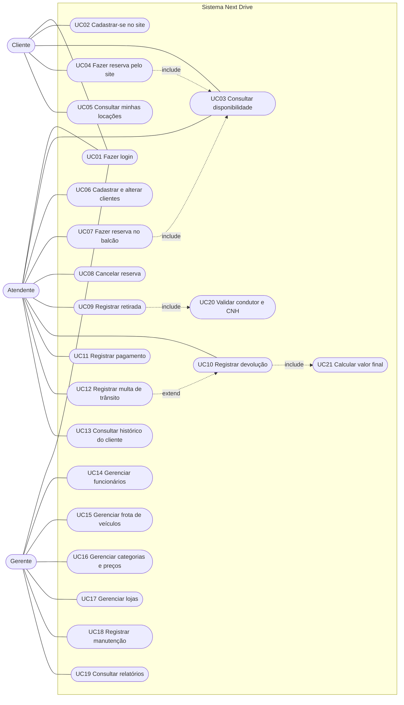
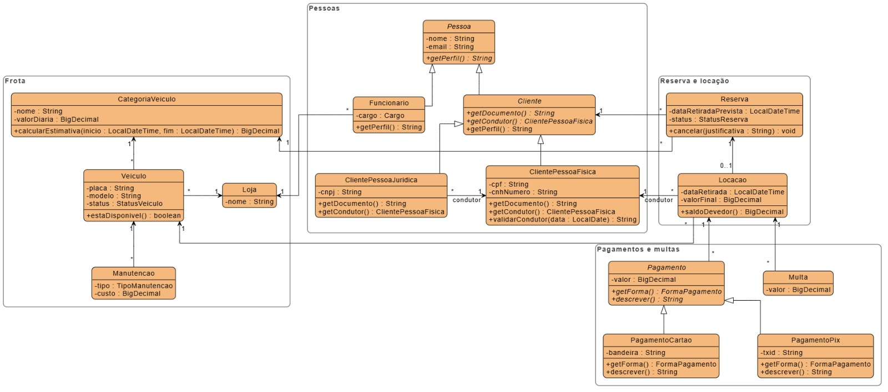
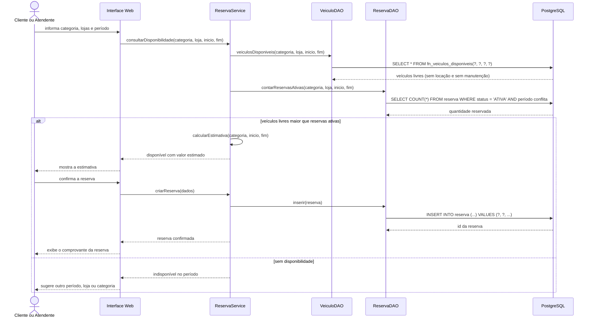
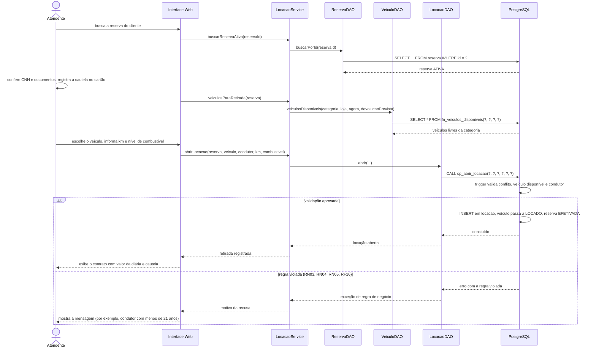
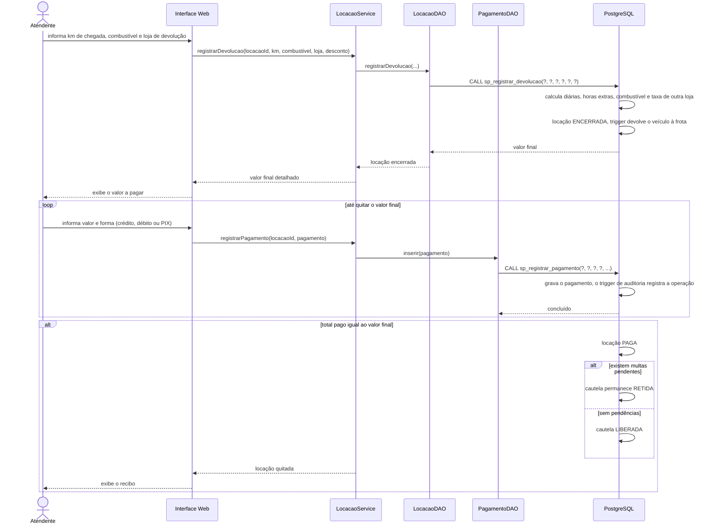
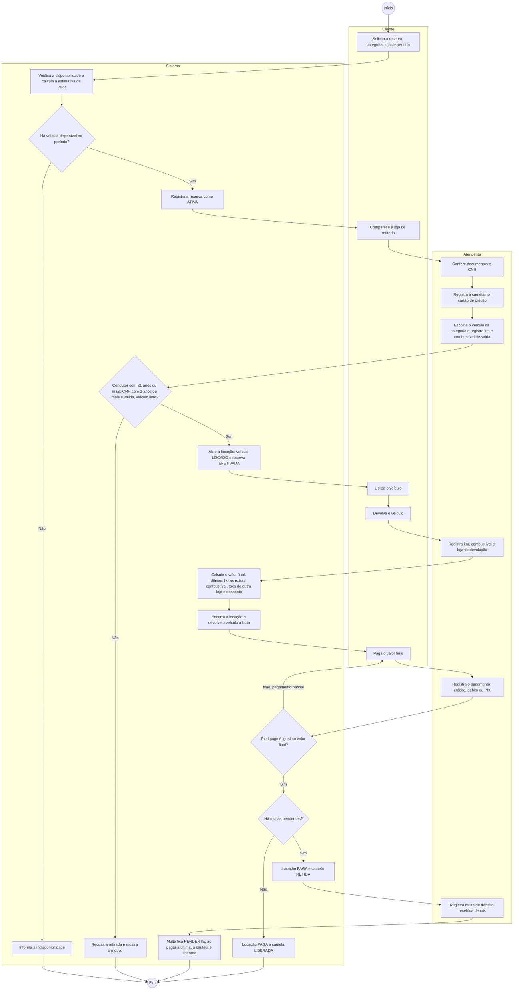
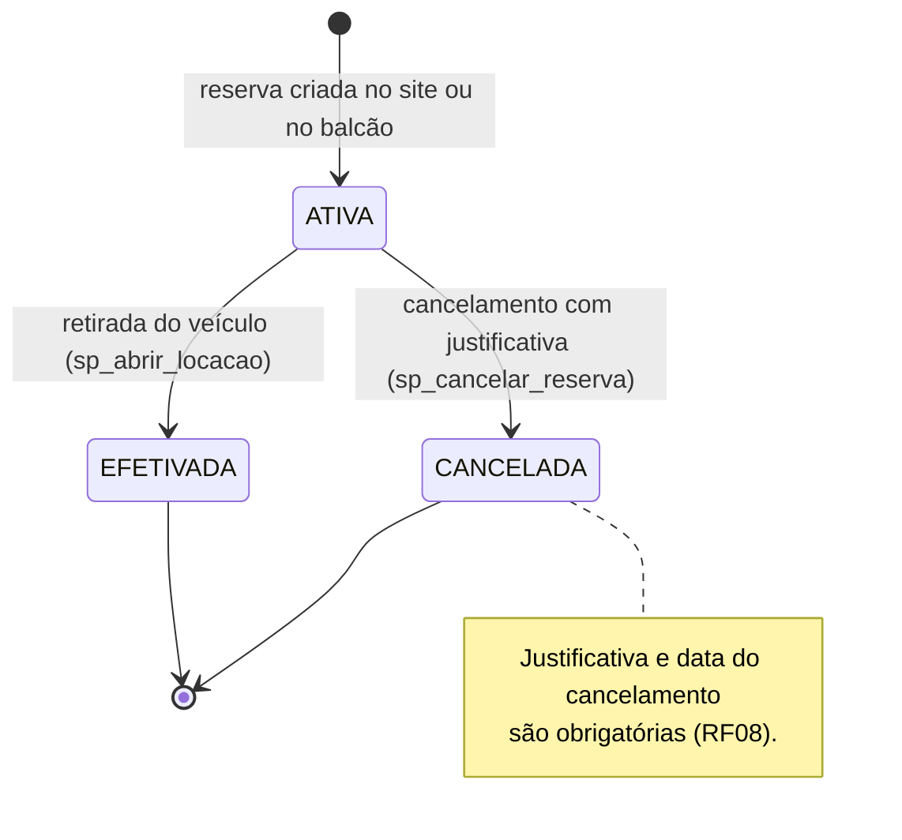
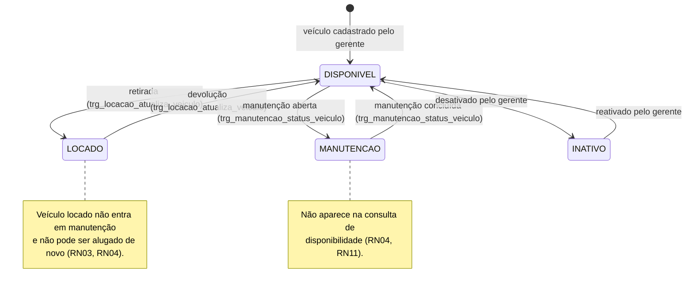
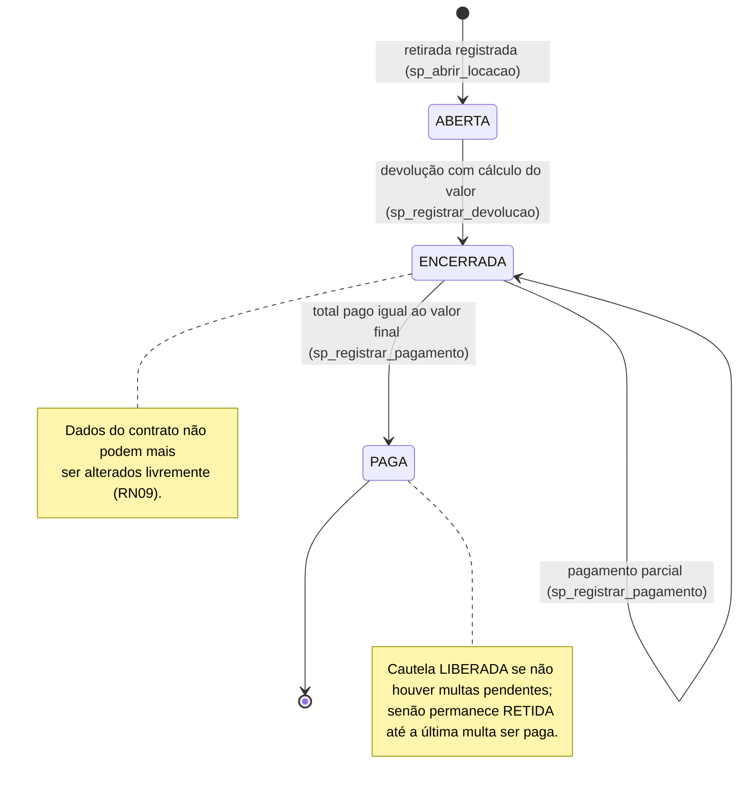
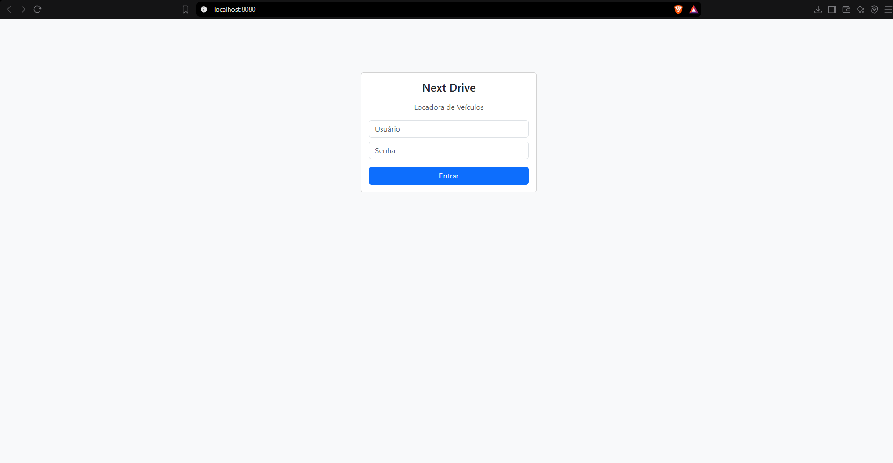

# Next Drive — Sistema de Locação de Veículos (artigo)

**Trabalho Final Integrado de Programação II, Engenharia de Software I e Banco de Dados II** — Ciência da Computação, Universidade do Oeste de Santa Catarina (Unoesc), 4º semestre, 2026/02.

**Autores:** Lucas Orlandi, Samuel Gralow, Diogo Rodrigo Nielsson, Felipe Kremer  
**Professores:** Otilia, Fran, Roberson  
**Repositório:** <https://github.com/lucasorlandi7/NextDrive>
---

## Resumo

Este trabalho apresenta o **Next Drive**, um sistema web para uma locadora de veículos com várias lojas, que cobre o processo completo de locação: reserva, retirada, devolução, pagamento e pós-locação (multas de trânsito e liberação da cautela). O sistema foi desenvolvido em Java, sem frameworks, sobre um banco de dados PostgreSQL. O banco concentra as regras de negócio críticas (conflito de locações, idade e habilitação do condutor, imutabilidade de locações finalizadas, auditoria) em *triggers* e *procedures*, e o acesso é separado por perfis de usuário (gerente, atendente, auditor e site). A modelagem seguiu UML (casos de uso, classes, sequência, atividades e estados) e o modelo relacional foi normalizado até a terceira forma normal. O planejamento foi feito em sprints, com versionamento no GitHub. O resultado é um sistema funcional, verificado por 34 testes de regras no banco e por testes de fluxo ponta a ponta na aplicação web.

**Palavras-chave:** locação de veículos; PostgreSQL; Java; UML; banco de dados.

---

## Sumário

1. [Introdução](#1-introdução)
2. [Modelo de negócio](#2-modelo-de-negócio)
3. [Metodologia e planejamento](#3-metodologia-e-planejamento)
4. [Modelagem do banco de dados](#4-modelagem-do-banco-de-dados)
5. [Scripts do banco de dados](#5-scripts-do-banco-de-dados)
6. [Modelagem UML](#6-modelagem-uml)
7. [Implementação em Java](#7-implementação-em-java)
8. [Telas do sistema](#8-telas-do-sistema)
9. [Testes e validação](#9-testes-e-validação)
10. [Como executar](#10-como-executar)
11. [Conclusões](#11-conclusões)
12. [Referências](#referências)

---

## 1 Introdução

Locadoras de veículos lidam com um processo em que erros custam caro: um carro entregue para dois clientes no mesmo período, um contrato alterado depois de fechado, um pagamento registrado sem rastro. Em sistemas pequenos, essas regras costumam ficar espalhadas pelas telas, e basta uma tela esquecer de validar para o dado errado entrar.

O objetivo deste trabalho é construir o **Next Drive**, sistema de gestão de uma locadora com várias lojas, em que cliente, atendente e gerente usam o mesmo sistema com permissões diferentes. O trabalho é integrado e atende três disciplinas ao mesmo tempo:

| Disciplina | O que o trabalho entrega |
|---|---|
| **Banco de Dados II** | Modelo relacional normalizado, scripts com índices e *constraints*, *views*, relatórios com junções, *triggers*, *procedures*, políticas de acesso, backup e restauração. |
| **Engenharia de Software I** | Levantamento de requisitos, diagramas UML (casos de uso, classes, sequência, atividades e estados), planejamento em sprints e uso de Git/GitHub. |
| **Programação II** | Aplicação web em Java com orientação a objetos (herança, polimorfismo, classes abstratas, enumerações), JDBC, JavaDoc e funcionalidade extra. |

A decisão de projeto que organiza todo o trabalho é **colocar as regras de negócio no banco**. A aplicação Java valida o que ajuda o usuário (mensagens claras, campos obrigatórios), mas a garantia final é do PostgreSQL. Assim, qualquer caminho de acesso (a aplicação, um script, outro sistema no futuro) respeita as mesmas regras.

---

## 2 Modelo de negócio

### 2.1 Processo de locação

O processo tem cinco etapas:

1. **Reserva.** O cliente escolhe categoria de veículo, lojas de retirada e devolução e o período. O sistema consulta a disponibilidade e informa uma estimativa de valor. A reserva pode ser feita pelo próprio cliente no site ou por um atendente no balcão, e pode ser cancelada com justificativa.
2. **Retirada.** O cliente comparece à loja. O atendente confere os documentos e a CNH, registra a **cautela** no cartão de crédito, escolhe um veículo da categoria reservada e anota quilometragem e nível de combustível de saída. A reserva passa a *efetivada* e o veículo a *locado*.
3. **Devolução.** O atendente registra quilometragem, combustível e loja de devolução. O sistema calcula o **valor final**: diárias, horas extras por atraso, combustível faltante, taxa por devolução em outra loja e desconto. O veículo volta à frota.
4. **Pagamento.** O pagamento é registrado em cartão de crédito, cartão de débito ou PIX, podendo ser parcial. Quando o total pago iguala o valor final, a locação fica *paga*.
5. **Pós-locação.** Multas de trânsito recebidas depois são vinculadas à locação. A cautela é liberada quando a locação está paga e não há multas pendentes; se houver, permanece retida até o pagamento da última.

### 2.2 Atores

| Ator | Responsabilidades |
|---|---|
| **Cliente** | Pessoa física (CPF e CNH) ou jurídica (CNPJ e condutor responsável). Cadastra-se no site, consulta disponibilidade, faz reservas e acompanha suas locações. |
| **Atendente** | Opera o balcão: cadastra clientes, faz e cancela reservas, registra retirada, devolução, pagamentos e multas. |
| **Gerente** | Tudo o que o atendente faz, mais: gerencia funcionários, frota, categorias, preços, lojas e manutenções; consulta relatórios e a auditoria. |

### 2.3 Requisitos

Os requisitos completos (RF01 a RF24, RNF01 a RNF09 e regras de negócio RN01 a RN12) estão na documentação da equipe. A tabela abaixo mostra **onde cada um foi atendido**.

**Requisitos funcionais**

| Requisito | Descrição resumida | Onde foi atendido |
|---|---|---|
| RF01 | Índices nas colunas mais consultadas | `sql/03_indices.sql` e índices únicos de `02_create_tables.sql` |
| RF02 | Login com e-mail e senha | `fn_autenticar`; `AutenticacaoService`; tela de login |
| RF03 | Gerente gerencia funcionários | `GerenteControlador` (/gerente/funcionarios); privilégios do grupo gerente |
| RF04 | Cadastro de clientes PF e PJ, inclusive pelo site | Cadastro no site (`/cadastro`) e no balcão (`/atendente/cliente/novo`) |
| RF05 | Veículos, categorias e lojas | Telas de frota e categorias do gerente |
| RF06 | Disponibilidade por categoria, loja e período | View `vw_disponibilidade_frota` e função `fn_veiculos_disponiveis` |
| RF07 | Reservas pelo site e pelo balcão | `ReservaService` com bloqueio por transação |
| RF08 | Cancelamento com justificativa | Procedure `sp_cancelar_reserva` |
| RF09 | Retirada com veículo, km, combustível e cautela | Procedure `sp_abrir_locacao` |
| RF10 | Devolução com cálculo do valor | Procedure `sp_registrar_devolucao` |
| RF11 | Pagamento por crédito, débito ou PIX | Procedure `sp_registrar_pagamento`; herança `Pagamento` |
| RF12 | Manutenção de veículos | Tabela `manutencao`; trigger `trg_manutencao_status_veiculo` |
| RF13 | Histórico de locações do cliente | View `vw_historico_cliente`; área do cliente |
| RF14 | Relatórios a partir de views | Relatórios R01 a R13; painel gerencial |
| RF15 | Impedir locações conflitantes | Trigger `trg_locacao_conflito` e `trg_locacao_atualiza_veiculo` |
| RF16 | Condutor com 21 anos ou mais e CNH com 2 anos ou mais | Trigger `trg_locacao_valida_condutor` |
| RF17 | Auditoria de pagamentos e preços | Triggers `trg_auditoria_pagamento` e `trg_auditoria_preco` |
| RF18 | Perfis de acesso, backup e restauração | `07_roles_privilegios.sql`; `10_backup_restauração.sh` |
| RF19 a RF23 | Diagramas UML | Seção 6 |
| RF24 | Multas de trânsito vinculadas à locação | Tabela `multa`; trigger `trg_multa_libera_cautela` |

**Requisitos não funcionais**

| Requisito | Como foi atendido |
|---|---|
| RNF01 / RNF02 | Java 17 com interface web acessada pelo navegador. |
| RNF03 | Todos os dados em PostgreSQL. |
| RNF04 | Todo acesso usa `PreparedStatement` e `CallableStatement`; nenhuma consulta concatena entrada do usuário. |
| RNF05 | Senhas guardadas com *bcrypt* (`pgcrypto`); nenhum perfil consegue ler a coluna `senha_hash`. |
| RNF06 / RNF07 | Pacotes e nomes padrão Java; JavaDoc gerado sem erros. |
| RNF08 | Plano de sprints em [`docs/plano-de-sprints.md`](plano-de-sprints.md). |
| RNF09 | Diagramas UML em `docs/uml/`, conferidos com o código e o banco (seção 6). |

**Regras de negócio**

| Regra | Onde é garantida |
|---|---|
| RN01 CPF/CNPJ único | Restrições `UNIQUE` em `cliente_pf` e `cliente_pj` |
| RN02 Placa única | `uq_veiculo_placa` e `ck_veiculo_placa` |
| RN03 Sem locações conflitantes | Trigger `trg_locacao_conflito` |
| RN04 / RN11 Veículo indisponível ou em manutenção não é oferecido | `fn_veiculos_disponiveis` e trigger de manutenção |
| RN05 CNH válida | Trigger `trg_locacao_valida_condutor` |
| RN06 Devolução posterior à retirada | `ck_reserva_periodo`, `ck_locacao_prevista`, `ck_locacao_real` |
| RN07 / RN08 Valor por diária e período; atraso cobrado | Procedure `sp_registrar_devolucao` |
| RN09 Locação finalizada não é alterada livremente | Trigger `trg_locacao_imutavel` |
| RN10 Só gerente gerencia funcionários | Privilégios do banco e controle de rotas na aplicação |
| RN12 Forma de pagamento informada | `ck_pagamento_forma`, tabelas `pagamento_cartao` e `pagamento_pix` |

---

## 3 Metodologia e planejamento

O desenvolvimento seguiu **Scrum simplificado** com quadro **Kanban no GitHub Projects**, em cinco sprints de uma semana:

| Sprint | Objetivo |
|---|---|
| 1 | Fundamentos e banco de dados: requisitos, modelo relacional, tabelas, índices, views e relatórios. |
| 2 | Regras no banco e segurança: *triggers*, *procedures*, perfis de acesso, backup e testes das regras. |
| 3 | Modelagem de software: casos de uso, classes, sequência, atividades e estados. |
| 4 | Sistema em Java: domínio, acesso a dados, login, telas, cadastros e relatórios. |
| 5 | Entrega: README/artigo, revisão cruzada, ensaio da apresentação e autoavaliação. |

As regras de trabalho: toda tarefa vira uma *issue* com responsável; ninguém altera a `main` diretamente (cada tarefa tem um *branch* e um *pull request* revisado por um colega); mensagens de commit descrevem a mudança; e uma tarefa só está pronta quando funciona, passou nos testes, está documentada e foi revisada. O plano completo, com as tarefas de cada sprint, está em [`docs/plano-de-sprints.md`](plano-de-sprints.md).


*Figura — Quadro do projeto no GitHub Projects.*

---

## 4 Modelagem do banco de dados

O modelo tem 7 tabelas, implementadas em PostgreSQL 16: seis criadas em `sql/02_create_tables.sql` e a tabela de auditoria criada em `sql/07_gatilhos.sql`, junto com o trigger que a preenche.

### 4.1 Diagrama entidade-relacionamento


*Figura — Diagrama relacional do Next Drive: as 7 tabelas com todas as colunas e tipos. «PK» é chave primária, «FK» chave estrangeira e «UK» valor único. Nas ligações, a barra dupla indica "um", o pé de galinha indica "muitos" e o círculo indica que pode ser zero.*

| Tabela pai | Tabela filha | Chave estrangeira | Cardinalidade |
|---|---|---|---|
| `categoria` | `veiculo` | `categoria_id` | 1 : N |
| `categoria` | `reserva` | `categoria_id` | 1 : N |
| `cliente` | `reserva` | `cliente_id` | 1 : N |
| `reserva` | `locacao` | `reserva_id` (única) | 1 : 0..1 |
| `veiculo` | `locacao` | `veiculo_id` | 1 : N |
| `locacao` | `pagamento` | `locacao_id` | 1 : N |

A tabela `auditoria_pagamento` não tem chave estrangeira de propósito: ela guarda o histórico de um pagamento mesmo depois que ele é excluído.

### 4.2 Decisões de modelagem

| Decisão | Motivo |
|---|---|
| **Pagamento em uma única tabela**, com a coluna `tipo` | No Java, `Pagamento` é abstrata, com as subclasses `PagamentoCartao` e `PagamentoPix`. No banco, as duas formas ficam na mesma tabela; a constraint `ck_pagamento_tipo` exige `bandeira` quando o tipo é `CARTAO` e `txid` quando é `PIX`. |
| `reserva` aponta para a **categoria**; `locacao` aponta para o **veículo** | O cliente reserva uma categoria; o carro específico só é definido na retirada. |
| `locacao.reserva_id` é **único** | Cada reserva gera no máximo uma locação. |
| `locacao` **não guarda o cliente** | O cliente vem da reserva (`locacao.reserva_id → reserva.cliente_id`). Guardar de novo criaria uma dependência transitiva. |
| `locacao.valor_final` **armazenado** | É o valor calculado na devolução. Se a diária da categoria mudar depois, as locações antigas não mudam. |
| `veiculo.status` | Situação atual do carro (`DISPONIVEL`, `LOCADO` ou `MANUTENCAO`). Muda para `LOCADO` no aluguel e volta para `DISPONIVEL` na devolução, pelo trigger `trg_liberar_veiculo`. |
| `auditoria_pagamento` **sem chave estrangeira** | O histórico continua existindo mesmo se o pagamento for excluído. |

### 4.3 Normalização

- **1FN:** cada coluna guarda um único valor, sem listas; cada pagamento é uma linha separada.
- **2FN:** todas as chaves primárias são simples (`id`), então não existe dependência parcial.
- **3FN:** não há dependências transitivas. O nome e a diária ficam só em `categoria`, os dados do cliente só em `cliente`, e o cliente da locação é obtido pela reserva. Os relatórios juntam as tabelas pelas views de `04_views.sql`.

Redundância intencional: `locacao.valor_final`, explicada acima. Ponto de atenção: em `pagamento`, as colunas `bandeira` e `txid` ficam vazias conforme o tipo; a constraint `ck_pagamento_tipo` garante que a coluna certa esteja preenchida.

### 4.4 Restrições principais

| Regra | Onde é garantida |
|---|---|
| CPF e e-mail do cliente únicos | `UNIQUE` em `cliente.cpf` e `cliente.email` |
| Placa do veículo única | `UNIQUE` em `veiculo.placa` |
| Categoria com nome único e diária positiva | `UNIQUE` em `categoria.nome`; `CHECK (valor_diaria > 0)` |
| Ano e quilometragem válidos | `CHECK (ano BETWEEN 1990 AND 2100)` e `CHECK (quilometragem >= 0)` |
| Só as situações previstas | `CHECK` nas colunas `status` de `veiculo`, `reserva` e `locacao` |
| Devolução prevista depois da retirada | `ck_reserva_datas` |
| Uma locação por reserva | `UNIQUE` em `locacao.reserva_id` |
| Cartão com bandeira, Pix com txid e valor positivo | `ck_pagamento_tipo` e `CHECK (valor > 0)` |
| Não alugar carro indisponível ou já alugado | trigger `trg_validar_locacao` (`07_gatilhos.sql`) |
| CNH válida até a devolução prevista | trigger `trg_validar_cnh` (`07_gatilhos.sql`) |
| Carro volta a ficar disponível ao encerrar a locação | trigger `trg_liberar_veiculo` (`07_gatilhos.sql`) |
| Histórico de inclusões, alterações e exclusões de pagamentos | trigger `trg_auditar_pagamento` (`07_gatilhos.sql`) |

### 4.5 Dicionário de dados

O dicionário completo, tabela por tabela, com cada campo, tipo e regra, está em [`docs/dicionario-de-dados.md`](dicionario-de-dados.md). Resumo das 7 tabelas:

| Tabela | Campos | O que guarda |
|---|---|---|
| `categoria` | `id`, `nome`, `valor_diaria` | Categorias de carro e o preço da diária |
| `cliente` | `id`, `nome`, `cpf`, `email`, `telefone`, `cnh_numero`, `cnh_validade` | Pessoas que alugam os carros |
| `veiculo` | `id`, `placa`, `modelo`, `ano`, `quilometragem`, `status`, `categoria_id` | Carros da frota e a situação atual de cada um |
| `reserva` | `id`, `cliente_id`, `categoria_id`, `data_retirada_prevista`, `data_devolucao_prevista`, `status`, `justificativa_cancelamento` | Pedido do cliente para uma categoria em um período |
| `locacao` | `id`, `reserva_id`, `veiculo_id`, `data_retirada`, `data_devolucao_real`, `km_saida`, `km_chegada`, `valor_final`, `status` | O aluguel, da retirada até a devolução |
| `pagamento` | `id`, `locacao_id`, `tipo`, `valor`, `data_pagamento`, `bandeira`, `txid` | Pagamentos por cartão ou Pix, podendo ser em partes |
| `auditoria_pagamento` | `id`, `pagamento_id`, `operacao`, `valor_antigo`, `valor_novo`, `usuario`, `data_hora` | Histórico de inclusões, alterações e exclusões de pagamentos |

## 5 Scripts do banco de dados

Os scripts ficam em [`sql/`](../sql/) e devem ser executados na ordem abaixo, conectado ao banco `nextdrive`. Para ver o código de cada um, clique no nome do script.

| Ordem | Script | O que faz |
|---|---|---|
| 1 | [`01_create_database.sql`](../sql/01_create_database.sql) | Cria o banco `nextdrive` (opcional; pode ser criado pelo DBeaver) |
| 2 | [`02_create_tables.sql`](../sql/02_create_tables.sql) | 6 tabelas, chaves e restrições |
| 3 | [`03_indices.sql`](../sql/03_indices.sql) | 5 índices |
| 4 | [`04_views.sql`](../sql/04_views.sql) | 3 views |
| 5 | [`05_dados_exemplo.sql`](../sql/05_dados_exemplo.sql) | Dados de exemplo |
| 6 | [`06_consultas_relatorios.sql`](../sql/06_consultas_relatorios.sql) | 7 relatórios (somente consulta) |
| 7 | [`07_gatilhos.sql`](../sql/07_gatilhos.sql) | Tabela de auditoria e 4 triggers |
| 8 | [`08_procedimentos.sql`](../sql/08_procedimentos.sql) | 1 função e 2 procedures |
| 9 | [`09_roles_privilegios.sql`](../sql/09_roles_privilegios.sql) | Grupos, usuários e privilégios |
| 10 | [`10_backup_restore.sh`](../sql/10_backup_restore.sh) | Backup e restauração (script de terminal) |
| 11 | [`11_testes_regras.sql`](../sql/11_testes_regras.sql) | 13 testes das regras; desfaz tudo no final |

### 5.1 Criação da base

O `01` só cria o banco. O `02` apaga as tabelas, se já existirem, e cria as seis tabelas do modelo com chaves primárias, chaves estrangeiras, `UNIQUE` e `CHECK` (detalhes na seção 4).

<details>
<summary>01_create_database.sql</summary>

```sql
-- Next Drive - criação do banco (opcional).
-- Rode este script conectado ao banco "postgres". Se você já criou o banco "nextdrive" pelo DBeaver, pule este passo.

CREATE DATABASE nextdrive;
```

</details>

<details>
<summary>02_create_tables.sql — tabelas e constraints</summary>

```sql
DROP TABLE IF EXISTS auditoria_pagamento, pagamento, locacao, reserva, veiculo, cliente, categoria CASCADE;

CREATE TABLE categoria (
    id            SERIAL PRIMARY KEY,
    nome          VARCHAR(60)   NOT NULL UNIQUE,
    valor_diaria  NUMERIC(10,2) NOT NULL CHECK (valor_diaria > 0)
);

CREATE TABLE cliente (
    id            SERIAL PRIMARY KEY,
    nome          VARCHAR(120) NOT NULL,
    cpf           VARCHAR(11)  NOT NULL UNIQUE,
    email         VARCHAR(120) NOT NULL UNIQUE,
    telefone      VARCHAR(20),
    cnh_numero    VARCHAR(11)  NOT NULL,
    cnh_validade  DATE         NOT NULL
);

CREATE TABLE veiculo (
    id             SERIAL PRIMARY KEY,
    placa          VARCHAR(8)  NOT NULL UNIQUE,
    modelo         VARCHAR(60) NOT NULL,
    ano            INTEGER     NOT NULL CHECK (ano BETWEEN 1990 AND 2100),
    quilometragem  INTEGER     NOT NULL DEFAULT 0 CHECK (quilometragem >= 0),
    status         VARCHAR(12) NOT NULL DEFAULT 'DISPONIVEL'
                   CHECK (status IN ('DISPONIVEL', 'LOCADO', 'MANUTENCAO')),
    categoria_id   INTEGER     NOT NULL REFERENCES categoria (id)
);

CREATE TABLE reserva (
    id                       SERIAL PRIMARY KEY,
    cliente_id               INTEGER     NOT NULL REFERENCES cliente (id),
    categoria_id             INTEGER     NOT NULL REFERENCES categoria (id),
    data_retirada_prevista   DATE        NOT NULL,
    data_devolucao_prevista  DATE        NOT NULL,
    status                   VARCHAR(10) NOT NULL DEFAULT 'ATIVA'
                             CHECK (status IN ('ATIVA', 'CANCELADA', 'EFETIVADA')),
    justificativa_cancelamento  VARCHAR(200),
    CONSTRAINT ck_reserva_datas CHECK (data_devolucao_prevista > data_retirada_prevista)
);

CREATE TABLE locacao (
    id                   SERIAL PRIMARY KEY,
    reserva_id           INTEGER     NOT NULL UNIQUE REFERENCES reserva (id),
    veiculo_id           INTEGER     NOT NULL REFERENCES veiculo (id),
    data_retirada        DATE        NOT NULL,
    data_devolucao_real  DATE,
    km_saida             INTEGER     NOT NULL,
    km_chegada           INTEGER,
    valor_final          NUMERIC(10,2),
    status               VARCHAR(10) NOT NULL DEFAULT 'ABERTA'
                         CHECK (status IN ('ABERTA', 'ENCERRADA', 'PAGA'))
);

CREATE TABLE pagamento (
    id              SERIAL PRIMARY KEY,
    locacao_id      INTEGER       NOT NULL REFERENCES locacao (id),
    tipo            VARCHAR(6)    NOT NULL CHECK (tipo IN ('CARTAO', 'PIX')),
    valor           NUMERIC(10,2) NOT NULL CHECK (valor > 0),
    data_pagamento  TIMESTAMP     NOT NULL DEFAULT now(),
    bandeira        VARCHAR(20),   -- só para cartão
    txid            VARCHAR(35),   -- só para Pix
    CONSTRAINT ck_pagamento_tipo CHECK (
        (tipo = 'CARTAO' AND bandeira IS NOT NULL) OR (tipo = 'PIX' AND txid IS NOT NULL))
);
```

</details>

### 5.2 Índices

A placa, o CPF, o e-mail, o nome da categoria e a reserva da locação já ganham índice automaticamente por serem `UNIQUE`. O script cria mais cinco índices para as buscas mais comuns do sistema: cliente por nome, carros por situação, reservas por período, locação aberta de um carro e pagamentos de uma locação.

<details>
<summary>03_indices.sql</summary>

```sql
-- Next Drive - índices.
-- A placa do veículo e o CPF do cliente já têm índice criado automaticamente pela restrição UNIQUE.
-- Aqui ficam os índices extras, para as buscas mais comuns do sistema.

CREATE INDEX IF NOT EXISTS idx_cliente_nome         ON cliente (nome);
CREATE INDEX IF NOT EXISTS idx_veiculo_status       ON veiculo (status);
CREATE INDEX IF NOT EXISTS idx_reserva_datas        ON reserva (data_retirada_prevista, data_devolucao_prevista);
CREATE INDEX IF NOT EXISTS idx_locacao_veiculo      ON locacao (veiculo_id, status);
CREATE INDEX IF NOT EXISTS idx_pagamento_locacao    ON pagamento (locacao_id);
```

</details>

### 5.3 Views

| View | O que mostra | Usada em |
|---|---|---|
| `vw_veiculos_disponiveis` | Carros com status `DISPONIVEL`, com categoria e diária | R02 |
| `vw_locacoes_abertas` | Locações em andamento, com cliente, carro e devolução prevista | R03 |
| `vw_faturamento_categoria` | Quantidade e total de pagamentos por categoria | R04 |

<details>
<summary>04_views.sql</summary>

```sql
-- Next Drive - views (consultas salvas).

CREATE OR REPLACE VIEW vw_veiculos_disponiveis AS
SELECT v.id, v.placa, v.modelo, v.ano, c.nome AS categoria, c.valor_diaria
FROM veiculo v
JOIN categoria c ON c.id = v.categoria_id
WHERE v.status = 'DISPONIVEL';

CREATE OR REPLACE VIEW vw_locacoes_abertas AS
SELECT l.id AS locacao_id, cl.nome AS cliente, v.placa, v.modelo,
       l.data_retirada, r.data_devolucao_prevista
FROM locacao l
JOIN reserva r  ON r.id = l.reserva_id
JOIN cliente cl ON cl.id = r.cliente_id
JOIN veiculo v  ON v.id = l.veiculo_id
WHERE l.status = 'ABERTA';

CREATE OR REPLACE VIEW vw_faturamento_categoria AS
SELECT c.nome AS categoria, COUNT(p.id) AS pagamentos, COALESCE(SUM(p.valor), 0) AS total
FROM categoria c
LEFT JOIN veiculo v   ON v.categoria_id = c.id
LEFT JOIN locacao l   ON l.veiculo_id = v.id
LEFT JOIN pagamento p ON p.locacao_id = l.id
GROUP BY c.nome;
```

</details>

### 5.4 Dados de exemplo

O script carrega 3 categorias, 5 carros, 3 clientes, 5 reservas (efetivadas, uma ativa e uma cancelada), 3 locações (uma paga, uma devolvida com atraso e pagamento parcial e uma ainda aberta) e 2 pagamentos (cartão e Pix). Assim todos os relatórios mostram resultado.

<details>
<summary>05_dados_exemplo.sql</summary>

```sql
-- Next Drive (versão simples) - dados de exemplo

INSERT INTO categoria (nome, valor_diaria) VALUES
    ('Econômico', 120.00),
    ('SUV',       220.00),
    ('Luxo',      380.00);

INSERT INTO veiculo (placa, modelo, ano, quilometragem, categoria_id) VALUES
    ('ABC1D23', 'Fiat Mobi',        2023, 15200, 1),
    ('DEF4G56', 'Chevrolet Onix',   2024,  8300, 1),
    ('GHI7J89', 'Jeep Compass',     2023, 22100, 2),
    ('JKL0M12', 'Toyota Corolla X', 2024,  5400, 3),
    ('NOP3Q45', 'Renault Kwid',     2022, 41000, 1);

INSERT INTO cliente (nome, cpf, email, telefone, cnh_numero, cnh_validade) VALUES
    ('Ana Lima',        '11122233344', 'ana.lima@example.com',       '49999990001', '12345678901', '2030-05-20'),
    ('Carlos Pereira',  '55566677788', 'carlos.pereira@example.com', '49999990002', '10987654321', '2029-11-10'),
    ('Marcos Almeida',  '99988877766', 'marcos.almeida@example.com', '49999990003', '11223344556', '2031-02-15');

-- Reservas: duas viraram locação já devolvida, uma está com o carro na rua,
-- uma ainda vai acontecer e uma foi cancelada.
INSERT INTO reserva (cliente_id, categoria_id, data_retirada_prevista, data_devolucao_prevista, status, justificativa_cancelamento) VALUES
    (1, 1, '2026-11-02', '2026-11-05', 'EFETIVADA', NULL),
    (2, 2, '2026-11-10', '2026-11-14', 'EFETIVADA', NULL),
    (3, 3, '2026-11-20', '2026-11-25', 'EFETIVADA', NULL),
    (1, 2, '2026-12-01', '2026-12-03', 'ATIVA',     NULL),
    (2, 1, '2026-11-18', '2026-11-20', 'CANCELADA', 'Cliente desistiu da viagem');

-- Locações:
--   1) Ana, Fiat Mobi: 3 diárias de R$ 120,00 = R$ 360,00, já paga.
--   2) Carlos, Jeep Compass: devolveu 2 dias depois do previsto.
--      6 diárias de R$ 220,00 + 2 x 30% da diária = R$ 1.452,00; pagou só uma parte.
--   3) Marcos, Toyota Corolla: ainda está com o carro.
INSERT INTO locacao (reserva_id, veiculo_id, data_retirada, data_devolucao_real, km_saida, km_chegada, valor_final, status) VALUES
    (1, 1, '2026-11-02', '2026-11-05', 15200, 15650,  360.00, 'PAGA'),
    (2, 3, '2026-11-10', '2026-11-16', 22100, 23050, 1452.00, 'ENCERRADA'),
    (3, 4, '2026-11-20', NULL,          5400,  NULL,    NULL, 'ABERTA');

-- Situação atual dos carros depois dessas locações.
UPDATE veiculo SET quilometragem = 15650 WHERE id = 1;
UPDATE veiculo SET quilometragem = 23050 WHERE id = 3;
UPDATE veiculo SET status = 'LOCADO'     WHERE id = 4;
UPDATE veiculo SET status = 'MANUTENCAO' WHERE id = 5;

-- Pagamentos: um com cartão (quita a locação 1) e um Pix parcial da locação 2.
INSERT INTO pagamento (locacao_id, tipo, valor, data_pagamento, bandeira, txid) VALUES
    (1, 'CARTAO', 360.00, '2026-11-05 17:40', 'Visa', NULL),
    (2, 'PIX',    700.00, '2026-11-16 10:15', NULL,   'E1234567820261116101500001');
```

</details>

### 5.5 Relatórios (SELECTs)

As consultas estão em [`sql/06_consultas_relatorios.sql`](../sql/06_consultas_relatorios.sql). Todas usam junções (`JOIN`) ou views. Os resultados abaixo são os obtidos com os dados de exemplo (`sql/05_dados_exemplo.sql`). Para conferir, basta executar cada consulta no banco depois de rodar os scripts.

#### R01 — Situação da frota por categoria

Mostra quantos carros de cada categoria estão disponíveis, alugados ou em manutenção.

```sql
SELECT c.nome AS categoria, v.status, COUNT(*) AS quantidade
FROM veiculo v
JOIN categoria c ON c.id = v.categoria_id
GROUP BY c.nome, v.status
ORDER BY c.nome, v.status;
```

| categoria | status | quantidade |
|---|---|---:|
| Econômico | DISPONIVEL | 2 |
| Econômico | MANUTENCAO | 1 |
| Luxo | LOCADO | 1 |
| SUV | DISPONIVEL | 1 |

#### R02 — Carros disponíveis para alugar (view vw_veiculos_disponiveis)

Lista os carros que podem ser alugados agora, com a diária da categoria. Usa a view `vw_veiculos_disponiveis`.

```sql
SELECT placa, modelo, ano, categoria, valor_diaria
FROM vw_veiculos_disponiveis
ORDER BY categoria, modelo;
```

| placa | modelo | ano | categoria | valor_diaria |
|---|---|---:|---|---:|
| DEF4G56 | Chevrolet Onix | 2024 | Econômico | 120.00 |
| ABC1D23 | Fiat Mobi | 2023 | Econômico | 120.00 |
| GHI7J89 | Jeep Compass | 2023 | SUV | 220.00 |

#### R03 — Carros na rua: locações abertas (view vw_locacoes_abertas)

Mostra os carros que estão com clientes e quando devem voltar. Usa a view `vw_locacoes_abertas`.

```sql
SELECT locacao_id, cliente, placa, modelo, data_retirada, data_devolucao_prevista
FROM vw_locacoes_abertas
ORDER BY data_retirada;
```

| locacao_id | cliente | placa | modelo | data_retirada | data_devolucao_prevista |
|---:|---|---|---|---|---|
| 3 | Marcos Almeida | JKL0M12 | Toyota Corolla X | 2026-11-20 | 2026-11-25 |

#### R04 — Faturamento por categoria (view vw_faturamento_categoria)

Soma o que foi recebido em cada categoria. Usa a view `vw_faturamento_categoria`.

```sql
SELECT categoria, pagamentos, total
FROM vw_faturamento_categoria
ORDER BY total DESC;
```

| categoria | pagamentos | total |
|---|---:|---:|
| SUV | 1 | 700.00 |
| Econômico | 1 | 360.00 |
| Luxo | 0 | 0 |

#### R05 — Locações e total gasto por cliente

Mostra quantas locações cada cliente fez e quanto gastou.

```sql
SELECT cl.nome AS cliente, COUNT(l.id) AS locacoes, COALESCE(SUM(l.valor_final), 0) AS total_gasto
FROM cliente cl
LEFT JOIN reserva r ON r.cliente_id = cl.id
LEFT JOIN locacao l ON l.reserva_id = r.id
GROUP BY cl.nome
ORDER BY total_gasto DESC;
```

| cliente | locacoes | total_gasto |
|---|---:|---:|
| Carlos Pereira | 1 | 1452.00 |
| Ana Lima | 1 | 360.00 |
| Marcos Almeida | 1 | 0 |

#### R06 — Recebimentos por forma de pagamento e categoria

Separa os valores recebidos por forma de pagamento (cartão ou Pix) e por categoria.

```sql
SELECT p.tipo AS forma, c.nome AS categoria, COUNT(*) AS pagamentos, SUM(p.valor) AS total
FROM pagamento p
JOIN locacao l   ON l.id = p.locacao_id
JOIN veiculo v   ON v.id = l.veiculo_id
JOIN categoria c ON c.id = v.categoria_id
GROUP BY p.tipo, c.nome
ORDER BY p.tipo, c.nome;
```

| forma | categoria | pagamentos | total |
|---|---|---:|---:|
| CARTAO | Econômico | 1 | 360.00 |
| PIX | SUV | 1 | 700.00 |

#### R07 — Saldo devedor das locações já devolvidas

Mostra, para cada locação devolvida, quanto foi cobrado, quanto já foi pago e quanto falta pagar.

```sql
SELECT l.id AS locacao, cl.nome AS cliente, l.valor_final,
       COALESCE(SUM(p.valor), 0) AS pago,
       l.valor_final - COALESCE(SUM(p.valor), 0) AS saldo
FROM locacao l
JOIN reserva r      ON r.id = l.reserva_id
JOIN cliente cl     ON cl.id = r.cliente_id
LEFT JOIN pagamento p ON p.locacao_id = l.id
WHERE l.status IN ('ENCERRADA', 'PAGA')
GROUP BY l.id, cl.nome, l.valor_final
ORDER BY saldo DESC;
```

| locacao | cliente | valor_final | pago | saldo |
|---:|---|---:|---:|---:|
| 2 | Carlos Pereira | 1452.00 | 700.00 | 752.00 |
| 1 | Ana Lima | 360.00 | 360.00 | 0.00 |

### 5.6 Triggers

| Trigger | Tabela e momento | O que faz |
|---|---|---|
| `trg_validar_locacao` | `locacao`, antes de incluir | Impede alugar um carro que não está `DISPONIVEL` ou que já tem locação aberta |
| `trg_liberar_veiculo` | `locacao`, depois de mudar o status | Quando a locação é encerrada, o carro volta a ficar `DISPONIVEL` e recebe a quilometragem de chegada |
| `trg_validar_cnh` | `reserva`, antes de incluir | Impede reserva se a CNH do cliente vencer antes da devolução prevista |
| `trg_auditar_pagamento` | `pagamento`, depois de incluir, alterar ou excluir | Grava cada operação em `auditoria_pagamento`, com valor antigo, valor novo, usuário e data |

A função do trigger de auditoria é `SECURITY DEFINER`: roda com as permissões do dono do banco, por isso os pagamentos feitos pelo atendente também são auditados, mesmo ele não tendo acesso à tabela de auditoria.

<details>
<summary>07_gatilhos.sql</summary>

```sql
-- Next Drive - gatilhos (triggers).

DROP TABLE IF EXISTS auditoria_pagamento;

CREATE TABLE auditoria_pagamento (
    id            SERIAL PRIMARY KEY,
    pagamento_id  INTEGER       NOT NULL,
    operacao      VARCHAR(6)    NOT NULL,
    valor_antigo  NUMERIC(10,2),
    valor_novo    NUMERIC(10,2),
    usuario       VARCHAR(60)   NOT NULL DEFAULT current_user,
    data_hora     TIMESTAMP     NOT NULL DEFAULT now()
);

-- 1. Não deixa alugar um carro que não está disponível ou que já tem locação aberta.
CREATE OR REPLACE FUNCTION fn_validar_locacao() RETURNS TRIGGER AS $$
DECLARE
    v_status VARCHAR(12);
BEGIN
    SELECT status INTO v_status FROM veiculo WHERE id = NEW.veiculo_id;
    IF v_status IS DISTINCT FROM 'DISPONIVEL' THEN
        RAISE EXCEPTION 'O veículo % não está disponível (situação: %).', NEW.veiculo_id, v_status;
    END IF;
    IF EXISTS (SELECT 1 FROM locacao WHERE veiculo_id = NEW.veiculo_id AND status = 'ABERTA') THEN
        RAISE EXCEPTION 'O veículo % já tem uma locação aberta.', NEW.veiculo_id;
    END IF;
    RETURN NEW;
END;
$$ LANGUAGE plpgsql;

DROP TRIGGER IF EXISTS trg_validar_locacao ON locacao;
CREATE TRIGGER trg_validar_locacao
    BEFORE INSERT ON locacao
    FOR EACH ROW EXECUTE FUNCTION fn_validar_locacao();

-- 2. Quando a locação é encerrada, o carro volta a ficar disponível e recebe a quilometragem nova.
CREATE OR REPLACE FUNCTION fn_liberar_veiculo() RETURNS TRIGGER AS $$
BEGIN
    UPDATE veiculo
       SET status = 'DISPONIVEL',
           quilometragem = COALESCE(NEW.km_chegada, quilometragem)
     WHERE id = NEW.veiculo_id AND status = 'LOCADO';
    RETURN NEW;
END;
$$ LANGUAGE plpgsql;

DROP TRIGGER IF EXISTS trg_liberar_veiculo ON locacao;
CREATE TRIGGER trg_liberar_veiculo
    AFTER UPDATE OF status ON locacao
    FOR EACH ROW
    WHEN (OLD.status = 'ABERTA' AND NEW.status IN ('ENCERRADA', 'PAGA'))
    EXECUTE FUNCTION fn_liberar_veiculo();

-- 3. Não deixa fazer reserva para cliente com CNH que vence antes da devolução.
CREATE OR REPLACE FUNCTION fn_validar_cnh() RETURNS TRIGGER AS $$
DECLARE
    v_validade DATE;
BEGIN
    SELECT cnh_validade INTO v_validade FROM cliente WHERE id = NEW.cliente_id;
    IF v_validade < NEW.data_devolucao_prevista THEN
        RAISE EXCEPTION 'A CNH do cliente vence em %, antes da devolução.', v_validade;
    END IF;
    RETURN NEW;
END;
$$ LANGUAGE plpgsql;

DROP TRIGGER IF EXISTS trg_validar_cnh ON reserva;
CREATE TRIGGER trg_validar_cnh
    BEFORE INSERT ON reserva
    FOR EACH ROW EXECUTE FUNCTION fn_validar_cnh();

-- 4. Auditoria: guarda toda inclusão, alteração e exclusão de pagamentos.
CREATE OR REPLACE FUNCTION fn_auditar_pagamento() RETURNS TRIGGER AS $$
BEGIN
    IF TG_OP = 'INSERT' THEN
        INSERT INTO auditoria_pagamento (pagamento_id, operacao, valor_novo)
        VALUES (NEW.id, TG_OP, NEW.valor);
        RETURN NEW;
    ELSIF TG_OP = 'UPDATE' THEN
        INSERT INTO auditoria_pagamento (pagamento_id, operacao, valor_antigo, valor_novo)
        VALUES (NEW.id, TG_OP, OLD.valor, NEW.valor);
        RETURN NEW;
    END IF;
    INSERT INTO auditoria_pagamento (pagamento_id, operacao, valor_antigo)
    VALUES (OLD.id, TG_OP, OLD.valor);
    RETURN OLD;
END;
$$ LANGUAGE plpgsql SECURITY DEFINER SET search_path = public;

DROP TRIGGER IF EXISTS trg_auditar_pagamento ON pagamento;
CREATE TRIGGER trg_auditar_pagamento
    AFTER INSERT OR UPDATE OR DELETE ON pagamento
    FOR EACH ROW EXECUTE FUNCTION fn_auditar_pagamento();
```

</details>

### 5.7 Procedures

| Rotina | Tipo | O que faz |
|---|---|---|
| `fn_valor_final(locacao, data)` | Função | Calcula o valor da locação: diárias (mínimo 1) mais 30% da diária por dia de atraso |
| `sp_devolver_veiculo(locacao, km, data)` | Procedure | Registra a devolução: confere se a locação está aberta, se a quilometragem e a data são válidas, calcula o valor e encerra a locação |
| `sp_cancelar_reserva(reserva, justificativa)` | Procedure | Cancela uma reserva ativa, exigindo a justificativa |

Exemplo de uso: `CALL sp_devolver_veiculo(3, 5900, '2026-11-26');` encerra a locação 3 com 5.900 km.

<details>
<summary>08_procedimentos.sql</summary>

```sql
-- Next Drive - função e procedures.

-- Calcula o valor final: diárias (mínimo 1) mais 30% da diária por dia de atraso.
CREATE OR REPLACE FUNCTION fn_valor_final(p_locacao_id INTEGER, p_devolucao DATE) RETURNS NUMERIC AS $$
DECLARE
    v_diaria    NUMERIC;
    v_retirada  DATE;
    v_prevista  DATE;
    v_dias      INTEGER;
    v_atraso    INTEGER;
BEGIN
    SELECT c.valor_diaria, l.data_retirada, r.data_devolucao_prevista
      INTO v_diaria, v_retirada, v_prevista
      FROM locacao l
      JOIN reserva r   ON r.id = l.reserva_id
      JOIN veiculo v   ON v.id = l.veiculo_id
      JOIN categoria c ON c.id = v.categoria_id
     WHERE l.id = p_locacao_id;
    IF NOT FOUND THEN
        RAISE EXCEPTION 'Locação % não encontrada.', p_locacao_id;
    END IF;
    v_dias   := GREATEST(1, p_devolucao - v_retirada);
    v_atraso := GREATEST(0, p_devolucao - v_prevista);
    RETURN ROUND(v_diaria * v_dias + v_diaria * 0.30 * v_atraso, 2);
END;
$$ LANGUAGE plpgsql;

-- Registra a devolução: guarda quilometragem e data, calcula o valor e encerra a locação.
CREATE OR REPLACE PROCEDURE sp_devolver_veiculo(p_locacao_id INTEGER, p_km INTEGER, p_devolucao DATE)
AS $$
DECLARE
    v_loc locacao%ROWTYPE;
BEGIN
    SELECT * INTO v_loc FROM locacao WHERE id = p_locacao_id;
    IF NOT FOUND THEN
        RAISE EXCEPTION 'Locação % não encontrada.', p_locacao_id;
    END IF;
    IF v_loc.status <> 'ABERTA' THEN
        RAISE EXCEPTION 'A locação % já foi encerrada.', p_locacao_id;
    END IF;
    IF p_km < v_loc.km_saida THEN
        RAISE EXCEPTION 'A quilometragem não pode ser menor que a da saída (%).', v_loc.km_saida;
    END IF;
    IF p_devolucao < v_loc.data_retirada THEN
        RAISE EXCEPTION 'A devolução não pode ser antes da retirada.';
    END IF;
    UPDATE locacao
       SET data_devolucao_real = p_devolucao,
           km_chegada = p_km,
           valor_final = fn_valor_final(p_locacao_id, p_devolucao),
           status = 'ENCERRADA'
     WHERE id = p_locacao_id;
END;
$$ LANGUAGE plpgsql;

-- Cancela uma reserva ativa, guardando a justificativa.
CREATE OR REPLACE PROCEDURE sp_cancelar_reserva(p_reserva_id INTEGER, p_justificativa VARCHAR)
AS $$
DECLARE
    v_status VARCHAR(10);
BEGIN
    SELECT status INTO v_status FROM reserva WHERE id = p_reserva_id;
    IF NOT FOUND THEN
        RAISE EXCEPTION 'Reserva % não encontrada.', p_reserva_id;
    END IF;
    IF v_status <> 'ATIVA' THEN
        RAISE EXCEPTION 'Só é possível cancelar reservas ativas (situação atual: %).', v_status;
    END IF;
    IF p_justificativa IS NULL OR length(trim(p_justificativa)) = 0 THEN
        RAISE EXCEPTION 'Informe a justificativa do cancelamento.';
    END IF;
    UPDATE reserva SET status = 'CANCELADA', justificativa_cancelamento = p_justificativa WHERE id = p_reserva_id;
END;
$$ LANGUAGE plpgsql;
```

</details>

### 5.8 Perfis e políticas de acesso

As permissões são dadas a dois grupos, e cada usuário herda as do seu grupo:

| Grupo | Usuário de exemplo | Pode fazer |
|---|---|---|
| `grupo_atendente` | `atendente_nextdrive` | Consultar tudo (menos auditoria e faturamento), cadastrar e alterar clientes, reservas, locações e pagamentos, e alterar a situação dos carros. **Não exclui nada.** |
| `grupo_gerente` | `gerente_nextdrive` | Tudo do atendente, mais cadastrar e excluir categorias, carros, clientes e reservas, ler a auditoria e o faturamento. Nem o gerente exclui locações e pagamentos. |

A matriz completa e como conferir no DBeaver estão em [`docs/politicas-de-acesso.md`](politicas-de-acesso.md).

<details>
<summary>09_roles_privilegios.sql</summary>

```sql
-- Next Drive - controle de acesso (grupos, usuários e privilégios).
-- Rode depois dos scripts de tabelas, gatilhos e procedimentos.

DO $$
BEGIN
    IF NOT EXISTS (SELECT FROM pg_roles WHERE rolname = 'grupo_atendente') THEN
        CREATE ROLE grupo_atendente NOLOGIN;
    END IF;
    IF NOT EXISTS (SELECT FROM pg_roles WHERE rolname = 'grupo_gerente') THEN
        CREATE ROLE grupo_gerente NOLOGIN;
    END IF;
    IF NOT EXISTS (SELECT FROM pg_roles WHERE rolname = 'atendente_nextdrive') THEN
        CREATE ROLE atendente_nextdrive LOGIN PASSWORD 'Atendente@123' IN ROLE grupo_atendente;
    END IF;
    IF NOT EXISTS (SELECT FROM pg_roles WHERE rolname = 'gerente_nextdrive') THEN
        CREATE ROLE gerente_nextdrive LOGIN PASSWORD 'Gerente@123' IN ROLE grupo_gerente;
    END IF;
END
$$;

REVOKE ALL ON ALL TABLES IN SCHEMA public FROM grupo_atendente, grupo_gerente;
GRANT USAGE ON SCHEMA public TO grupo_atendente, grupo_gerente;
GRANT USAGE, SELECT ON ALL SEQUENCES IN SCHEMA public TO grupo_atendente, grupo_gerente;

-- Atendente: consulta tudo (menos a auditoria), cadastra e altera, mas não exclui nada.
GRANT SELECT ON categoria, cliente, veiculo, reserva, locacao, pagamento TO grupo_atendente;
GRANT INSERT, UPDATE ON cliente, reserva, locacao, pagamento TO grupo_atendente;
GRANT UPDATE ON veiculo TO grupo_atendente;

-- Gerente: tudo do atendente, mais gerenciar categorias e carros, excluir cadastros e ver a auditoria.
GRANT SELECT, INSERT, UPDATE, DELETE ON categoria, cliente, veiculo, reserva TO grupo_gerente;
GRANT SELECT, INSERT, UPDATE ON locacao, pagamento TO grupo_gerente;
GRANT SELECT ON auditoria_pagamento TO grupo_gerente;

-- Views dos relatórios: o atendente vê os carros disponíveis e as locações abertas;
-- o faturamento fica só para o gerente.
GRANT SELECT ON vw_veiculos_disponiveis, vw_locacoes_abertas TO grupo_atendente;
GRANT SELECT ON vw_veiculos_disponiveis, vw_locacoes_abertas, vw_faturamento_categoria TO grupo_gerente;
```

</details>

### 5.9 Backup e restauração

| Item | Definição |
|---|---|
| Ferramentas | `pg_dump` (formato *custom*) e `pg_restore` |
| Frequência | Um backup por dia, fora do horário de atendimento |
| Retenção | Últimos 7 dias, mais uma cópia semanal fora do computador do banco |
| Restauração | Sempre em um banco separado (`nextdrive_restaurado`), para não sobrescrever o banco em uso |
| Uso | `bash 10_backup_restore.sh backup` e `bash 10_backup_restore.sh restaurar arquivo.backup` |

Resultado do teste realizado com os dados de exemplo:

| Conferência | Banco original | Banco restaurado |
|---|:---:|:---:|
| Clientes | 3 | 3 |
| Veículos | 5 | 5 |
| Reservas | 5 | 5 |
| Locações | 3 | 3 |
| Pagamentos | 2 | 2 |
| Triggers | 4 | 4 |
| Views | 3 | 3 |
| Funções e procedures | 7 | 7 |

O passo a passo completo, inclusive no Windows (Git Bash, DBeaver e Prompt de Comando), está em [`docs/backup-restore.md`](backup-restore.md).

<details>
<summary>10_backup_restore.sh</summary>

```bash
#!/bin/bash
# Next Drive - backup e restauração do banco.
# Uso:  ./10_backup_restore.sh backup
#       ./10_backup_restore.sh restaurar arquivo.backup
# Se a porta ou o usuário forem diferentes, mude as variáveis abaixo.
# A senha do PostgreSQL pode ser informada antes:  export PGPASSWORD=suasenha

BANCO=nextdrive
RESTAURADO=nextdrive_restaurado
USUARIO=postgres
HOST=localhost
PORTA=${PORTA:-5432}
PASTA=./backups

case "$1" in
    backup)
        mkdir -p "$PASTA"
        ARQUIVO="$PASTA/${BANCO}_$(date +%Y%m%d_%H%M%S).backup"
        pg_dump -h "$HOST" -p "$PORTA" -U "$USUARIO" -Fc -f "$ARQUIVO" "$BANCO" && echo "Backup salvo em $ARQUIVO"
        ;;
    restaurar)
        if [ -z "$2" ]; then
            echo "Informe o arquivo de backup."
            exit 1
        fi
        dropdb -h "$HOST" -p "$PORTA" -U "$USUARIO" --if-exists "$RESTAURADO"
        createdb -h "$HOST" -p "$PORTA" -U "$USUARIO" "$RESTAURADO"
        pg_restore -h "$HOST" -p "$PORTA" -U "$USUARIO" -d "$RESTAURADO" "$2" && echo "Banco $RESTAURADO restaurado a partir de $2"
        ;;
    *)
        echo "Uso: $0 backup | $0 restaurar arquivo.backup"
        exit 1
        ;;
esac
```

</details>

## 6 Modelagem UML

Os diagramas foram escritos em Mermaid, que o GitHub renderiza diretamente. Cada diagrama cita os requisitos atendidos e, quando aplicável, a *procedure* ou o *trigger* que implementa cada transição, o que mantém a modelagem consistente com o código e o banco (RNF09).

### 6.1 Casos de uso (RF19)

Atores: **Cliente** (pessoa física ou jurídica, usa o site), **Atendente** (funcionário de balcão) e **Gerente**
(gestão da locadora). Os casos de uso derivam dos requisitos funcionais e do processo de negócio do README.



#### Descrição dos casos de uso

| Código | Caso de uso | Ator | Requisitos | Descrição |
|---|---|---|---|---|
| UC01 | Fazer login | Todos | RF02 | Entra no sistema com e-mail e senha; o perfil (cliente, atendente ou gerente) define o que fica disponível. |
| UC02 | Cadastrar-se no site | Cliente | RF04 | Cliente PF (CPF e CNH) ou PJ (CNPJ e condutor responsável) se cadastra sozinho. |
| UC03 | Consultar disponibilidade | Cliente, Atendente | RF06, RN04, RN11 | Consulta veículos livres por categoria, loja e período; veículos em manutenção não aparecem. |
| UC04 | Fazer reserva pelo site | Cliente | RF07 | Informa dados, horário, lojas de retirada e devolução e categoria; o sistema estima o valor. |
| UC05 | Consultar minhas locações | Cliente | RF13 | O cliente vê o histórico das suas locações. |
| UC06 | Cadastrar e alterar clientes | Atendente | RF04 | Cadastro no balcão de clientes PF e PJ. |
| UC07 | Fazer reserva no balcão | Atendente | RF07 | Mesma reserva do site, registrada pelo atendente (canal BALCÃO). |
| UC08 | Cancelar reserva | Atendente | RF08 | Cancela reserva ativa com justificativa obrigatória (`sp_cancelar_reserva`). |
| UC09 | Registrar retirada | Atendente | RF09, RN03, RN05 | Confere documentos, registra a cautela, escolhe o veículo e anota km e combustível (`sp_abrir_locacao`). |
| UC10 | Registrar devolução | Atendente | RF10, RN06, RN08 | Anota km e combustível de chegada; o sistema calcula o valor (`sp_registrar_devolucao`). |
| UC11 | Registrar pagamento | Atendente | RF11, RN12 | Registra cartão de crédito, débito ou PIX; quita a locação e libera a cautela se não houver pendências. |
| UC12 | Registrar multa de trânsito | Atendente | RF24 | Vincula multa recebida depois a uma locação para cobrança do cliente. |
| UC13 | Consultar histórico do cliente | Atendente | RF13 | Lista as locações de um cliente. |
| UC14 | Gerenciar funcionários | Gerente | RF03, RN10 | Cadastra, consulta e altera funcionários (apenas gerentes). |
| UC15 | Gerenciar frota de veículos | Gerente | RF05, RN02 | Cadastra e altera veículos (placa única). |
| UC16 | Gerenciar categorias e preços | Gerente | RF05, RF17 | Define diárias e taxas; as alterações de preço são auditadas. |
| UC17 | Gerenciar lojas | Gerente | RF05 | Cadastra e altera lojas. |
| UC18 | Registrar manutenção | Gerente | RF12 | Abre e conclui manutenções; o veículo fica indisponível enquanto durar. |
| UC19 | Consultar relatórios | Gerente | RF14 | Relatórios administrativos baseados em views. |
| UC20 | Validar condutor e CNH | (incluído em UC09) | RF16, RN05 | Exige idade mínima de 21 anos, CNH com 2 anos ou mais e dentro da validade. |
| UC21 | Calcular valor final | (incluído em UC10) | RN07, RN08 | Diárias, horas extras, diferença de combustível, taxa de outra loja e desconto. |

**Relações:** `include` = o caso de uso base sempre usa o outro; `extend` = o registro de multa pode ocorrer
depois de uma devolução (pós-locação).


### 6.2 Classes (RF19)

Modelo de domínio em Java (pacote `br.edu.unoesc.nextdrive.model`), consistente com o banco de dados (RNF09).



*Figura — Diagrama de classes do pacote `model`. Getters, setters, construtores e `toString()` foram omitidos para legibilidade.*

#### Associações

| Classe | Multiplicidade | Classe | Multiplicidade | Significado |
|---|:---:|---|:---:|---|
| `Veiculo` | * | `Categoria` | 1 | Todo carro pertence a uma categoria, que define a diária |
| `Reserva` | * | `Cliente` | 1 | Um cliente pode ter várias reservas |
| `Reserva` | * | `Categoria` | 1 | A reserva é feita por categoria |
| `Locacao` | 0..1 | `Reserva` | 1 | Cada reserva gera no máximo uma locação |
| `Locacao` | * | `Veiculo` | 1 | O carro é escolhido na retirada |
| `Pagamento` | * | `Locacao` | 1 | Uma locação pode ser paga em várias partes |

No código, `Veiculo`, `Reserva` e `Locacao` guardam o objeto associado (por exemplo, `Reserva.cliente`); `Pagamento` guarda só o código da locação (`locacaoId`).

#### Conceitos de POO aplicados

| Conceito | Onde aparece |
|---|---|
| **Encapsulamento** | Todos os atributos são privados (`-`) e acessados por getters e setters. As regras ficam dentro das próprias classes: `Cliente.cnhValidaEm()`, `Veiculo.estaDisponivel()`, `Reserva.cancelar()`, `Reserva.estimativa()`, `Locacao.calcularValorFinal()`, `Locacao.encerrar()` e `Locacao.saldoDevedor()`. |
| **Herança** | `Pagamento` → `PagamentoCartao` / `PagamentoPix`. |
| **Polimorfismo** | `getTipo()` e `descrever()` são abstratos em `Pagamento`, e cada subclasse implementa do seu jeito: o cartão devolve `CARTAO` e descreve a bandeira; o Pix devolve `PIX` e descreve o txid. O `toString()` também é sobrescrito nas classes. |
| **Classe abstrata** | `Pagamento` não pode ser instanciada diretamente; os métodos abstratos aparecem em itálico no diagrama. |
| **Enumerações** | `StatusVeiculo`, `StatusReserva` e `StatusLocacao`, com os mesmos valores dos `CHECK` do banco. |
| **Constante** | `Locacao.MULTA_ATRASO` (30% da diária por dia de atraso), sublinhada no diagrama por ser `static`. |

#### Correspondência com o banco de dados

| Classe | Tabela |
|---|---|
| `Categoria`, `Cliente`, `Veiculo`, `Reserva`, `Locacao` | `categoria`, `cliente`, `veiculo`, `reserva`, `locacao` |
| `Pagamento` + `PagamentoCartao` / `PagamentoPix` | `pagamento` (a coluna `tipo` indica a subclasse) |
| — | `auditoria_pagamento`, preenchida só pelo trigger, sem classe Java |

O diagrama mostra o pacote `model`. Os pacotes `dao` (acesso ao banco com JDBC) e `controller` (rotas da aplicação Spring Boot) usam essas classes.


### 6.3 Sequência (RF21)

Fluxos de **reserva**, **retirada** e **devolução**. As camadas seguem a arquitetura do código Java:
interface web → `Service` (regras de negócio) → `DAO` (JDBC, consultas parametrizadas) → PostgreSQL
(procedures e triggers dos scripts `09` e `08`).

#### 1. Reserva (pelo site ou balcão) — RF06, RF07



#### 2. Retirada do veículo (abertura da locação) — RF09, RF15, RF16



#### 3. Devolução e pagamento — RF10, RF11



**Observações**
- Regras críticas (conflito de locação, idade e CNH, cálculo do valor, cautela) ficam no banco, por triggers e procedures; o Java apenas chama as procedures e traduz os erros em mensagens (RNF04, consultas parametrizadas).
- Toda comunicação com o banco usa `PreparedStatement` e `CallableStatement`.


### 6.4 Atividades (RF22)

Fluxo completo da contratação de um veículo, da reserva ao pós-locação, com as responsabilidades divididas em
raias: **Cliente**, **Atendente** e **Sistema**. Os losangos são decisões; as regras citadas (RN e RF) estão nos
triggers e procedures do banco.



#### Pontos de decisão e regras associadas

| Decisão | Regra | Onde é garantida |
|---|---|---|
| Há veículo disponível? | RN03, RN04, RN11, RF06 | `fn_veiculos_disponiveis` e reservas ativas na consulta de disponibilidade |
| Condutor e veículo válidos? | RF16, RN05, RN03, RN04 | Triggers `trg_locacao_valida_condutor` e `trg_locacao_conflito` |
| Valor final | RN06, RN07, RN08 | Procedure `sp_registrar_devolucao` |
| Pagamento quita a locação? | RN12 | Procedure `sp_registrar_pagamento` |
| Multas pendentes? | Processo de negócio (pós-locação) | Procedure de pagamento e trigger `trg_multa_libera_cautela` |


### 6.5 Estados (RF23)

Cada transição indica o evento que a provoca e, entre parênteses, a procedure ou o trigger responsável.
Os estados correspondem exatamente aos valores das colunas `status` do banco.

#### Reserva (`reserva.status`)



#### Veículo (`veiculo.status`)



#### Locação (`locacao.status`)



#### Resumo das transições permitidas

| Entidade | De | Para | Evento |
|---|---|---|---|
| Reserva | ATIVA | CANCELADA | Cancelamento com justificativa |
| Reserva | ATIVA | EFETIVADA | Retirada do veículo |
| Veículo | DISPONIVEL | LOCADO | Abertura da locação |
| Veículo | LOCADO | DISPONIVEL | Devolução |
| Veículo | DISPONIVEL | MANUTENCAO | Manutenção aberta |
| Veículo | MANUTENCAO | DISPONIVEL | Manutenção concluída |
| Veículo | DISPONIVEL, INATIVO | INATIVO, DISPONIVEL | Desativação e reativação pelo gerente |
| Locação | ABERTA | ENCERRADA | Devolução |
| Locação | ENCERRADA | PAGA | Quitação do valor final |

Qualquer outra transição é bloqueada pelo banco (por exemplo, alterar uma locação paga, ou colocar em manutenção um veículo locado).


---

## 7 Implementação em Java

### 7.1 Arquitetura

A aplicação usa **Java 17 puro**, sem frameworks: o servidor HTTP é o `com.sun.net.httpserver` do próprio JDK e o acesso ao banco é feito por JDBC. A única dependência externa é o driver do PostgreSQL. A escolha foi proposital: sem frameworks, cada camada fica visível e pode ser explicada linha a linha.

O código está organizado em camadas, em `java/src/main/java/br/edu/unoesc/nextdrive/`:

| Pacote | Responsabilidade |
|---|---|
| `model` | Classes de domínio: entidades, enumerações e regras que pertencem ao próprio objeto |
| `dao` | Acesso ao banco com `PreparedStatement` e `CallableStatement`, uma classe por entidade |
| `service` | Casos de uso: coordenam DAOs, transações e traduzem erros do banco em mensagens amigáveis (`NegocioException`) |
| `web` | Servidor HTTP, sessão, controladores por perfil e geração das páginas |
| `util` | Conexão com o banco e componentes auxiliares |

### 7.2 Programação orientada a objetos

| Conceito | Aplicação no código |
|---|---|
| **Herança** | `Pessoa` → `Cliente` → `ClientePessoaFisica` / `ClientePessoaJuridica`; `Pessoa` → `Funcionario`; `Pagamento` → `PagamentoCartao` / `PagamentoPix` |
| **Classes abstratas** | `Pessoa`, `Cliente` e `Pagamento` não são instanciadas diretamente |
| **Polimorfismo** | `Cliente.getDocumento()` devolve CPF ou CNPJ; `Cliente.getCondutor()` devolve o próprio cliente PF ou o condutor da empresa; `Pagamento.descrever()` muda conforme a forma de pagamento |
| **Encapsulamento** | Atributos privados; regras como `Reserva.cancelar` e `Locacao.saldoDevedor` ficam dentro da classe |
| **Enumerações** | `Cargo`, `StatusVeiculo`, `StatusReserva`, `StatusLocacao`, `FormaPagamento`, `Canal`, `TipoManutencao` |

O modelo de classes espelha o modelo relacional (herança em tabelas separadas), de modo que `ClienteDAO` monta o objeto da subclasse correta conforme o tipo de cliente no banco.

### 7.3 Persistência

- Todas as consultas usam **parâmetros** (`?`), nunca concatenação (RNF04).
- As operações de negócio críticas chamam as *procedures* do banco (`CALL sp_abrir_locacao(...)`), de modo que a regra existe em um só lugar.
- A criação de reserva usa **transação** com `pg_advisory_xact_lock` por categoria e loja: dois clientes reservando o último veículo ao mesmo tempo são serializados e apenas o primeiro é aceito.
- A aplicação usa **uma conexão com papel de banco diferente para cada perfil**: `SITE` para login e cadastro, `ATENDENTE` para o balcão e `GERENTE` para a gestão. Mesmo que um erro de programação libere uma tela por engano, o banco nega a operação.

### 7.4 Segurança

| Medida | Como foi feita |
|---|---|
| Senhas | *bcrypt* no banco; a aplicação nunca lê o hash |
| Sessão | Cookie `NDSESSAO` com `HttpOnly` e `SameSite=Lax` |
| CSRF | Token por sessão exigido em todos os formulários `POST` |
| XSS | Toda saída HTML é escapada |
| Autorização | Cada rota declara os perfis permitidos; o banco aplica o mesmo limite |
| SQL *injection* | Apenas consultas parametrizadas |

### 7.5 Funcionalidade extra

O **painel gerencial** reúne o faturamento mensal em um gráfico de barras desenhado com HTML e CSS (sem biblioteca), a utilização da frota e as multas pendentes, e permite **exportar os relatórios em CSV** para abrir em planilhas.

### 7.6 Documentação

O código possui JavaDoc nas classes e métodos públicos, gerado sem erros ou avisos:

```bash
cd java
mvn javadoc:javadoc        # saída em target/site/apidocs
```

---

## 8 Telas do sistema

As telas abaixo foram capturadas com o sistema em execução, conectado ao banco `nextdrive` com os dados de exemplo.

**Figura 1 — Tela de login (RF02).**



**Figura 2 — Cadastro do cliente pelo site, pessoa física e jurídica (RF04).**


**Figura 3 — Consulta pública de disponibilidade da frota (RF06).**


**Figura 4 — Nova reserva: consulta de disponibilidade e estimativa de valor (RF07).**


**Figura 5 — Área do cliente: reservas e locações (RF13).**


**Figura 6 — Painel do atendente: reservas ativas e locações abertas.**


**Figura 7 — Registro da retirada: veículo, quilometragem, combustível e cautela (RF09).**


**Figura 8 — Registro da devolução com cálculo do valor final (RF10).**


**Figura 9 — Registro de pagamento: crédito, débito ou PIX (RF11).**


**Figura 10 — Registro de multa de trânsito (RF24).**


**Figura 11 — Cadastro e consulta de clientes no balcão (RF04).**


**Figura 12 — Painel gerencial com indicadores e gráfico de faturamento (RF14).**


**Figura 13 — Gestão de frota (RF05).**


**Figura 14 — Manutenção de veículos (RF12).**


**Figura 15 — Gestão de funcionários, exclusiva do gerente (RF03, RN10).**


**Figura 16 — Trilha de auditoria de pagamentos e preços (RF17).**


### 8.1 Banco de dados


*Figura — Estrutura do banco no DBeaver.*


*Figura — Diagrama entidade-relacionamento gerado a partir do banco.*

---

## 9 Testes e validação

### 9.1 Regras no banco

O script `sql/11_testes_regras.sql` executa **34 verificações** e imprime `[OK]` ou `[FALHA]` para cada uma. Entre elas: condutor menor de 21 anos, CNH recente ou CNH vencida recusados; locação conflitante e veículo em manutenção recusados; veículo locado que não entra em manutenção; abertura da locação com diária e cautela copiadas da categoria; cálculo da devolução (diárias, horas extras, combustível, taxa de outra loja e valor final); locação encerrada ou paga que não aceita alteração nem exclusão; pagamento parcial, pagamento acima do saldo recusado e quitação; forma de pagamento inválida recusada; cancelamento de reserva exigindo justificativa; auditoria de pagamentos e de alteração de preços; retenção e liberação da cautela conforme as multas; e login com senha correta e incorreta. Os privilégios de cada perfil foram conferidos separadamente, com logins reais (ver [`docs/politicas-de-acesso.md`](politicas-de-acesso.md)).

```bash
psql -U postgres -d nextdrive -f sql/11_testes_regras.sql   # roda em transação e desfaz ao final
```

### 9.2 Aplicação

O fluxo completo foi exercitado pela interface web: cadastro e login por perfil, consulta de disponibilidade, reserva com estimativa, cancelamento, retirada, devolução, pagamento parcial e total, multa e painel gerencial. Também foram verificados: bloqueio de rotas por perfil, recusa de formulário sem token CSRF, escape de HTML, recusa de condutor menor de 21 anos e recusa de manutenção em veículo locado.

### 9.3 Backup e restauração

O backup completo foi restaurado em um banco novo, e as contagens (tabelas, locações, pagamentos, veículos e *triggers*) conferiram com as do banco original (seção 5.9).

---

## 10 Como executar

**Requisitos:** JDK 17, PostgreSQL 16 (ou 11 ou superior), Maven e DBeaver (ou `psql`).

1. **Banco:** crie o banco `nextdrive` e execute, na ordem, os scripts de `sql/` (02 a 09; o 05 carrega os dados de exemplo). Detalhes em [`sql/README.md`](../sql/README.md).
2. **Aplicação:** importe a pasta `java/` como projeto Maven (Eclipse: *File > Import > Maven > Existing Maven Projects*) e execute `br.edu.unoesc.nextdrive.App`, ou, pelo terminal:

```bash
cd java
mvn package
java -jar target/nextdrive-jar-with-dependencies.jar
```

3. **Acesso:** abra <http://localhost:8080>. Configurações por variável de ambiente (`NEXTDRIVE_DB_URL`, `NEXTDRIVE_PORT` e as credenciais de cada perfil) estão em [`java/README.md`](../java/README.md).

**Usuários de exemplo** (senha `Senha@123`): cliente `ana.lima@example.com`; atendente `juliana.prado@nextdrive.example`; gerente `marcos.almeida@nextdrive.example`.

---

## 11 Conclusões

O Next Drive cumpre o processo de locação de ponta a ponta e atende os três componentes do trabalho: o banco com regras, segurança e recuperação; a modelagem UML consistente com o código e o banco; e a aplicação Java orientada a objetos.

**Principais aprendizados**

- **Regras no banco valem para todos.** Colocar conflito de locação, idade do condutor e imutabilidade em *triggers* e *procedures* fez com que as telas ficassem simples e que nenhum caminho de acesso consiga burlar a regra. O custo é testar o banco com cuidado, o que levou ao script de 34 verificações.
- **Normalização tem consequências práticas.** Remover `cliente_id` de `locacao` (o cliente vem da reserva) evitou uma dependência transitiva; em compensação, guardar a diária contratada e as parcelas do valor final foi uma redundância deliberada, para que contratos antigos não mudem quando o preço muda.
- **Concorrência exige decisão explícita.** O caso de dois clientes reservando o último veículo só foi resolvido de forma confiável com transação e bloqueio consultivo.
- **Menos dependências, mais compreensão.** Usar o servidor HTTP do JDK e JDBC puro deu controle sobre cada camada, ao custo de escrever à mão o que um *framework* já traria.

**Limitações conhecidas**

- A aplicação usa HTTP; para uso real é necessário HTTPS (por exemplo, por um servidor intermediário).
- Não há limite de tentativas de login.
- As sessões ficam em memória e se perdem ao reiniciar a aplicação.
- Cada requisição abre uma conexão nova com o banco, sem *pool* de conexões.
- A cobrança do pagamento é registrada manualmente, sem integração com operadoras de cartão ou PIX.
- Os usuários de exemplo do banco usam senhas de teste, que devem ser trocadas antes de qualquer uso real.

**Trabalhos futuros:** HTTPS e limite de tentativas de login; *pool* de conexões; arquivamento de WAL para reduzir a perda máxima de dados do backup; integração com meios de pagamento; notificações de reserva e devolução por e-mail.

---

## Referências

DEITEL, Paul; DEITEL, Harvey. **Java: como programar**. 10. ed. São Paulo: Pearson, 2016.

ELMASRI, Ramez; NAVATHE, Shamkant B. **Sistemas de banco de dados**. 7. ed. São Paulo: Pearson, 2018.

FOWLER, Martin. **UML essencial**: um breve guia para a linguagem-padrão de modelagem de objetos. 3. ed. Porto Alegre: Bookman, 2005.

SOMMERVILLE, Ian. **Engenharia de software**. 10. ed. São Paulo: Pearson, 2018.

THE POSTGRESQL GLOBAL DEVELOPMENT GROUP. **PostgreSQL 16 documentation**. Disponível em: <https://www.postgresql.org/docs/16/>. Acesso em: nov. 2026.

ORACLE. **Java SE 17 documentation**. Disponível em: <https://docs.oracle.com/en/java/javase/17/>. Acesso em: nov. 2026.
