# Next Drive — Sistema de Locação de Veículos (artigo)

**Trabalho Final Integrado de Programação II, Engenharia de Software I e Banco de Dados II** — Ciência da Computação, Universidade do Oeste de Santa Catarina (Unoesc), 4º semestre, 2026/02.

**Autores:** Lucas Orlandi, Samuel Gralow, Diogo Rodrigo Nielsson, Felipe Kremer  
**Professores:** Otilia Barbosa, Franciele Petry e Roberson Alves  
**Repositório:** <https://github.com/lucasorlandi7/NextDrive>

---

## Resumo

Este trabalho apresenta o **Next Drive**, um sistema web para uma locadora de veículos que cobre o processo de locação: cadastro de clientes e carros, aluguel, devolução com cálculo do valor (incluindo multa por atraso) e pagamento por cartão ou Pix. A aplicação foi desenvolvida em Java 17 com Spring Boot e JDBC, sobre um banco de dados PostgreSQL 16. O banco tem 7 tabelas normalizadas até a terceira forma normal e concentra as regras críticas em *triggers* e *procedures*: impedir o aluguel de um carro indisponível, bloquear clientes com CNH vencida, devolver o carro à frota na devolução e auditar os pagamentos. O acesso ao banco é separado em dois perfis, atendente e gerente, e há uma rotina de backup e restauração testada. A modelagem seguiu UML (casos de uso, classes, sequência, atividades e estados), e o código foi versionado no GitHub. O resultado é um sistema funcional, com 13 testes das regras no banco e 9 testes automatizados das classes Java.

**Palavras-chave:** locação de veículos; PostgreSQL; Java; UML; banco de dados.

---

## Sumário

1. [Introdução](#1-introdução)
2. [Modelo de negócio](#2-modelo-de-negócio)
3. [Metodologia e planejamento](#3-metodologia-e-planejamento)
4. [Modelagem do banco de dados](#4-modelagem-do-banco-de-dados)
5. [Scripts do banco de dados](#5-scripts-do-banco-de-dados)
6. [Modelagem UML](#6-modelagem-uml)
7. [Implementação em Java](#7-implementação-em-java)
8. [Telas do sistema](#8-telas-do-sistema)
9. [Testes e validação](#9-testes-e-validação)
10. [Como executar](#10-como-executar)
11. [Conclusões](#11-conclusões)
12. [Referências](#referências)

---

## 1 Introdução

Locadoras de veículos lidam com um processo em que erros custam caro: um carro entregue para dois clientes ao mesmo tempo, um aluguel feito para alguém com a CNH vencida, um pagamento alterado sem deixar rastro. Em sistemas pequenos, essas regras costumam ficar espalhadas pelas telas, e basta uma tela esquecer de validar para o dado errado entrar.

O objetivo deste trabalho é construir o **Next Drive**, um sistema simples de gestão de uma locadora, usado pelos funcionários para cadastrar clientes e carros, registrar aluguéis, devoluções e pagamentos. O trabalho é integrado e atende três disciplinas ao mesmo tempo:

| Disciplina | O que o trabalho entrega |
|---|---|
| **Banco de Dados II** | Modelo relacional normalizado, scripts com índices e *constraints*, *views*, relatórios com junções, *triggers*, *procedures*, políticas de acesso, backup e restauração. |
| **Engenharia de Software I** | Levantamento de requisitos, diagramas UML (casos de uso, classes, sequência, atividades e estados), planejamento das atividades e uso de Git/GitHub. |
| **Programação II** | Aplicação web em Java com orientação a objetos (encapsulamento, herança, polimorfismo, classe abstrata e enumerações), persistência com JDBC e JavaDoc. |

A decisão de projeto que organiza o trabalho é **garantir as regras principais no banco**. A aplicação Java valida o que ajuda o usuário (mensagens claras, campos obrigatórios), mas o PostgreSQL também recusa o que é inválido. Assim, qualquer caminho de acesso (a aplicação, um script ou outro sistema no futuro) respeita as mesmas regras.

---

## 2 Modelo de negócio

### 2.1 Processo de locação

O processo tem quatro etapas:

1. **Cadastro.** O funcionário cadastra os clientes (nome, CPF, e-mail, telefone, número e validade da CNH) e os carros (placa, modelo, ano, quilometragem e categoria). Cada categoria tem o seu valor de diária.
2. **Aluguel.** O funcionário escolhe um carro disponível, o cliente e as datas de retirada e devolução. O sistema confere se o carro está disponível e se a CNH do cliente vale até a data de devolução, registra a reserva e a locação e informa uma estimativa de valor. O carro passa a ficar *locado*.
3. **Devolução.** O funcionário informa a data e a quilometragem de chegada. O sistema calcula o **valor final**: as diárias usadas (no mínimo uma) mais 30% da diária para cada dia de atraso em relação à devolução prevista. O carro volta a ficar *disponível*, com a quilometragem atualizada.
4. **Pagamento.** O pagamento é registrado por cartão (com a bandeira) ou Pix (com o código da transação). Quando o total pago cobre o valor final, a locação fica *paga*.

Fora do fluxo de aluguel, o funcionário pode **mandar um carro para manutenção**, tirando-o da lista de disponíveis, e liberá-lo depois.

### 2.2 Atores

| Ator | Responsabilidades |
|---|---|
| **Administrador** | Usuário da aplicação: entra com usuário e senha e faz todas as operações das telas (clientes, carros, aluguel, devolução e pagamento). |
| **Atendente** (perfil do banco) | Consulta, cadastra e altera clientes, reservas, locações e pagamentos, mas não exclui nada. |
| **Gerente** (perfil do banco) | Tudo o que o atendente faz, mais gerenciar categorias e carros, excluir cadastros e consultar a auditoria e o faturamento. |

Os perfis atendente e gerente são usuários do PostgreSQL, com privilégios diferentes (seção 5.8 e [`docs/politicas-de-acesso.md`](politicas-de-acesso.md)).

### 2.3 Requisitos

Os requisitos completos estão no [README](../README.md). A tabela abaixo mostra **onde cada um foi atendido**.

**Requisitos funcionais**

| Requisito | Descrição resumida | Onde foi atendido |
|---|---|---|
| RF01 | Índices na placa, no CPF e nas datas da reserva | `sql/03_indices.sql` e índices dos campos `UNIQUE` em `02_create_tables.sql` |
| RF02 | Acesso com usuário e senha | Tela de login (`index.html`) |
| RF03 | Cadastrar, consultar e excluir clientes | Tela Clientes; `ClienteController` e `ClienteDAO` |
| RF04 | Cadastrar, consultar e excluir carros por categoria | Tela Carros; `VeiculoController` e `VeiculoDAO` |
| RF05 | Consulta de carros disponíveis por view | View `vw_veiculos_disponiveis` (relatório R02) |
| RF06 | Alugar um carro disponível | Tela Alugar; `LocacaoController` e `LocacaoDAO.alugar()`, em uma transação |
| RF07 | Cancelar reserva com justificativa por procedure | Procedure `sp_cancelar_reserva` |
| RF08 | Devolver o carro informando a quilometragem | Tela Locações; `LocacaoController`; procedure `sp_devolver_veiculo` no banco |
| RF09 | Calcular o valor final por procedure | Função `fn_valor_final` e procedure `sp_devolver_veiculo`; a mesma regra está em `Locacao.calcularValorFinal()` |
| RF10 | Pagamento por cartão ou Pix | Tela Locações; `PagamentoDAO`; herança `Pagamento` → `PagamentoCartao` / `PagamentoPix` |
| RF11 | Manutenção do carro | Botão de manutenção na tela Carros; `VeiculoController` |
| RF12 | Lista de locações | Tela Locações; `LocacaoController` |
| RF13 | Relatórios por views | Relatórios R01 a R07 (seção 5.5) |
| RF14 | Impedir aluguel de carro indisponível e liberar o carro na devolução | Triggers `trg_validar_locacao` e `trg_liberar_veiculo` |
| RF15 | Impedir reserva com CNH vencida antes da devolução | Trigger `trg_validar_cnh`; também conferido na aplicação (`Cliente.cnhValidaEm()`) |
| RF16 | Auditoria dos pagamentos | Trigger `trg_auditar_pagamento` e tabela `auditoria_pagamento` |
| RF17 | Perfis de acesso, backup e restauração | `sql/09_roles_privilegios.sql` e `sql/10_backup_restore.sh` |
| RF18 a RF22 | Diagramas UML | Seção 6 |

**Requisitos não funcionais**

| Requisito | Como foi atendido |
|---|---|
| RNF01 / RNF02 | Java 17 com interface web acessada pelo navegador. |
| RNF03 | Todos os dados ficam no PostgreSQL. |
| RNF04 | Todo acesso ao banco usa `PreparedStatement`; nenhuma consulta concatena dados digitados pelo usuário. |
| RNF05 | Atendido em parte: as senhas dos usuários do banco são guardadas pelo PostgreSQL de forma criptografada; o login da aplicação usa usuário e senha fixos (limitação na seção 11). |
| RNF06 / RNF07 | Pacotes e nomes no padrão Java; classes e métodos documentados com JavaDoc. |
| RNF08 | Código e documentação versionados no GitHub. |
| RNF09 | Diagramas UML conferidos com o código e o banco (seção 6). |

---

## 3 Metodologia e planejamento

O trabalho foi organizado em etapas, com as tarefas divididas entre os integrantes e acompanhadas no **GitHub Projects**:

| Etapa | Objetivo |
|---|---|
| 1 | Requisitos e modelo de negócio. |
| 2 | Banco de dados: modelo relacional, tabelas, índices, views e relatórios. |
| 3 | Regras no banco e segurança: *triggers*, *procedures*, perfis de acesso, backup e testes. |
| 4 | Modelagem UML: casos de uso, classes, sequência, atividades e estados. |
| 5 | Aplicação Java: classes de domínio, acesso a dados e telas. |
| 6 | Entrega: README, artigo, revisão e apresentação. |

Durante o desenvolvimento, o grupo simplificou o escopo do sistema: a primeira versão tinha várias lojas, funcionários, clientes pessoa jurídica, multas de trânsito e caução. Para que todos conseguissem entender e explicar o código, a versão final ficou com o núcleo do processo de locação, mantendo todos os itens técnicos pedidos pelas três disciplinas. Todo o histórico dessa mudança está nos *commits* do repositório.

---

## 4 Modelagem do banco de dados

O modelo tem 7 tabelas, implementadas em PostgreSQL 16: seis criadas em `sql/02_create_tables.sql` e a tabela de auditoria criada em `sql/07_gatilhos.sql`, junto com o trigger que a preenche.

### 4.1 Diagrama entidade-relacionamento

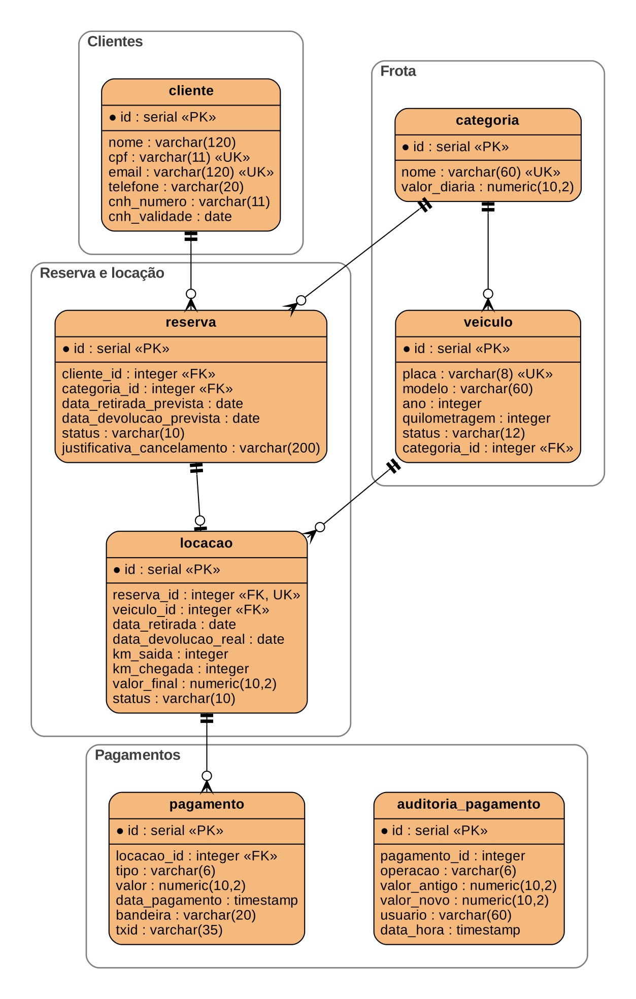

*Figura — Diagrama relacional do Next Drive: as 7 tabelas com todas as colunas e tipos. «PK» é chave primária, «FK» chave estrangeira e «UK» valor único. Nas ligações, a barra dupla indica "um", o pé de galinha indica "muitos" e o círculo indica que pode ser zero.*

| Tabela pai | Tabela filha | Chave estrangeira | Cardinalidade |
|---|---|---|---|
| `categoria` | `veiculo` | `categoria_id` | 1 : N |
| `categoria` | `reserva` | `categoria_id` | 1 : N |
| `cliente` | `reserva` | `cliente_id` | 1 : N |
| `reserva` | `locacao` | `reserva_id` (única) | 1 : 0..1 |
| `veiculo` | `locacao` | `veiculo_id` | 1 : N |
| `locacao` | `pagamento` | `locacao_id` | 1 : N |

A tabela `auditoria_pagamento` não tem chave estrangeira de propósito: ela guarda o histórico de um pagamento mesmo depois que ele é excluído.

### 4.2 Decisões de modelagem

| Decisão | Motivo |
|---|---|
| **Pagamento em uma única tabela**, com a coluna `tipo` | No Java, `Pagamento` é abstrata, com as subclasses `PagamentoCartao` e `PagamentoPix`. No banco, as duas formas ficam na mesma tabela; a constraint `ck_pagamento_tipo` exige `bandeira` quando o tipo é `CARTAO` e `txid` quando é `PIX`. |
| `reserva` aponta para a **categoria**; `locacao` aponta para o **veículo** | O cliente reserva uma categoria; o carro específico só é definido na retirada. |
| `locacao.reserva_id` é **único** | Cada reserva gera no máximo uma locação. |
| `locacao` **não guarda o cliente** | O cliente vem da reserva (`locacao.reserva_id → reserva.cliente_id`). Guardar de novo criaria uma dependência transitiva. |
| `locacao.valor_final` **armazenado** | É o valor calculado na devolução. Se a diária da categoria mudar depois, as locações antigas não mudam. |
| `veiculo.status` | Situação atual do carro (`DISPONIVEL`, `LOCADO` ou `MANUTENCAO`). Muda para `LOCADO` no aluguel e volta para `DISPONIVEL` na devolução, pelo trigger `trg_liberar_veiculo`. |
| `auditoria_pagamento` **sem chave estrangeira** | O histórico continua existindo mesmo se o pagamento for excluído. |

### 4.3 Normalização

- **1FN:** cada coluna guarda um único valor, sem listas; cada pagamento é uma linha separada.
- **2FN:** todas as chaves primárias são simples (`id`), então não existe dependência parcial.
- **3FN:** não há dependências transitivas. O nome e a diária ficam só em `categoria`, os dados do cliente só em `cliente`, e o cliente da locação é obtido pela reserva. Os relatórios juntam as tabelas pelas views de `04_views.sql`.

Redundância intencional: `locacao.valor_final`, explicada acima. Ponto de atenção: em `pagamento`, as colunas `bandeira` e `txid` ficam vazias conforme o tipo; a constraint `ck_pagamento_tipo` garante que a coluna certa esteja preenchida.

### 4.4 Restrições principais

| Regra | Onde é garantida |
|---|---|
| CPF e e-mail do cliente únicos | `UNIQUE` em `cliente.cpf` e `cliente.email` |
| Placa do veículo única | `UNIQUE` em `veiculo.placa` |
| Categoria com nome único e diária positiva | `UNIQUE` em `categoria.nome`; `CHECK (valor_diaria > 0)` |
| Ano e quilometragem válidos | `CHECK (ano BETWEEN 1990 AND 2100)` e `CHECK (quilometragem >= 0)` |
| Só as situações previstas | `CHECK` nas colunas `status` de `veiculo`, `reserva` e `locacao` |
| Devolução prevista depois da retirada | `ck_reserva_datas` |
| Uma locação por reserva | `UNIQUE` em `locacao.reserva_id` |
| Cartão com bandeira, Pix com txid e valor positivo | `ck_pagamento_tipo` e `CHECK (valor > 0)` |
| Não alugar carro indisponível ou já alugado | trigger `trg_validar_locacao` (`07_gatilhos.sql`) |
| CNH válida até a devolução prevista | trigger `trg_validar_cnh` (`07_gatilhos.sql`) |
| Carro volta a ficar disponível ao encerrar a locação | trigger `trg_liberar_veiculo` (`07_gatilhos.sql`) |
| Histórico de inclusões, alterações e exclusões de pagamentos | trigger `trg_auditar_pagamento` (`07_gatilhos.sql`) |

### 4.5 Dicionário de dados

O dicionário completo, tabela por tabela, com cada campo, tipo e regra, está em [`docs/dicionario-de-dados.md`](dicionario-de-dados.md). Resumo das 7 tabelas:

| Tabela | Campos | O que guarda |
|---|---|---|
| `categoria` | `id`, `nome`, `valor_diaria` | Categorias de carro e o preço da diária |
| `cliente` | `id`, `nome`, `cpf`, `email`, `telefone`, `cnh_numero`, `cnh_validade` | Pessoas que alugam os carros |
| `veiculo` | `id`, `placa`, `modelo`, `ano`, `quilometragem`, `status`, `categoria_id` | Carros da frota e a situação atual de cada um |
| `reserva` | `id`, `cliente_id`, `categoria_id`, `data_retirada_prevista`, `data_devolucao_prevista`, `status`, `justificativa_cancelamento` | Pedido do cliente para uma categoria em um período |
| `locacao` | `id`, `reserva_id`, `veiculo_id`, `data_retirada`, `data_devolucao_real`, `km_saida`, `km_chegada`, `valor_final`, `status` | O aluguel, da retirada até a devolução |
| `pagamento` | `id`, `locacao_id`, `tipo`, `valor`, `data_pagamento`, `bandeira`, `txid` | Pagamentos por cartão ou Pix, podendo ser em partes |
| `auditoria_pagamento` | `id`, `pagamento_id`, `operacao`, `valor_antigo`, `valor_novo`, `usuario`, `data_hora` | Histórico de inclusões, alterações e exclusões de pagamentos |

## 5 Scripts do banco de dados

Os scripts ficam em [`sql/`](../sql/) e devem ser executados na ordem abaixo, conectado ao banco `nextdrive`. Para ver o código de cada um, clique no nome do script.

| Ordem | Script | O que faz |
|---|---|---|
| 1 | [`01_create_database.sql`](../sql/01_create_database.sql) | Cria o banco `nextdrive` (opcional; pode ser criado pelo DBeaver) |
| 2 | [`02_create_tables.sql`](../sql/02_create_tables.sql) | 6 tabelas, chaves e restrições |
| 3 | [`03_indices.sql`](../sql/03_indices.sql) | 5 índices |
| 4 | [`04_views.sql`](../sql/04_views.sql) | 3 views |
| 5 | [`05_dados_exemplo.sql`](../sql/05_dados_exemplo.sql) | Dados de exemplo |
| 6 | [`06_consultas_relatorios.sql`](../sql/06_consultas_relatorios.sql) | 7 relatórios (somente consulta) |
| 7 | [`07_gatilhos.sql`](../sql/07_gatilhos.sql) | Tabela de auditoria e 4 triggers |
| 8 | [`08_procedimentos.sql`](../sql/08_procedimentos.sql) | 1 função e 2 procedures |
| 9 | [`09_roles_privilegios.sql`](../sql/09_roles_privilegios.sql) | Grupos, usuários e privilégios |
| 10 | [`10_backup_restore.sh`](../sql/10_backup_restore.sh) | Backup e restauração (script de terminal) |
| 11 | [`11_testes_regras.sql`](../sql/11_testes_regras.sql) | 13 testes das regras; desfaz tudo no final |

### 5.1 Criação da base

O `01` só cria o banco. O `02` apaga as tabelas, se já existirem, e cria as seis tabelas do modelo com chaves primárias, chaves estrangeiras, `UNIQUE` e `CHECK` (detalhes na seção 4).

<details>
<summary>01_create_database.sql</summary>

```sql
-- Next Drive - criação do banco (opcional).
-- Rode este script conectado ao banco "postgres". Se você já criou o banco "nextdrive" pelo DBeaver, pule este passo.

CREATE DATABASE nextdrive;
```

</details>

<details>
<summary>02_create_tables.sql — tabelas e constraints</summary>

```sql
DROP TABLE IF EXISTS auditoria_pagamento, pagamento, locacao, reserva, veiculo, cliente, categoria CASCADE;

CREATE TABLE categoria (
    id            SERIAL PRIMARY KEY,
    nome          VARCHAR(60)   NOT NULL UNIQUE,
    valor_diaria  NUMERIC(10,2) NOT NULL CHECK (valor_diaria > 0)
);

CREATE TABLE cliente (
    id            SERIAL PRIMARY KEY,
    nome          VARCHAR(120) NOT NULL,
    cpf           VARCHAR(11)  NOT NULL UNIQUE,
    email         VARCHAR(120) NOT NULL UNIQUE,
    telefone      VARCHAR(20),
    cnh_numero    VARCHAR(11)  NOT NULL,
    cnh_validade  DATE         NOT NULL
);

CREATE TABLE veiculo (
    id             SERIAL PRIMARY KEY,
    placa          VARCHAR(8)  NOT NULL UNIQUE,
    modelo         VARCHAR(60) NOT NULL,
    ano            INTEGER     NOT NULL CHECK (ano BETWEEN 1990 AND 2100),
    quilometragem  INTEGER     NOT NULL DEFAULT 0 CHECK (quilometragem >= 0),
    status         VARCHAR(12) NOT NULL DEFAULT 'DISPONIVEL'
                   CHECK (status IN ('DISPONIVEL', 'LOCADO', 'MANUTENCAO')),
    categoria_id   INTEGER     NOT NULL REFERENCES categoria (id)
);

CREATE TABLE reserva (
    id                       SERIAL PRIMARY KEY,
    cliente_id               INTEGER     NOT NULL REFERENCES cliente (id),
    categoria_id             INTEGER     NOT NULL REFERENCES categoria (id),
    data_retirada_prevista   DATE        NOT NULL,
    data_devolucao_prevista  DATE        NOT NULL,
    status                   VARCHAR(10) NOT NULL DEFAULT 'ATIVA'
                             CHECK (status IN ('ATIVA', 'CANCELADA', 'EFETIVADA')),
    justificativa_cancelamento  VARCHAR(200),
    CONSTRAINT ck_reserva_datas CHECK (data_devolucao_prevista > data_retirada_prevista)
);

CREATE TABLE locacao (
    id                   SERIAL PRIMARY KEY,
    reserva_id           INTEGER     NOT NULL UNIQUE REFERENCES reserva (id),
    veiculo_id           INTEGER     NOT NULL REFERENCES veiculo (id),
    data_retirada        DATE        NOT NULL,
    data_devolucao_real  DATE,
    km_saida             INTEGER     NOT NULL,
    km_chegada           INTEGER,
    valor_final          NUMERIC(10,2),
    status               VARCHAR(10) NOT NULL DEFAULT 'ABERTA'
                         CHECK (status IN ('ABERTA', 'ENCERRADA', 'PAGA'))
);

CREATE TABLE pagamento (
    id              SERIAL PRIMARY KEY,
    locacao_id      INTEGER       NOT NULL REFERENCES locacao (id),
    tipo            VARCHAR(6)    NOT NULL CHECK (tipo IN ('CARTAO', 'PIX')),
    valor           NUMERIC(10,2) NOT NULL CHECK (valor > 0),
    data_pagamento  TIMESTAMP     NOT NULL DEFAULT now(),
    bandeira        VARCHAR(20),   -- só para cartão
    txid            VARCHAR(35),   -- só para Pix
    CONSTRAINT ck_pagamento_tipo CHECK (
        (tipo = 'CARTAO' AND bandeira IS NOT NULL) OR (tipo = 'PIX' AND txid IS NOT NULL))
);
```

</details>

### 5.2 Índices

A placa, o CPF, o e-mail, o nome da categoria e a reserva da locação já ganham índice automaticamente por serem `UNIQUE`. O script cria mais cinco índices para as buscas mais comuns do sistema: cliente por nome, carros por situação, reservas por período, locação aberta de um carro e pagamentos de uma locação.

<details>
<summary>03_indices.sql</summary>

```sql
-- Next Drive - índices.
-- A placa do veículo e o CPF do cliente já têm índice criado automaticamente pela restrição UNIQUE.
-- Aqui ficam os índices extras, para as buscas mais comuns do sistema.

CREATE INDEX IF NOT EXISTS idx_cliente_nome         ON cliente (nome);
CREATE INDEX IF NOT EXISTS idx_veiculo_status       ON veiculo (status);
CREATE INDEX IF NOT EXISTS idx_reserva_datas        ON reserva (data_retirada_prevista, data_devolucao_prevista);
CREATE INDEX IF NOT EXISTS idx_locacao_veiculo      ON locacao (veiculo_id, status);
CREATE INDEX IF NOT EXISTS idx_pagamento_locacao    ON pagamento (locacao_id);
```

</details>

### 5.3 Views

| View | O que mostra | Usada em |
|---|---|---|
| `vw_veiculos_disponiveis` | Carros com status `DISPONIVEL`, com categoria e diária | R02 |
| `vw_locacoes_abertas` | Locações em andamento, com cliente, carro e devolução prevista | R03 |
| `vw_faturamento_categoria` | Quantidade e total de pagamentos por categoria | R04 |

<details>
<summary>04_views.sql</summary>

```sql
-- Next Drive - views (consultas salvas).

CREATE OR REPLACE VIEW vw_veiculos_disponiveis AS
SELECT v.id, v.placa, v.modelo, v.ano, c.nome AS categoria, c.valor_diaria
FROM veiculo v
JOIN categoria c ON c.id = v.categoria_id
WHERE v.status = 'DISPONIVEL';

CREATE OR REPLACE VIEW vw_locacoes_abertas AS
SELECT l.id AS locacao_id, cl.nome AS cliente, v.placa, v.modelo,
       l.data_retirada, r.data_devolucao_prevista
FROM locacao l
JOIN reserva r  ON r.id = l.reserva_id
JOIN cliente cl ON cl.id = r.cliente_id
JOIN veiculo v  ON v.id = l.veiculo_id
WHERE l.status = 'ABERTA';

CREATE OR REPLACE VIEW vw_faturamento_categoria AS
SELECT c.nome AS categoria, COUNT(p.id) AS pagamentos, COALESCE(SUM(p.valor), 0) AS total
FROM categoria c
LEFT JOIN veiculo v   ON v.categoria_id = c.id
LEFT JOIN locacao l   ON l.veiculo_id = v.id
LEFT JOIN pagamento p ON p.locacao_id = l.id
GROUP BY c.nome;
```

</details>

### 5.4 Dados de exemplo

O script carrega 3 categorias, 5 carros, 3 clientes, 5 reservas (efetivadas, uma ativa e uma cancelada), 3 locações (uma paga, uma devolvida com atraso e pagamento parcial e uma ainda aberta) e 2 pagamentos (cartão e Pix). Assim todos os relatórios mostram resultado.

<details>
<summary>05_dados_exemplo.sql</summary>

```sql
-- Next Drive (versão simples) - dados de exemplo

INSERT INTO categoria (nome, valor_diaria) VALUES
    ('Econômico', 120.00),
    ('SUV',       220.00),
    ('Luxo',      380.00);

INSERT INTO veiculo (placa, modelo, ano, quilometragem, categoria_id) VALUES
    ('ABC1D23', 'Fiat Mobi',        2023, 15200, 1),
    ('DEF4G56', 'Chevrolet Onix',   2024,  8300, 1),
    ('GHI7J89', 'Jeep Compass',     2023, 22100, 2),
    ('JKL0M12', 'Toyota Corolla X', 2024,  5400, 3),
    ('NOP3Q45', 'Renault Kwid',     2022, 41000, 1);

INSERT INTO cliente (nome, cpf, email, telefone, cnh_numero, cnh_validade) VALUES
    ('Ana Lima',        '11122233344', 'ana.lima@example.com',       '49999990001', '12345678901', '2030-05-20'),
    ('Carlos Pereira',  '55566677788', 'carlos.pereira@example.com', '49999990002', '10987654321', '2029-11-10'),
    ('Marcos Almeida',  '99988877766', 'marcos.almeida@example.com', '49999990003', '11223344556', '2031-02-15');

-- Reservas: duas viraram locação já devolvida, uma está com o carro na rua,
-- uma ainda vai acontecer e uma foi cancelada.
INSERT INTO reserva (cliente_id, categoria_id, data_retirada_prevista, data_devolucao_prevista, status, justificativa_cancelamento) VALUES
    (1, 1, '2026-11-02', '2026-11-05', 'EFETIVADA', NULL),
    (2, 2, '2026-11-10', '2026-11-14', 'EFETIVADA', NULL),
    (3, 3, '2026-11-20', '2026-11-25', 'EFETIVADA', NULL),
    (1, 2, '2026-12-01', '2026-12-03', 'ATIVA',     NULL),
    (2, 1, '2026-11-18', '2026-11-20', 'CANCELADA', 'Cliente desistiu da viagem');

-- Locações:
--   1) Ana, Fiat Mobi: 3 diárias de R$ 120,00 = R$ 360,00, já paga.
--   2) Carlos, Jeep Compass: devolveu 2 dias depois do previsto.
--      6 diárias de R$ 220,00 + 2 x 30% da diária = R$ 1.452,00; pagou só uma parte.
--   3) Marcos, Toyota Corolla: ainda está com o carro.
INSERT INTO locacao (reserva_id, veiculo_id, data_retirada, data_devolucao_real, km_saida, km_chegada, valor_final, status) VALUES
    (1, 1, '2026-11-02', '2026-11-05', 15200, 15650,  360.00, 'PAGA'),
    (2, 3, '2026-11-10', '2026-11-16', 22100, 23050, 1452.00, 'ENCERRADA'),
    (3, 4, '2026-11-20', NULL,          5400,  NULL,    NULL, 'ABERTA');

-- Situação atual dos carros depois dessas locações.
UPDATE veiculo SET quilometragem = 15650 WHERE id = 1;
UPDATE veiculo SET quilometragem = 23050 WHERE id = 3;
UPDATE veiculo SET status = 'LOCADO'     WHERE id = 4;
UPDATE veiculo SET status = 'MANUTENCAO' WHERE id = 5;

-- Pagamentos: um com cartão (quita a locação 1) e um Pix parcial da locação 2.
INSERT INTO pagamento (locacao_id, tipo, valor, data_pagamento, bandeira, txid) VALUES
    (1, 'CARTAO', 360.00, '2026-11-05 17:40', 'Visa', NULL),
    (2, 'PIX',    700.00, '2026-11-16 10:15', NULL,   'E1234567820261116101500001');
```

</details>

### 5.5 Relatórios (SELECTs)

As consultas estão em [`sql/06_consultas_relatorios.sql`](../sql/06_consultas_relatorios.sql). Todas usam junções (`JOIN`) ou views. Os resultados abaixo são os obtidos com os dados de exemplo (`sql/05_dados_exemplo.sql`). Para conferir, basta executar cada consulta no banco depois de rodar os scripts.

#### R01 — Situação da frota por categoria

Mostra quantos carros de cada categoria estão disponíveis, alugados ou em manutenção.

```sql
SELECT c.nome AS categoria, v.status, COUNT(*) AS quantidade
FROM veiculo v
JOIN categoria c ON c.id = v.categoria_id
GROUP BY c.nome, v.status
ORDER BY c.nome, v.status;
```

| categoria | status | quantidade |
|---|---|---:|
| Econômico | DISPONIVEL | 2 |
| Econômico | MANUTENCAO | 1 |
| Luxo | LOCADO | 1 |
| SUV | DISPONIVEL | 1 |

#### R02 — Carros disponíveis para alugar (view vw_veiculos_disponiveis)

Lista os carros que podem ser alugados agora, com a diária da categoria. Usa a view `vw_veiculos_disponiveis`.

```sql
SELECT placa, modelo, ano, categoria, valor_diaria
FROM vw_veiculos_disponiveis
ORDER BY categoria, modelo;
```

| placa | modelo | ano | categoria | valor_diaria |
|---|---|---:|---|---:|
| DEF4G56 | Chevrolet Onix | 2024 | Econômico | 120.00 |
| ABC1D23 | Fiat Mobi | 2023 | Econômico | 120.00 |
| GHI7J89 | Jeep Compass | 2023 | SUV | 220.00 |

#### R03 — Carros na rua: locações abertas (view vw_locacoes_abertas)

Mostra os carros que estão com clientes e quando devem voltar. Usa a view `vw_locacoes_abertas`.

```sql
SELECT locacao_id, cliente, placa, modelo, data_retirada, data_devolucao_prevista
FROM vw_locacoes_abertas
ORDER BY data_retirada;
```

| locacao_id | cliente | placa | modelo | data_retirada | data_devolucao_prevista |
|---:|---|---|---|---|---|
| 3 | Marcos Almeida | JKL0M12 | Toyota Corolla X | 2026-11-20 | 2026-11-25 |

#### R04 — Faturamento por categoria (view vw_faturamento_categoria)

Soma o que foi recebido em cada categoria. Usa a view `vw_faturamento_categoria`.

```sql
SELECT categoria, pagamentos, total
FROM vw_faturamento_categoria
ORDER BY total DESC;
```

| categoria | pagamentos | total |
|---|---:|---:|
| SUV | 1 | 700.00 |
| Econômico | 1 | 360.00 |
| Luxo | 0 | 0 |

#### R05 — Locações e total gasto por cliente

Mostra quantas locações cada cliente fez e quanto gastou.

```sql
SELECT cl.nome AS cliente, COUNT(l.id) AS locacoes, COALESCE(SUM(l.valor_final), 0) AS total_gasto
FROM cliente cl
LEFT JOIN reserva r ON r.cliente_id = cl.id
LEFT JOIN locacao l ON l.reserva_id = r.id
GROUP BY cl.nome
ORDER BY total_gasto DESC;
```

| cliente | locacoes | total_gasto |
|---|---:|---:|
| Carlos Pereira | 1 | 1452.00 |
| Ana Lima | 1 | 360.00 |
| Marcos Almeida | 1 | 0 |

#### R06 — Recebimentos por forma de pagamento e categoria

Separa os valores recebidos por forma de pagamento (cartão ou Pix) e por categoria.

```sql
SELECT p.tipo AS forma, c.nome AS categoria, COUNT(*) AS pagamentos, SUM(p.valor) AS total
FROM pagamento p
JOIN locacao l   ON l.id = p.locacao_id
JOIN veiculo v   ON v.id = l.veiculo_id
JOIN categoria c ON c.id = v.categoria_id
GROUP BY p.tipo, c.nome
ORDER BY p.tipo, c.nome;
```

| forma | categoria | pagamentos | total |
|---|---|---:|---:|
| CARTAO | Econômico | 1 | 360.00 |
| PIX | SUV | 1 | 700.00 |

#### R07 — Saldo devedor das locações já devolvidas

Mostra, para cada locação devolvida, quanto foi cobrado, quanto já foi pago e quanto falta pagar.

```sql
SELECT l.id AS locacao, cl.nome AS cliente, l.valor_final,
       COALESCE(SUM(p.valor), 0) AS pago,
       l.valor_final - COALESCE(SUM(p.valor), 0) AS saldo
FROM locacao l
JOIN reserva r      ON r.id = l.reserva_id
JOIN cliente cl     ON cl.id = r.cliente_id
LEFT JOIN pagamento p ON p.locacao_id = l.id
WHERE l.status IN ('ENCERRADA', 'PAGA')
GROUP BY l.id, cl.nome, l.valor_final
ORDER BY saldo DESC;
```

| locacao | cliente | valor_final | pago | saldo |
|---:|---|---:|---:|---:|
| 2 | Carlos Pereira | 1452.00 | 700.00 | 752.00 |
| 1 | Ana Lima | 360.00 | 360.00 | 0.00 |

### 5.6 Triggers

| Trigger | Tabela e momento | O que faz |
|---|---|---|
| `trg_validar_locacao` | `locacao`, antes de incluir | Impede alugar um carro que não está `DISPONIVEL` ou que já tem locação aberta |
| `trg_liberar_veiculo` | `locacao`, depois de mudar o status | Quando a locação é encerrada, o carro volta a ficar `DISPONIVEL` e recebe a quilometragem de chegada |
| `trg_validar_cnh` | `reserva`, antes de incluir | Impede reserva se a CNH do cliente vencer antes da devolução prevista |
| `trg_auditar_pagamento` | `pagamento`, depois de incluir, alterar ou excluir | Grava cada operação em `auditoria_pagamento`, com valor antigo, valor novo, usuário e data |

A função do trigger de auditoria é `SECURITY DEFINER`: roda com as permissões do dono do banco, por isso os pagamentos feitos pelo atendente também são auditados, mesmo ele não tendo acesso à tabela de auditoria.

<details>
<summary>07_gatilhos.sql</summary>

```sql
-- Next Drive - gatilhos (triggers).

DROP TABLE IF EXISTS auditoria_pagamento;

CREATE TABLE auditoria_pagamento (
    id            SERIAL PRIMARY KEY,
    pagamento_id  INTEGER       NOT NULL,
    operacao      VARCHAR(6)    NOT NULL,
    valor_antigo  NUMERIC(10,2),
    valor_novo    NUMERIC(10,2),
    usuario       VARCHAR(60)   NOT NULL DEFAULT current_user,
    data_hora     TIMESTAMP     NOT NULL DEFAULT now()
);

-- 1. Não deixa alugar um carro que não está disponível ou que já tem locação aberta.
CREATE OR REPLACE FUNCTION fn_validar_locacao() RETURNS TRIGGER AS $$
DECLARE
    v_status VARCHAR(12);
BEGIN
    SELECT status INTO v_status FROM veiculo WHERE id = NEW.veiculo_id;
    IF v_status IS DISTINCT FROM 'DISPONIVEL' THEN
        RAISE EXCEPTION 'O veículo % não está disponível (situação: %).', NEW.veiculo_id, v_status;
    END IF;
    IF EXISTS (SELECT 1 FROM locacao WHERE veiculo_id = NEW.veiculo_id AND status = 'ABERTA') THEN
        RAISE EXCEPTION 'O veículo % já tem uma locação aberta.', NEW.veiculo_id;
    END IF;
    RETURN NEW;
END;
$$ LANGUAGE plpgsql;

DROP TRIGGER IF EXISTS trg_validar_locacao ON locacao;
CREATE TRIGGER trg_validar_locacao
    BEFORE INSERT ON locacao
    FOR EACH ROW EXECUTE FUNCTION fn_validar_locacao();

-- 2. Quando a locação é encerrada, o carro volta a ficar disponível e recebe a quilometragem nova.
CREATE OR REPLACE FUNCTION fn_liberar_veiculo() RETURNS TRIGGER AS $$
BEGIN
    UPDATE veiculo
       SET status = 'DISPONIVEL',
           quilometragem = COALESCE(NEW.km_chegada, quilometragem)
     WHERE id = NEW.veiculo_id AND status = 'LOCADO';
    RETURN NEW;
END;
$$ LANGUAGE plpgsql;

DROP TRIGGER IF EXISTS trg_liberar_veiculo ON locacao;
CREATE TRIGGER trg_liberar_veiculo
    AFTER UPDATE OF status ON locacao
    FOR EACH ROW
    WHEN (OLD.status = 'ABERTA' AND NEW.status IN ('ENCERRADA', 'PAGA'))
    EXECUTE FUNCTION fn_liberar_veiculo();

-- 3. Não deixa fazer reserva para cliente com CNH que vence antes da devolução.
CREATE OR REPLACE FUNCTION fn_validar_cnh() RETURNS TRIGGER AS $$
DECLARE
    v_validade DATE;
BEGIN
    SELECT cnh_validade INTO v_validade FROM cliente WHERE id = NEW.cliente_id;
    IF v_validade < NEW.data_devolucao_prevista THEN
        RAISE EXCEPTION 'A CNH do cliente vence em %, antes da devolução.', v_validade;
    END IF;
    RETURN NEW;
END;
$$ LANGUAGE plpgsql;

DROP TRIGGER IF EXISTS trg_validar_cnh ON reserva;
CREATE TRIGGER trg_validar_cnh
    BEFORE INSERT ON reserva
    FOR EACH ROW EXECUTE FUNCTION fn_validar_cnh();

-- 4. Auditoria: guarda toda inclusão, alteração e exclusão de pagamentos.
CREATE OR REPLACE FUNCTION fn_auditar_pagamento() RETURNS TRIGGER AS $$
BEGIN
    IF TG_OP = 'INSERT' THEN
        INSERT INTO auditoria_pagamento (pagamento_id, operacao, valor_novo)
        VALUES (NEW.id, TG_OP, NEW.valor);
        RETURN NEW;
    ELSIF TG_OP = 'UPDATE' THEN
        INSERT INTO auditoria_pagamento (pagamento_id, operacao, valor_antigo, valor_novo)
        VALUES (NEW.id, TG_OP, OLD.valor, NEW.valor);
        RETURN NEW;
    END IF;
    INSERT INTO auditoria_pagamento (pagamento_id, operacao, valor_antigo)
    VALUES (OLD.id, TG_OP, OLD.valor);
    RETURN OLD;
END;
$$ LANGUAGE plpgsql SECURITY DEFINER SET search_path = public;

DROP TRIGGER IF EXISTS trg_auditar_pagamento ON pagamento;
CREATE TRIGGER trg_auditar_pagamento
    AFTER INSERT OR UPDATE OR DELETE ON pagamento
    FOR EACH ROW EXECUTE FUNCTION fn_auditar_pagamento();
```

</details>

### 5.7 Procedures

| Rotina | Tipo | O que faz |
|---|---|---|
| `fn_valor_final(locacao, data)` | Função | Calcula o valor da locação: diárias (mínimo 1) mais 30% da diária por dia de atraso |
| `sp_devolver_veiculo(locacao, km, data)` | Procedure | Registra a devolução: confere se a locação está aberta, se a quilometragem e a data são válidas, calcula o valor e encerra a locação |
| `sp_cancelar_reserva(reserva, justificativa)` | Procedure | Cancela uma reserva ativa, exigindo a justificativa |

Exemplo de uso: `CALL sp_devolver_veiculo(3, 5900, '2026-11-26');` encerra a locação 3 com 5.900 km.

<details>
<summary>08_procedimentos.sql</summary>

```sql
-- Next Drive - função e procedures.

-- Calcula o valor final: diárias (mínimo 1) mais 30% da diária por dia de atraso.
CREATE OR REPLACE FUNCTION fn_valor_final(p_locacao_id INTEGER, p_devolucao DATE) RETURNS NUMERIC AS $$
DECLARE
    v_diaria    NUMERIC;
    v_retirada  DATE;
    v_prevista  DATE;
    v_dias      INTEGER;
    v_atraso    INTEGER;
BEGIN
    SELECT c.valor_diaria, l.data_retirada, r.data_devolucao_prevista
      INTO v_diaria, v_retirada, v_prevista
      FROM locacao l
      JOIN reserva r   ON r.id = l.reserva_id
      JOIN veiculo v   ON v.id = l.veiculo_id
      JOIN categoria c ON c.id = v.categoria_id
     WHERE l.id = p_locacao_id;
    IF NOT FOUND THEN
        RAISE EXCEPTION 'Locação % não encontrada.', p_locacao_id;
    END IF;
    v_dias   := GREATEST(1, p_devolucao - v_retirada);
    v_atraso := GREATEST(0, p_devolucao - v_prevista);
    RETURN ROUND(v_diaria * v_dias + v_diaria * 0.30 * v_atraso, 2);
END;
$$ LANGUAGE plpgsql;

-- Registra a devolução: guarda quilometragem e data, calcula o valor e encerra a locação.
CREATE OR REPLACE PROCEDURE sp_devolver_veiculo(p_locacao_id INTEGER, p_km INTEGER, p_devolucao DATE)
AS $$
DECLARE
    v_loc locacao%ROWTYPE;
BEGIN
    SELECT * INTO v_loc FROM locacao WHERE id = p_locacao_id;
    IF NOT FOUND THEN
        RAISE EXCEPTION 'Locação % não encontrada.', p_locacao_id;
    END IF;
    IF v_loc.status <> 'ABERTA' THEN
        RAISE EXCEPTION 'A locação % já foi encerrada.', p_locacao_id;
    END IF;
    IF p_km < v_loc.km_saida THEN
        RAISE EXCEPTION 'A quilometragem não pode ser menor que a da saída (%).', v_loc.km_saida;
    END IF;
    IF p_devolucao < v_loc.data_retirada THEN
        RAISE EXCEPTION 'A devolução não pode ser antes da retirada.';
    END IF;
    UPDATE locacao
       SET data_devolucao_real = p_devolucao,
           km_chegada = p_km,
           valor_final = fn_valor_final(p_locacao_id, p_devolucao),
           status = 'ENCERRADA'
     WHERE id = p_locacao_id;
END;
$$ LANGUAGE plpgsql;

-- Cancela uma reserva ativa, guardando a justificativa.
CREATE OR REPLACE PROCEDURE sp_cancelar_reserva(p_reserva_id INTEGER, p_justificativa VARCHAR)
AS $$
DECLARE
    v_status VARCHAR(10);
BEGIN
    SELECT status INTO v_status FROM reserva WHERE id = p_reserva_id;
    IF NOT FOUND THEN
        RAISE EXCEPTION 'Reserva % não encontrada.', p_reserva_id;
    END IF;
    IF v_status <> 'ATIVA' THEN
        RAISE EXCEPTION 'Só é possível cancelar reservas ativas (situação atual: %).', v_status;
    END IF;
    IF p_justificativa IS NULL OR length(trim(p_justificativa)) = 0 THEN
        RAISE EXCEPTION 'Informe a justificativa do cancelamento.';
    END IF;
    UPDATE reserva SET status = 'CANCELADA', justificativa_cancelamento = p_justificativa WHERE id = p_reserva_id;
END;
$$ LANGUAGE plpgsql;
```

</details>

### 5.8 Perfis e políticas de acesso

As permissões são dadas a dois grupos, e cada usuário herda as do seu grupo:

| Grupo | Usuário de exemplo | Pode fazer |
|---|---|---|
| `grupo_atendente` | `atendente_nextdrive` | Consultar tudo (menos auditoria e faturamento), cadastrar e alterar clientes, reservas, locações e pagamentos, e alterar a situação dos carros. **Não exclui nada.** |
| `grupo_gerente` | `gerente_nextdrive` | Tudo do atendente, mais cadastrar e excluir categorias, carros, clientes e reservas, ler a auditoria e o faturamento. Nem o gerente exclui locações e pagamentos. |

A matriz completa e como conferir no DBeaver estão em [`docs/politicas-de-acesso.md`](politicas-de-acesso.md).

<details>
<summary>09_roles_privilegios.sql</summary>

```sql
-- Next Drive - controle de acesso (grupos, usuários e privilégios).
-- Rode depois dos scripts de tabelas, gatilhos e procedimentos.

DO $$
BEGIN
    IF NOT EXISTS (SELECT FROM pg_roles WHERE rolname = 'grupo_atendente') THEN
        CREATE ROLE grupo_atendente NOLOGIN;
    END IF;
    IF NOT EXISTS (SELECT FROM pg_roles WHERE rolname = 'grupo_gerente') THEN
        CREATE ROLE grupo_gerente NOLOGIN;
    END IF;
    IF NOT EXISTS (SELECT FROM pg_roles WHERE rolname = 'atendente_nextdrive') THEN
        CREATE ROLE atendente_nextdrive LOGIN PASSWORD 'Atendente@123' IN ROLE grupo_atendente;
    END IF;
    IF NOT EXISTS (SELECT FROM pg_roles WHERE rolname = 'gerente_nextdrive') THEN
        CREATE ROLE gerente_nextdrive LOGIN PASSWORD 'Gerente@123' IN ROLE grupo_gerente;
    END IF;
END
$$;

REVOKE ALL ON ALL TABLES IN SCHEMA public FROM grupo_atendente, grupo_gerente;
GRANT USAGE ON SCHEMA public TO grupo_atendente, grupo_gerente;
GRANT USAGE, SELECT ON ALL SEQUENCES IN SCHEMA public TO grupo_atendente, grupo_gerente;

-- Atendente: consulta tudo (menos a auditoria), cadastra e altera, mas não exclui nada.
GRANT SELECT ON categoria, cliente, veiculo, reserva, locacao, pagamento TO grupo_atendente;
GRANT INSERT, UPDATE ON cliente, reserva, locacao, pagamento TO grupo_atendente;
GRANT UPDATE ON veiculo TO grupo_atendente;

-- Gerente: tudo do atendente, mais gerenciar categorias e carros, excluir cadastros e ver a auditoria.
GRANT SELECT, INSERT, UPDATE, DELETE ON categoria, cliente, veiculo, reserva TO grupo_gerente;
GRANT SELECT, INSERT, UPDATE ON locacao, pagamento TO grupo_gerente;
GRANT SELECT ON auditoria_pagamento TO grupo_gerente;

-- Views dos relatórios: o atendente vê os carros disponíveis e as locações abertas;
-- o faturamento fica só para o gerente.
GRANT SELECT ON vw_veiculos_disponiveis, vw_locacoes_abertas TO grupo_atendente;
GRANT SELECT ON vw_veiculos_disponiveis, vw_locacoes_abertas, vw_faturamento_categoria TO grupo_gerente;
```

</details>

### 5.9 Backup e restauração

| Item | Definição |
|---|---|
| Ferramentas | `pg_dump` (formato *custom*) e `pg_restore` |
| Frequência | Um backup por dia, fora do horário de atendimento |
| Retenção | Últimos 7 dias, mais uma cópia semanal fora do computador do banco |
| Restauração | Sempre em um banco separado (`nextdrive_restaurado`), para não sobrescrever o banco em uso |
| Uso | `bash 10_backup_restore.sh backup` e `bash 10_backup_restore.sh restaurar arquivo.backup` |

Resultado do teste realizado com os dados de exemplo:

| Conferência | Banco original | Banco restaurado |
|---|:---:|:---:|
| Clientes | 3 | 3 |
| Veículos | 5 | 5 |
| Reservas | 5 | 5 |
| Locações | 3 | 3 |
| Pagamentos | 2 | 2 |
| Triggers | 4 | 4 |
| Views | 3 | 3 |
| Funções e procedures | 7 | 7 |

O passo a passo completo, inclusive no Windows (Git Bash, DBeaver e Prompt de Comando), está em [`docs/backup-restore.md`](backup-restore.md).

<details>
<summary>10_backup_restore.sh</summary>

```bash
#!/bin/bash
# Next Drive - backup e restauração do banco.
# Uso:  ./10_backup_restore.sh backup
#       ./10_backup_restore.sh restaurar arquivo.backup
# Se a porta ou o usuário forem diferentes, mude as variáveis abaixo.
# A senha do PostgreSQL pode ser informada antes:  export PGPASSWORD=suasenha

BANCO=nextdrive
RESTAURADO=nextdrive_restaurado
USUARIO=postgres
HOST=localhost
PORTA=${PORTA:-5432}
PASTA=./backups

case "$1" in
    backup)
        mkdir -p "$PASTA"
        ARQUIVO="$PASTA/${BANCO}_$(date +%Y%m%d_%H%M%S).backup"
        pg_dump -h "$HOST" -p "$PORTA" -U "$USUARIO" -Fc -f "$ARQUIVO" "$BANCO" && echo "Backup salvo em $ARQUIVO"
        ;;
    restaurar)
        if [ -z "$2" ]; then
            echo "Informe o arquivo de backup."
            exit 1
        fi
        dropdb -h "$HOST" -p "$PORTA" -U "$USUARIO" --if-exists "$RESTAURADO"
        createdb -h "$HOST" -p "$PORTA" -U "$USUARIO" "$RESTAURADO"
        pg_restore -h "$HOST" -p "$PORTA" -U "$USUARIO" -d "$RESTAURADO" "$2" && echo "Banco $RESTAURADO restaurado a partir de $2"
        ;;
    *)
        echo "Uso: $0 backup | $0 restaurar arquivo.backup"
        exit 1
        ;;
esac
```

</details>

---

## 6 Modelagem UML

Os diagramas de classes, sequência e atividades são imagens, guardadas na pasta [`uml/`](uml/); os de casos de uso e de estados foram escritos em Mermaid, que o GitHub desenha diretamente. Cada diagrama cita os requisitos atendidos e, quando aplicável, a classe, a *procedure* ou o *trigger* que implementa cada passo, o que mantém a modelagem consistente com o código e o banco (RNF09).

### 6.1 Casos de uso (RF18)

Ator: **Administrador**, o funcionário da locadora que usa a aplicação. Todos os casos de uso abaixo fazem parte do sistema Next Drive. Os casos de uso derivam dos requisitos funcionais e do processo de negócio da seção 2.

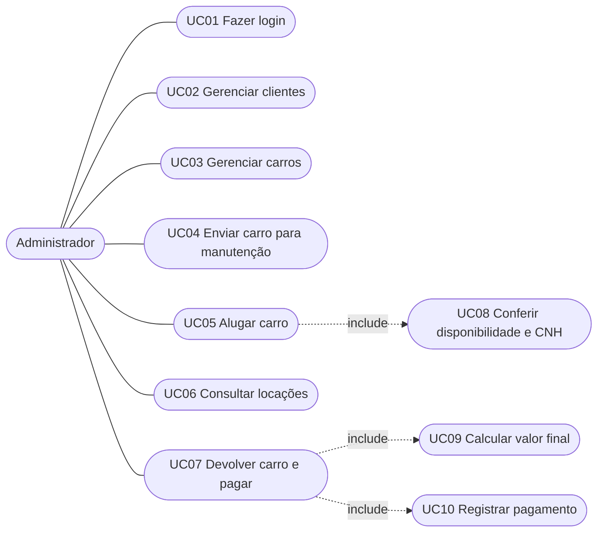

#### Descrição dos casos de uso

| Código | Caso de uso | Requisitos | Descrição |
|---|---|---|---|
| UC01 | Fazer login | RF02 | Entra no sistema com usuário e senha. |
| UC02 | Gerenciar clientes | RF03 | Cadastra, consulta e exclui clientes, com CPF, e-mail e CNH. |
| UC03 | Gerenciar carros | RF04 | Cadastra, consulta e exclui carros, cada um de uma categoria. |
| UC04 | Enviar carro para manutenção | RF11 | Tira o carro da lista de disponíveis e, depois, libera de novo. Carro locado não pode ir para manutenção. |
| UC05 | Alugar carro | RF06, RF14, RF15 | Escolhe o carro, o cliente e as datas; o sistema registra a reserva e a locação e mostra a estimativa de valor. |
| UC06 | Consultar locações | RF12 | Lista as locações com cliente, carro, datas, valor e situação. |
| UC07 | Devolver carro e pagar | RF08, RF10 | Informa a data e a quilometragem de chegada e a forma de pagamento. |
| UC08 | Conferir disponibilidade e CNH | RF05, RF14, RF15 | O carro precisa estar disponível e a CNH do cliente válida até a devolução. |
| UC09 | Calcular valor final | RF09 | Diárias usadas (mínimo 1) mais 30% da diária por dia de atraso. |
| UC10 | Registrar pagamento | RF10, RF16 | Grava o pagamento por cartão ou Pix; o banco audita a operação e marca a locação como paga. |

**Relações:** `include` = o caso de uso base sempre usa o outro.

O cancelamento de reserva (RF07) e os relatórios (RF13) não têm tela: são feitos direto no banco, pela *procedure* `sp_cancelar_reserva` e pelas consultas da seção 5.5.

### 6.2 Classes (RF19)

Modelo de domínio em Java (pacote `br.edu.unoesc.nextdrive.model`), consistente com o banco de dados (RNF09).


*Figura — Diagrama de classes do pacote `model`. Getters, setters, construtores e `toString()` foram omitidos para legibilidade.*

#### Associações

| Classe | Multiplicidade | Classe | Multiplicidade | Significado |
|---|:---:|---|:---:|---|
| `Veiculo` | * | `Categoria` | 1 | Todo carro pertence a uma categoria, que define a diária |
| `Reserva` | * | `Cliente` | 1 | Um cliente pode ter várias reservas |
| `Reserva` | * | `Categoria` | 1 | A reserva é feita por categoria |
| `Locacao` | 0..1 | `Reserva` | 1 | Cada reserva gera no máximo uma locação |
| `Locacao` | * | `Veiculo` | 1 | O carro é escolhido na retirada |
| `Pagamento` | * | `Locacao` | 1 | Uma locação pode ser paga em várias partes |

No código, `Veiculo`, `Reserva` e `Locacao` guardam o objeto associado (por exemplo, `Reserva.cliente`); `Pagamento` guarda só o código da locação (`locacaoId`).

#### Conceitos de POO aplicados

| Conceito | Onde aparece |
|---|---|
| **Encapsulamento** | Todos os atributos são privados (`-`) e acessados por getters e setters. As regras ficam dentro das próprias classes: `Cliente.cnhValidaEm()`, `Veiculo.estaDisponivel()`, `Reserva.cancelar()`, `Reserva.estimativa()`, `Locacao.calcularValorFinal()`, `Locacao.encerrar()` e `Locacao.saldoDevedor()`. |
| **Herança** | `Pagamento` → `PagamentoCartao` / `PagamentoPix`. |
| **Polimorfismo** | `getTipo()` e `descrever()` são abstratos em `Pagamento`, e cada subclasse implementa do seu jeito: o cartão devolve `CARTAO` e descreve a bandeira; o Pix devolve `PIX` e descreve o txid. O `toString()` também é sobrescrito nas classes. |
| **Classe abstrata** | `Pagamento` não pode ser instanciada diretamente; os métodos abstratos aparecem em itálico no diagrama. |
| **Enumerações** | `StatusVeiculo`, `StatusReserva` e `StatusLocacao`, com os mesmos valores dos `CHECK` do banco. |
| **Constante** | `Locacao.MULTA_ATRASO` (30% da diária por dia de atraso), sublinhada no diagrama por ser `static`. |

#### Correspondência com o banco de dados

| Classe | Tabela |
|---|---|
| `Categoria`, `Cliente`, `Veiculo`, `Reserva`, `Locacao` | `categoria`, `cliente`, `veiculo`, `reserva`, `locacao` |
| `Pagamento` + `PagamentoCartao` / `PagamentoPix` | `pagamento` (a coluna `tipo` indica a subclasse) |
| — | `auditoria_pagamento`, preenchida só pelo trigger, sem classe Java |

O diagrama mostra o pacote `model`. Os pacotes `dao` (acesso ao banco com JDBC) e `controller` (rotas da aplicação Spring Boot) usam essas classes.

### 6.3 Sequência (RF20)

Fluxos do **aluguel** e da **devolução com pagamento**. As linhas de vida seguem a arquitetura do sistema: o **Administrador**, a **Interface** (telas no navegador), o **Sistema** (aplicação Java: *controllers*, classes de domínio e DAOs) e o **Banco de Dados** (PostgreSQL, com os *triggers* do script `07`). Os quadros `alt` mostram os caminhos alternativos: dados inválidos, recusa do banco e forma de pagamento.

#### 1. Aluguel — RF06, RF14, RF15

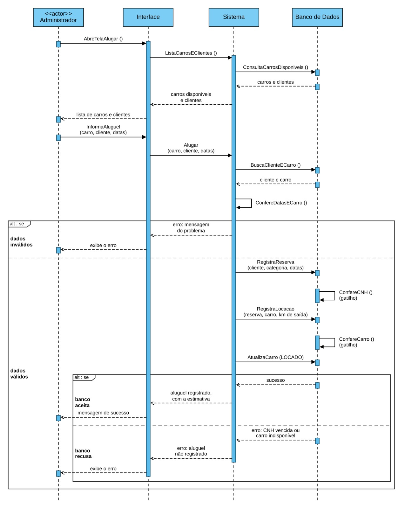

*Figura — Sequência do aluguel. O Sistema busca o cliente e o carro, confere as datas e a disponibilidade e grava, numa única transação, a reserva (EFETIVADA), a locação e a mudança do carro para LOCADO. Os gatilhos `trg_validar_cnh` (ConfereCNH) e `trg_validar_locacao` (ConfereCarro) repetem as regras no banco.*

#### 2. Devolução e pagamento — RF08, RF09, RF10, RF16

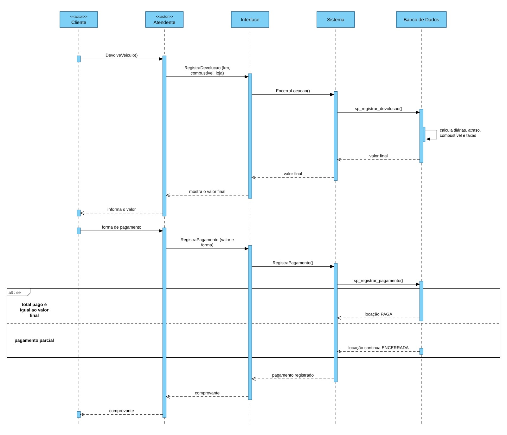

*Figura — Sequência da devolução com pagamento. O Sistema confere a km, a data e a forma de pagamento, calcula o valor final em `Locacao.calcularValorFinal()` e encerra a locação; o gatilho `trg_liberar_veiculo` (LiberaCarro) devolve o carro à frota. O pagamento é criado como `PagamentoCartao` ou `PagamentoPix`, o gatilho `trg_auditar_pagamento` (GravaAuditoria) registra a auditoria e a locação passa para PAGA.*

**Observações**
- As regras principais (carro livre, CNH válida, devolução do carro à frota e auditoria) são garantidas pelos triggers do banco, mesmo que a aplicação já as confira antes.
- Toda comunicação com o banco usa `PreparedStatement` (RNF04).

### 6.4 Atividades (RF21)

Fluxo completo de uma locação, do login até o pagamento, com as responsabilidades divididas em raias: **Administrador**, **Sistema (site e Java)** e **Banco de Dados**. Os losangos são decisões.

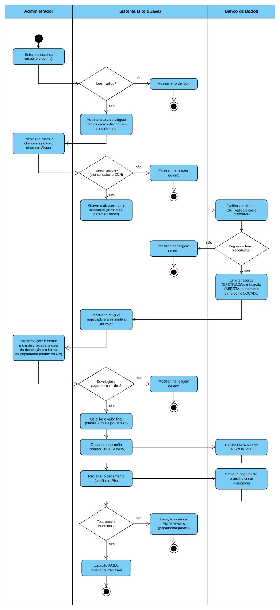

*Figura — Diagrama de atividades do processo de locação: login, aluguel com as validações da aplicação e dos gatilhos, devolução com cálculo do valor final e registro do pagamento.*

#### Pontos de decisão e regras associadas

| Decisão | Requisito | Onde é garantida |
|---|---|---|
| Login válido? | RF02 | Tela de login (`index.html`) |
| Dados do aluguel válidos? | RF14, RF15 | `LocacaoController` (cliente, carro disponível, datas e CNH) |
| Regras do banco respeitadas? | RF14, RF15 | Triggers `trg_validar_cnh` e `trg_validar_locacao` |
| Devolução e pagamento válidos? | RF08, RF10 | `LocacaoController` (km, data e forma de pagamento) |
| Valor final | RF09 | `Locacao.calcularValorFinal()` e, no banco, `fn_valor_final` |
| Total pago ≥ valor final? | RF10 | `PagamentoDAO`, que marca a locação como `PAGA` |

Pela tela, a devolução já registra o pagamento do valor total, então a locação termina `PAGA`. O caminho de pagamento parcial existe no banco (a locação fica `ENCERRADA` com saldo devedor, como no relatório R07).

### 6.5 Estados (RF22)

Cada transição indica o evento que a provoca e, entre parênteses, a classe, a *procedure* ou o *trigger* responsável. Os estados são exatamente os valores das colunas `status` do banco e das enumerações do Java.

#### Reserva (`reserva.status`)

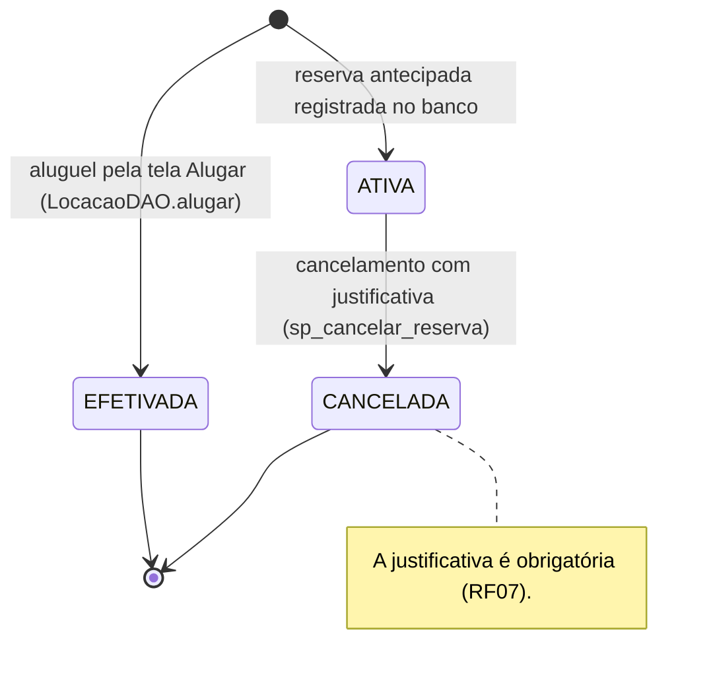

#### Veículo (`veiculo.status`)

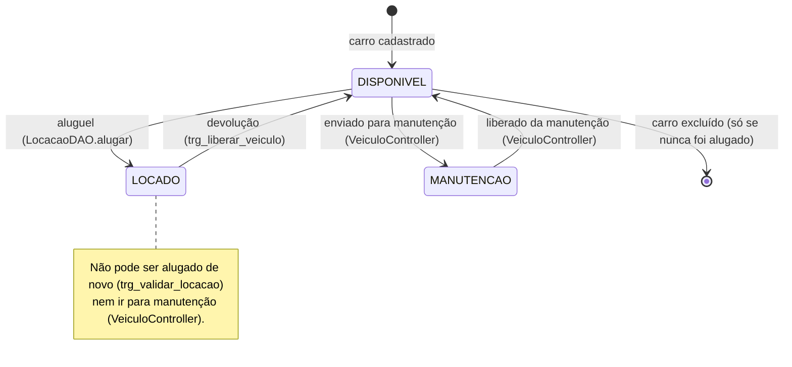

#### Locação (`locacao.status`)

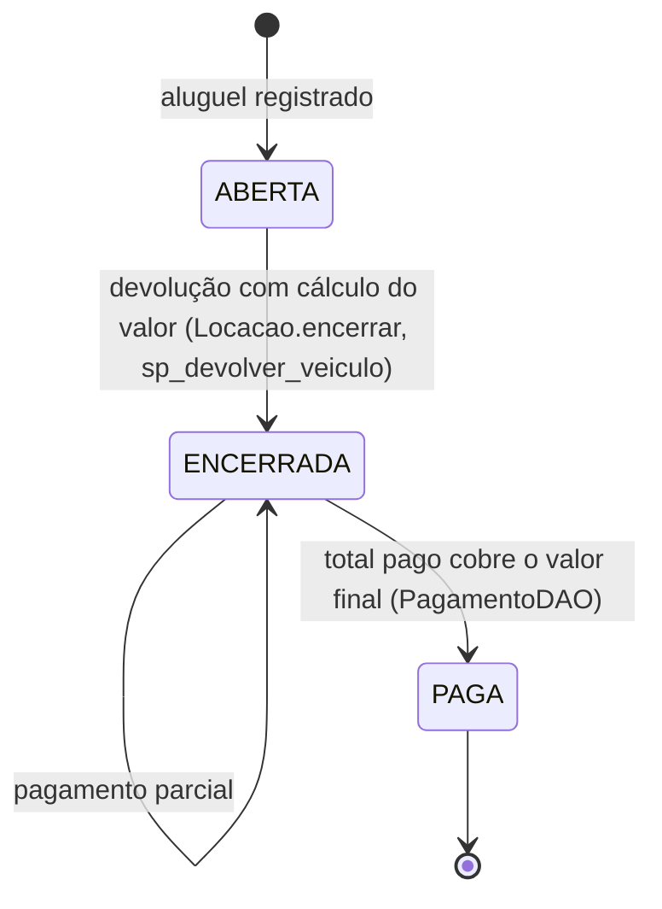

#### Resumo das transições permitidas

| Entidade | De | Para | Evento |
|---|---|---|---|
| Reserva | — | EFETIVADA | Aluguel feito pela tela |
| Reserva | ATIVA | CANCELADA | Cancelamento com justificativa |
| Veículo | DISPONIVEL | LOCADO | Aluguel |
| Veículo | LOCADO | DISPONIVEL | Devolução |
| Veículo | DISPONIVEL | MANUTENCAO | Envio para manutenção |
| Veículo | MANUTENCAO | DISPONIVEL | Liberação da manutenção |
| Locação | ABERTA | ENCERRADA | Devolução |
| Locação | ENCERRADA | PAGA | Pagamento do valor final |

---

## 7 Implementação em Java

### 7.1 Arquitetura

A aplicação usa **Java 17** com **Spring Boot 3** (servidor web embutido) e acesso ao banco por **JDBC**, com o driver do PostgreSQL. As telas são páginas HTML com Bootstrap e jQuery, que conversam com a aplicação por requisições HTTP. Ao iniciar, a classe `Application` confere a conexão com o banco, sobe o servidor e abre o navegador em `http://localhost:8080`.

O código está em `java/src/main/java/br/edu/unoesc/nextdrive/`:

| Pacote | Responsabilidade |
|---|---|
| `model` | Classes de domínio: `Categoria`, `Cliente`, `Veiculo`, `Reserva`, `Locacao`, `Pagamento` e subclasses, e as enumerações de situação |
| `dao` | Acesso ao banco com `PreparedStatement`, uma classe por entidade, e a conexão (`SingleConnection`) |
| `controller` | Rotas da aplicação (Spring Boot), que validam os dados e chamam os DAOs |
| `resources/static` | As páginas: login, menu, clientes, carros, alugar e locações |

| Rota | O que faz |
|---|---|
| `GET` / `POST /clientes`, `DELETE /clientes/{id}` | Lista, cadastra e exclui clientes |
| `GET /categorias` | Lista as categorias |
| `GET` / `POST /veiculos`, `DELETE /veiculos/{id}` | Lista, cadastra e exclui carros |
| `PUT /veiculos/{id}/situacao` | Envia para manutenção ou libera o carro |
| `GET` / `POST /locacoes` | Lista as locações e registra um aluguel |
| `PUT /locacoes/{id}/devolucao` | Registra a devolução e o pagamento |

### 7.2 Programação orientada a objetos

Os conceitos aparecem no pacote `model` e estão detalhados na seção 6.2:

| Conceito | Aplicação no código |
|---|---|
| **Encapsulamento** | Atributos privados; regras dentro das classes, como `Locacao.calcularValorFinal()`, `Reserva.cancelar()` e `Cliente.cnhValidaEm()` |
| **Herança** | `Pagamento` → `PagamentoCartao` / `PagamentoPix` |
| **Classe abstrata** | `Pagamento` não é instanciada diretamente |
| **Polimorfismo** | `getTipo()` e `descrever()` mudam conforme a forma de pagamento; o *controller* trata qualquer `Pagamento` da mesma forma |
| **Enumerações** | `StatusVeiculo`, `StatusReserva` e `StatusLocacao` |

### 7.3 Persistência

- Todas as consultas usam **parâmetros** (`?`), nunca concatenação (RNF04).
- A conexão é aberta com `autoCommit` desligado: cada operação termina com `commit` e, se der erro, com `rollback`.
- O **aluguel** grava a reserva, a locação e a mudança do carro para `LOCADO` na **mesma transação**; se o carro deixar de estar disponível no meio do caminho, nada é gravado.
- Mesmo com a validação feita em Java, os *triggers* do banco conferem de novo as regras principais.

### 7.4 Segurança

| Medida | Como foi feita |
|---|---|
| SQL *injection* | Apenas consultas parametrizadas |
| Perfis no banco | Usuários `atendente_nextdrive` e `gerente_nextdrive`, com privilégios diferentes (seção 5.8) |
| Auditoria | Toda inclusão, alteração e exclusão de pagamento fica registrada |
| Login da aplicação | Usuário e senha fixos, conferidos na página (limitação na seção 11) |

### 7.5 Recursos além do básico

- **Cálculo automático do valor**, com estimativa no aluguel e multa de 30% da diária por dia de atraso na devolução.
- **Controle de manutenção** dos carros, que some da lista de disponíveis enquanto estão em manutenção.
- **Auditoria de pagamentos** feita pelo banco, com usuário, data e valores antigo e novo.
- **Testes automatizados** das regras das classes Java (seção 9.2).
- **Abertura automática do navegador** quando a aplicação inicia.

### 7.6 Documentação

As classes e os métodos públicos têm JavaDoc. A documentação pode ser gerada com:

```bash
cd java
mvn javadoc:javadoc        # saída em target/site/apidocs
```

---

## 8 Telas do sistema

O sistema tem seis telas, acessadas pelo navegador em `http://localhost:8080`:

| Tela | Arquivo | O que faz | Requisitos |
|---|---|---|---|
| Login | `index.html` | Entrada com usuário e senha | RF02 |
| Menu | `menu.html` | Atalhos para as outras telas | — |
| Clientes | `clientes.html` | Cadastro, lista e exclusão de clientes | RF03 |
| Carros | `carros.html` | Cadastro, lista, exclusão e envio para manutenção | RF04, RF11 |
| Alugar | `alugar.html` | Escolha do carro disponível, do cliente e das datas | RF05, RF06 |
| Locações | `locacoes.html` | Lista das locações, devolução com cálculo do valor e pagamento por cartão ou Pix | RF08, RF09, RF10, RF12 |

As imagens abaixo foram capturadas com o sistema em execução, conectado ao banco `nextdrive` carregado com os dados de exemplo (`05_dados_exemplo.sql`).


*Figura — Tela de login (`index.html`).*

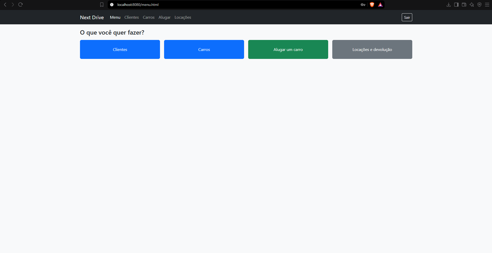

*Figura — Menu principal com atalhos para as telas do sistema (`menu.html`).*

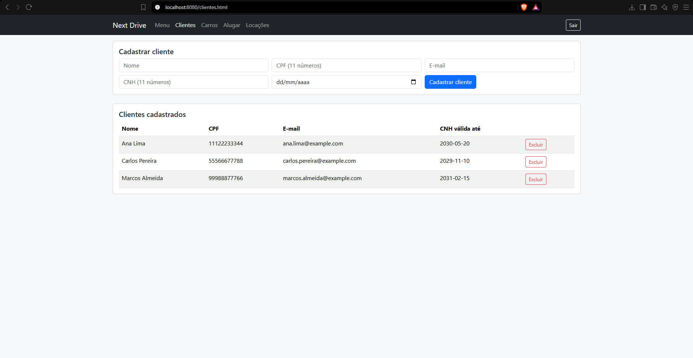

*Figura — Cadastro e lista de clientes (`clientes.html`), com os três clientes de exemplo.*

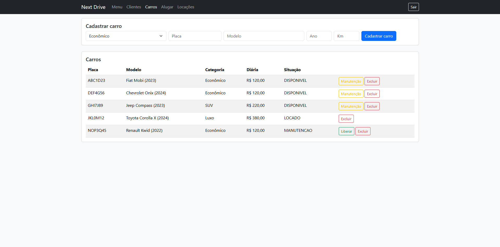

*Figura — Cadastro e lista de carros (`carros.html`). Cada carro mostra a categoria, a diária e a situação; o Corolla aparece como LOCADO e o Kwid como MANUTENCAO.*

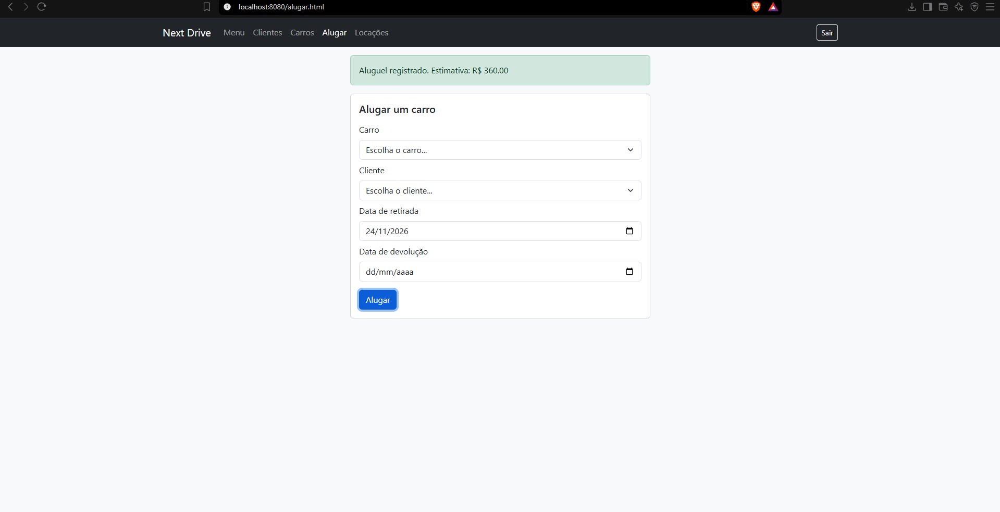

*Figura — Aluguel do Chevrolet Onix para Ana Lima de 24/11/2026 a 27/11/2026 (`alugar.html`). O sistema registra a locação e mostra a estimativa: 3 diárias de R$ 120,00 = R$ 360,00.*

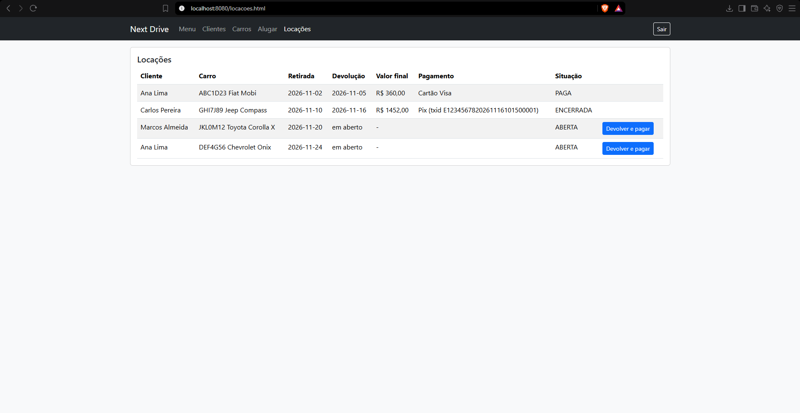

*Figura — Lista de locações (`locacoes.html`), já com a locação criada na tela anterior. As locações abertas têm o botão "Devolver e pagar".*

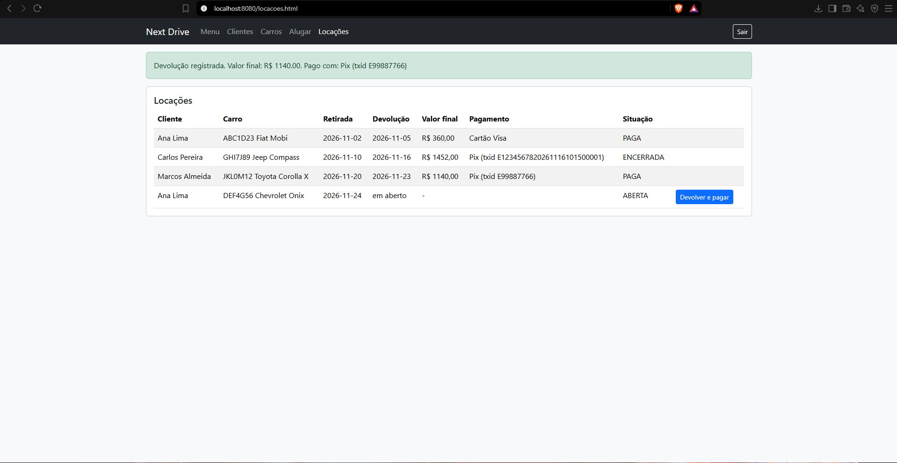

*Figura — Devolução do Toyota Corolla X de Marcos Almeida em 23/11/2026, com pagamento por Pix. O valor final (3 diárias de R$ 380,00 = R$ 1.140,00, sem atraso) é calculado pelo método `calcularValorFinal` da classe `Locacao`, e com o pagamento completo a locação passa para PAGA.*

---

## 9 Testes e validação

### 9.1 Regras no banco

O script `sql/11_testes_regras.sql` roda em uma transação, mostra `OK` ou `FALHOU` para cada teste e desfaz tudo no final. São 13 verificações:

| Teste | Resultado |
|---|---|
| Índices extras foram criados | OK |
| View mostra só carros disponíveis | OK |
| Bloqueia reserva com CNH vencida | OK |
| Bloqueia alugar carro em manutenção | OK |
| Bloqueia alugar carro que já está alugado | OK |
| Bloqueia devolução com quilometragem menor | OK |
| Devolução calcula R$ 672,00 (5 dias, 2 de atraso) | OK |
| Carro volta a ficar disponível e recebe a quilometragem | OK |
| Auditoria registra inclusão e alteração do pagamento | OK |
| Cancela reserva ativa com justificativa | OK |
| Não cancela reserva que já está cancelada | OK |
| Atendente não pode excluir cliente | OK |
| Atendente registra pagamento (auditoria funciona para ele) | OK |

```bash
psql -U postgres -d nextdrive -f sql/11_testes_regras.sql
```

### 9.2 Aplicação

A classe `NextDriveTest` tem 9 testes JUnit das regras das classes de domínio: valor de três dias sem atraso; devolução no mesmo dia cobrando uma diária; atraso acrescentando 30% da diária por dia; encerramento guardando os dados da devolução; saldo devedor descontando o que já foi pago; CNH vencida não sendo válida; pagamentos se descrevendo de forma diferente; só reserva ativa podendo ser cancelada; e estimativa usando a diária da categoria.

```bash
cd java
mvn test
```

### 9.3 Backup e restauração

O backup completo foi restaurado em um banco novo, e as contagens (clientes, veículos, reservas, locações, pagamentos, *triggers*, views e funções) conferiram com as do banco original (seção 5.9).

---

## 10 Como executar

**Requisitos:** JDK 17, Maven, PostgreSQL 16 e DBeaver (ou `psql`).

1. **Banco:** crie o banco `nextdrive` e execute, na ordem, os scripts `02`, `03`, `04`, `05`, `07`, `08` e `09` da pasta `sql/` (seção 5).
2. **Conexão:** se a senha ou a porta do seu PostgreSQL forem diferentes, ajuste em `java/src/main/java/br/edu/unoesc/nextdrive/dao/SingleConnection.java`.
3. **Aplicação:** execute a classe `br.edu.unoesc.nextdrive.Application` pelo Eclipse ou, pelo terminal:

```bash
cd java
mvn spring-boot:run
```

4. **Acesso:** o navegador abre em <http://localhost:8080>. Entre com o usuário `admin` e a senha `1234`.

Mais detalhes em [`java/README.md`](../java/README.md).

---

## 11 Conclusões

O Next Drive cumpre o processo de locação, do cadastro ao pagamento, e atende os três componentes do trabalho: o banco com regras, perfis de acesso e recuperação; a modelagem UML consistente com o código e o banco; e a aplicação Java orientada a objetos.

**Principais aprendizados**

- **Regras no banco valem para todos.** Com os *triggers*, um carro indisponível ou um cliente com CNH vencida são recusados mesmo que alguém acesse o banco sem passar pela aplicação.
- **Normalização tem consequências práticas.** Não guardar o cliente na locação (ele vem da reserva) evitou uma dependência transitiva; guardar o valor final foi uma redundância de propósito, para que locações antigas não mudem quando a diária muda.
- **Transações evitam dados pela metade.** O aluguel grava reserva, locação e situação do carro juntos, ou nada.
- **Escopo menor, sistema mais claro.** Simplificar o sistema fez com que o grupo inteiro conseguisse entender e explicar cada parte do código.

**Limitações conhecidas**

- O login da aplicação usa usuário e senha fixos conferidos na página, e as rotas não exigem login.
- A senha do banco está escrita no código, e a aplicação usa uma única conexão; por isso o servidor atende uma requisição por vez.
- Pela tela, a devolução já exige o pagamento do valor total; reserva antecipada, cancelamento e pagamento parcial só podem ser feitos direto no banco.
- O valor final é calculado em Java na tela de devolução; a *procedure* `sp_devolver_veiculo` tem a mesma regra, mas não é chamada pela aplicação.
- As telas carregam Bootstrap e jQuery pela internet.
- A aplicação usa HTTP; para uso real seria necessário HTTPS.

**Trabalhos futuros:** login com usuários guardados no banco e senha criptografada; telas de reserva antecipada, cancelamento e relatórios; pagamento parcial pela tela; uso das *procedures* pela aplicação; *pool* de conexões.

---

## Referências

DEITEL, Paul; DEITEL, Harvey. **Java: como programar**. 10. ed. São Paulo: Pearson, 2016.

ELMASRI, Ramez; NAVATHE, Shamkant B. **Sistemas de banco de dados**. 7. ed. São Paulo: Pearson, 2018.

FOWLER, Martin. **UML essencial**: um breve guia para a linguagem-padrão de modelagem de objetos. 3. ed. Porto Alegre: Bookman, 2005.

SOMMERVILLE, Ian. **Engenharia de software**. 10. ed. São Paulo: Pearson, 2018.

THE POSTGRESQL GLOBAL DEVELOPMENT GROUP. **PostgreSQL 16 documentation**. Disponível em: <https://www.postgresql.org/docs/16/>. Acesso em: nov. 2026.

ORACLE. **Java SE 17 documentation**. Disponível em: <https://docs.oracle.com/en/java/javase/17/>. Acesso em: nov. 2026.

SPRING. **Spring Boot reference documentation**. Disponível em: <https://docs.spring.io/spring-boot/>. Acesso em: nov. 2026.
