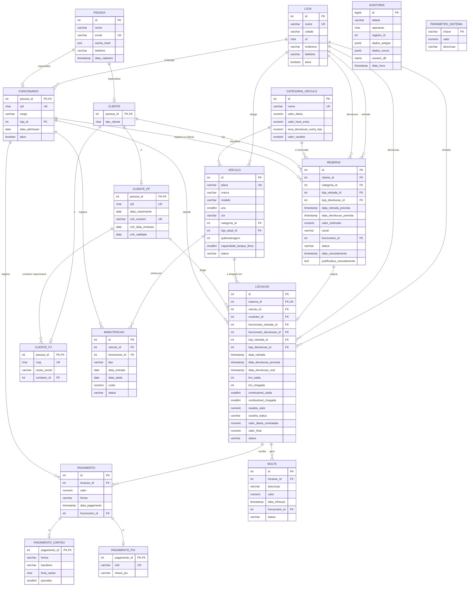

# Diagrama do Modelo Relacional — Next Drive

Modelo lógico relacional do sistema, implementado em PostgreSQL (`sql/02_create_tables.sql`).

## Diagrama Entidade-Relacionamento

> `AUDITORIA` e `PARAMETRO_SISTEMA` não têm chave estrangeira: a auditoria guarda o histórico
> mesmo que o registro original mude, e os parâmetros são constantes de cálculo.
> Os atributos de `LOCACAO` que detalham a composição do valor (diárias, horas extras, combustível,
> taxa de devolução e desconto) foram omitidos do desenho por espaço; estão no dicionário de dados.

## Decisões de modelagem

| Decisão | Motivo |
|---|---|
| **Herança de `Pessoa`** em tabelas separadas (`cliente`, `cliente_pf`, `cliente_pj`, `funcionario`) | Atende o RF20 e evita colunas nulas: CPF/CNH só existem para PF, CNPJ/condutor só para PJ. |
| **Chave estrangeira composta** `(pessoa_id, tipo_cliente)` nas subclasses | Garante pelo próprio banco que um cliente `PJ` não tenha linha em `cliente_pf` e vice-versa. |
| **Herança de `Pagamento`** (`pagamento_cartao`, `pagamento_pix`) | Atende o RF20. A coluna `forma` repetida na subclasse, com FK composta `(id, forma)`, impede um PIX ter detalhes de cartão. |
| `locacao` **não guarda `cliente_id`** | O cliente já é obtido por `locacao.reserva_id → reserva.cliente_id`; guardar de novo criaria dependência transitiva (fere a 3FN). |
| `locacao.condutor_id` referencia `cliente_pf` | Quem dirige é sempre pessoa física com CNH, mesmo quando o contratante é PJ (RF04, RF16). |
| `locacao.valor_diaria_contratada` | Guarda o preço vigente na retirada. Se o gerente alterar a categoria depois, as locações antigas não mudam. |
| Componentes de `valor_final` armazenados | São uma "foto" do cálculo feito na devolução (RN09). Uma constraint (`ck_locacao_total`) garante que o total sempre fecha com as parcelas. |
| `auditoria` com `JSONB` | Uma única tabela audita pagamentos e preços (RF17), guardando valores antigos e novos de qualquer tabela. |
| `veiculo.status` e `veiculo.loja_atual_id` | Estado atual da frota, mantido por triggers (RF15, RN04, RN11). |

## Normalização

- **1FN:** todas as colunas são atômicas; não há campos repetidos ou listas. Parcelas de pagamento ficam em colunas únicas.
- **2FN:** todas as tabelas com chave composta (as subclasses usam `pessoa_id` simples como PK) dependem da chave inteira; os atributos não-chave dependem da PK completa.
- **3FN:** não há dependências transitivas. Exemplos: o cliente da locação vem da reserva; nome da loja, da categoria e da pessoa ficam apenas nas suas tabelas e são trazidos por junção (views do `04_views.sql`).

Única redundância intencional: `locacao.valor_final` e seus componentes, justificada na tabela acima.

## Restrições principais

| Regra | Onde é garantida |
|---|---|
| RN01 — CPF/CNPJ único | `uq_cliente_pf_cpf`, `uq_cliente_pj_cnpj` |
| RN02 — placa única e válida | `uq_veiculo_placa`, `ck_veiculo_placa` |
| RN03 / RN04 — conflito e indisponibilidade | trigger `trg_locacao_conflito` (script 08) |
| RN05 — CNH válida | trigger `trg_locacao_valida_condutor` (script 08) |
| RN06 — devolução posterior à retirada | `ck_reserva_periodo`, `ck_locacao_prevista`, `ck_locacao_real` |
| RN09 — locação finalizada imutável | trigger `trg_locacao_imutavel` (script 08) |
| RN12 — forma de pagamento | `ck_pagamento_forma` + tabelas `pagamento_cartao` e `pagamento_pix` |
