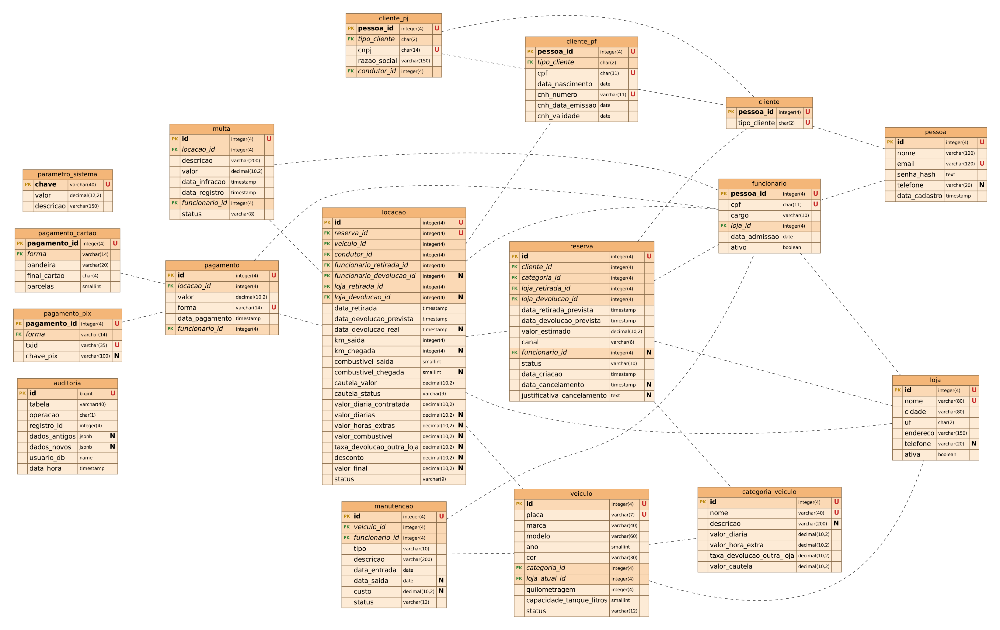

# Diagrama do Modelo Relacional — Next Drive

Modelo lógico relacional do sistema, implementado em PostgreSQL no script [`sql/02_create_tables.sql`](../sql/02_create_tables.sql).

O diagrama mostra, em cada tabela, a chave primária (**PK**), as chaves estrangeiras (**FK**) e as colunas principais. A lista completa de colunas, com tipos, tamanhos e restrições, está no [dicionário de dados](dicionario-de-dados.md).

As tabelas `auditoria` e `parametro_sistema` não aparecem no desenho porque não se ligam a nenhuma outra tabela: a auditoria guarda o histórico de alterações mesmo que o registro original mude, e os parâmetros são constantes usadas nos cálculos.

## Tabelas por módulo

| Módulo | Tabelas | O que guardam |
|---|---|---|
| Frota | `loja`, `categoria_veiculo`, `veiculo`, `manutencao` | Lojas, categorias com o valor da diária, veículos com placa e status, e o histórico de manutenções |
| Pessoas | `pessoa`, `funcionario`, `cliente`, `cliente_pf`, `cliente_pj` | Dados comuns de todas as pessoas e os dados específicos de funcionários, clientes pessoa física (CPF e CNH) e pessoa jurídica (CNPJ e condutor responsável) |
| Reserva e locação | `reserva`, `locacao` | A reserva feita por categoria e a locação aberta na retirada do veículo |
| Pagamentos e multas | `pagamento`, `pagamento_cartao`, `pagamento_pix`, `multa` | Pagamentos de cada locação, com os detalhes do cartão ou do PIX, e as multas de trânsito |
| Apoio | `auditoria`, `parametro_sistema` | Histórico de alterações em pagamentos e preços, e parâmetros de cálculo |

## Relacionamentos

| Tabela pai | Tabela filha | Chave estrangeira | Cardinalidade |
|---|---|---|---|
| `categoria_veiculo` | `veiculo` | `categoria_id` | 1 : N |
| `loja` | `veiculo` | `loja_atual_id` | 1 : N |
| `veiculo` | `manutencao` | `veiculo_id` | 1 : N |
| `loja` | `funcionario` | `loja_id` | 1 : N |
| `pessoa` | `funcionario` | `pessoa_id` | 1 : 1 |
| `pessoa` | `cliente` | `pessoa_id` | 1 : 1 |
| `cliente` | `cliente_pf` | `pessoa_id` | 1 : 1 |
| `cliente` | `cliente_pj` | `pessoa_id` | 1 : 1 |
| `cliente_pf` | `cliente_pj` | `condutor_id` | 1 : N |
| `cliente` | `reserva` | `cliente_id` | 1 : N |
| `categoria_veiculo` | `reserva` | `categoria_id` | 1 : N |
| `reserva` | `locacao` | `reserva_id` | 1 : 1 |
| `veiculo` | `locacao` | `veiculo_id` | 1 : N |
| `locacao` | `pagamento` | `locacao_id` | 1 : N |
| `pagamento` | `pagamento_cartao` | `pagamento_id` | 1 : 1 |
| `pagamento` | `pagamento_pix` | `pagamento_id` | 1 : 1 |
| `locacao` | `multa` | `locacao_id` | 1 : N |

Além dessas, o banco tem chaves estrangeiras de controle que não foram desenhadas para manter o diagrama legível: `reserva` e `locacao` também apontam para `loja` (loja de retirada e de devolução) e para `funcionario` (quem atendeu); `locacao` aponta para `cliente_pf` (o condutor); e `manutencao`, `pagamento` e `multa` apontam para o `funcionario` que fez o registro.

## Decisões de modelagem

| Decisão | Motivo |
|---|---|
| **Herança de `pessoa`** em tabelas separadas (`cliente`, `cliente_pf`, `cliente_pj`, `funcionario`) | Atende o RF20 e evita colunas nulas: CPF e CNH só existem para pessoa física; CNPJ e condutor, só para pessoa jurídica. |
| **Chave estrangeira composta** `(pessoa_id, tipo_cliente)` nas subclasses de cliente | Garante, pelo próprio banco, que um cliente pessoa jurídica não tenha linha em `cliente_pf`, e vice-versa. |
| **Herança de `pagamento`** (`pagamento_cartao`, `pagamento_pix`) | Atende o RF20. A FK composta `(pagamento_id, forma)` impede que um pagamento PIX tenha detalhes de cartão. |
| `locacao` **não guarda o cliente** | O cliente é obtido pela reserva (`locacao.reserva_id → reserva.cliente_id`). Guardar de novo criaria uma dependência transitiva. |
| `locacao.condutor_id` aponta para `cliente_pf` | Quem dirige é sempre uma pessoa física com CNH, mesmo quando o contratante é uma empresa. |
| `reserva` aponta para a **categoria**, e `locacao` para o **veículo** | O cliente reserva uma categoria; o veículo específico só é escolhido na retirada. |
| `veiculo.status` e `veiculo.loja_atual_id` | Guardam a situação atual da frota e são atualizados por triggers (RF15, RN04 e RN11). |

## Normalização

- **1FN:** não há listas nem grupos repetidos dentro de uma coluna; cada forma de pagamento e cada multa é uma linha separada.
- **2FN:** as chaves primárias são simples, então todos os atributos dependem da chave inteira.
- **3FN:** não há dependências transitivas. O nome da loja, da categoria e da pessoa ficam só nas suas tabelas e são trazidos por junção nas views (`sql/04_views.sql`).

Única redundância intencional: o valor final da locação e as parcelas que o compõem são guardados para que contratos antigos não mudem quando o preço da categoria muda.

Ponto de melhoria identificado: o endereço da loja está em uma única coluna (`endereco`); separá-lo em logradouro, número, bairro e CEP deixaria o campo atômico.

## Restrições principais

| Regra | Onde é garantida |
|---|---|
| RN01 — CPF/CNPJ único | `uq_cliente_pf_cpf`, `uq_cliente_pj_cnpj` |
| RN02 — placa única e válida | `uq_veiculo_placa`, `ck_veiculo_placa` |
| RN03 / RN04 — locação conflitante e veículo indisponível | trigger `trg_locacao_conflito` (`sql/08_triggers.sql`) |
| RN05 — CNH válida | trigger `trg_locacao_valida_condutor` (`sql/08_triggers.sql`) |
| RN06 — devolução posterior à retirada | `ck_reserva_periodo`, `ck_locacao_prevista`, `ck_locacao_real` |
| RN09 — locação finalizada não pode ser alterada | trigger `trg_locacao_imutavel` (`sql/08_triggers.sql`) |
| RN12 — forma de pagamento | `ck_pagamento_forma` e as tabelas `pagamento_cartao` e `pagamento_pix` |
