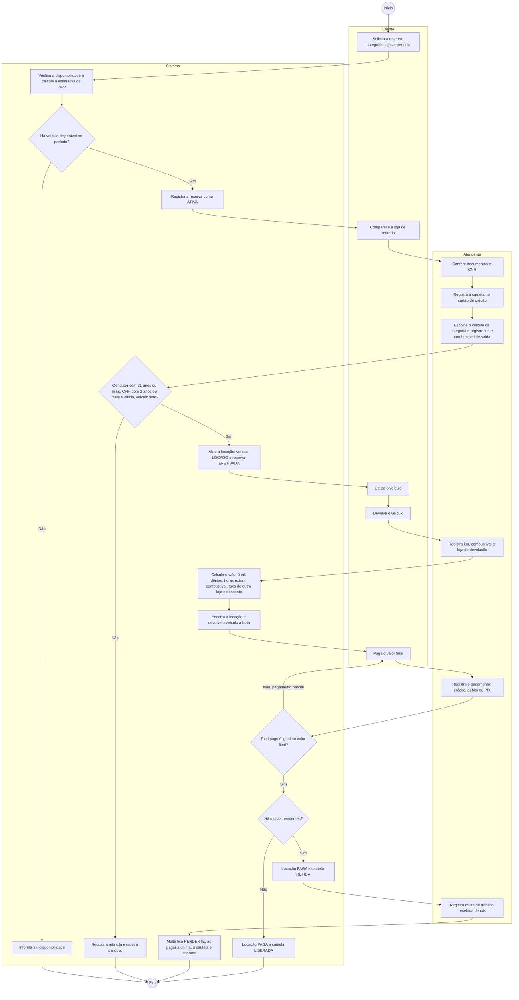

# Diagrama de Atividades — Processo de Contratação (RF22)

Fluxo completo da contratação de um veículo, da reserva ao pós-locação, com as responsabilidades divididas em
raias: **Cliente**, **Atendente** e **Sistema**. Os losangos são decisões; as regras citadas (RN e RF) estão nos
triggers e procedures do banco.

## Pontos de decisão e regras associadas

| Decisão | Regra | Onde é garantida |
|---|---|---|
| Há veículo disponível? | RN03, RN04, RN11, RF06 | `fn_veiculos_disponiveis` e reservas ativas na consulta de disponibilidade |
| Condutor e veículo válidos? | RF16, RN05, RN03, RN04 | Triggers `trg_locacao_valida_condutor` e `trg_locacao_conflito` |
| Valor final | RN06, RN07, RN08 | Procedure `sp_registrar_devolucao` |
| Pagamento quita a locação? | RN12 | Procedure `sp_registrar_pagamento` |
| Multas pendentes? | Processo de negócio (pós-locação) | Procedure de pagamento e trigger `trg_multa_libera_cautela` |
