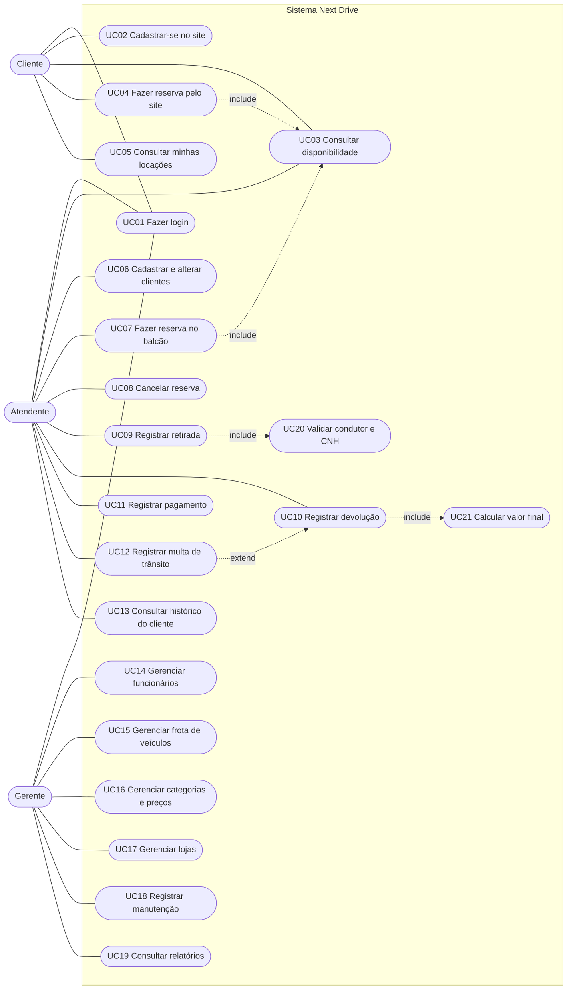

# Diagrama de Casos de Uso — Next Drive (RF19)

Atores: **Cliente** (pessoa física ou jurídica, usa o site), **Atendente** (funcionário de balcão) e **Gerente**
(gestão da locadora). Os casos de uso derivam dos requisitos funcionais e do processo de negócio do README.

## Descrição dos casos de uso

| Código | Caso de uso | Ator | Requisitos | Descrição |
|---|---|---|---|---|
| UC01 | Fazer login | Todos | RF02 | Entra no sistema com e-mail e senha; o perfil (cliente, atendente ou gerente) define o que fica disponível. |
| UC02 | Cadastrar-se no site | Cliente | RF04 | Cliente PF (CPF e CNH) ou PJ (CNPJ e condutor responsável) se cadastra sozinho. |
| UC03 | Consultar disponibilidade | Cliente, Atendente | RF06, RN04, RN11 | Consulta veículos livres por categoria, loja e período; veículos em manutenção não aparecem. |
| UC04 | Fazer reserva pelo site | Cliente | RF07 | Informa dados, horário, lojas de retirada e devolução e categoria; o sistema estima o valor. |
| UC05 | Consultar minhas locações | Cliente | RF13 | O cliente vê o histórico das suas locações. |
| UC06 | Cadastrar e alterar clientes | Atendente | RF04 | Cadastro no balcão de clientes PF e PJ. |
| UC07 | Fazer reserva no balcão | Atendente | RF07 | Mesma reserva do site, registrada pelo atendente (canal BALCÃO). |
| UC08 | Cancelar reserva | Atendente | RF08 | Cancela reserva ativa com justificativa obrigatória (`sp_cancelar_reserva`). |
| UC09 | Registrar retirada | Atendente | RF09, RN03, RN05 | Confere documentos, registra a cautela, escolhe o veículo e anota km e combustível (`sp_abrir_locacao`). |
| UC10 | Registrar devolução | Atendente | RF10, RN06, RN08 | Anota km e combustível de chegada; o sistema calcula o valor (`sp_registrar_devolucao`). |
| UC11 | Registrar pagamento | Atendente | RF11, RN12 | Registra cartão de crédito, débito ou PIX; quita a locação e libera a cautela se não houver pendências. |
| UC12 | Registrar multa de trânsito | Atendente | RF24 | Vincula multa recebida depois a uma locação para cobrança do cliente. |
| UC13 | Consultar histórico do cliente | Atendente | RF13 | Lista as locações de um cliente. |
| UC14 | Gerenciar funcionários | Gerente | RF03, RN10 | Cadastra, consulta e altera funcionários (apenas gerentes). |
| UC15 | Gerenciar frota de veículos | Gerente | RF05, RN02 | Cadastra e altera veículos (placa única). |
| UC16 | Gerenciar categorias e preços | Gerente | RF05, RF17 | Define diárias e taxas; as alterações de preço são auditadas. |
| UC17 | Gerenciar lojas | Gerente | RF05 | Cadastra e altera lojas. |
| UC18 | Registrar manutenção | Gerente | RF12 | Abre e conclui manutenções; o veículo fica indisponível enquanto durar. |
| UC19 | Consultar relatórios | Gerente | RF14 | Relatórios administrativos baseados em views. |
| UC20 | Validar condutor e CNH | (incluído em UC09) | RF16, RN05 | Exige idade mínima de 21 anos, CNH com 2 anos ou mais e dentro da validade. |
| UC21 | Calcular valor final | (incluído em UC10) | RN07, RN08 | Diárias, horas extras, diferença de combustível, taxa de outra loja e desconto. |

**Relações:** `include` = o caso de uso base sempre usa o outro; `extend` = o registro de multa pode ocorrer
depois de uma devolução (pós-locação).
