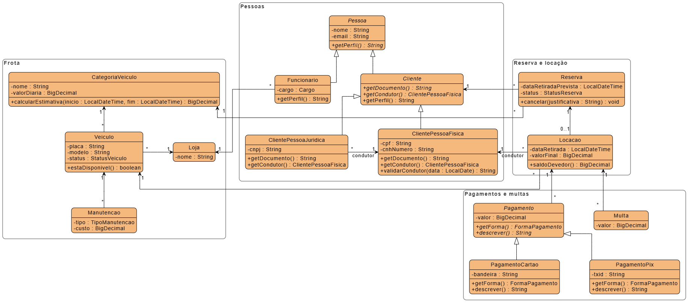

# Diagrama de Classes — Next Drive

Modelo de domínio em Java, no pacote [`br.edu.unoesc.nextdrive.model`](../../java/src/main/java/br/edu/unoesc/nextdrive/model), organizado nos mesmos módulos do banco de dados.

O diagrama mostra os atributos e métodos principais de cada classe. Getters, setters, construtores e as enumerações (`StatusVeiculo`, `StatusReserva`, `StatusLocacao`, `Canal`, `Cargo`, `FormaPagamento` e `TipoManutencao`) foram omitidos para deixar o desenho legível.

## Classes por módulo

| Módulo | Classes | Responsabilidade |
|---|---|---|
| Pessoas | `Pessoa`, `Cliente`, `ClientePessoaFisica`, `ClientePessoaJuridica`, `Funcionario` | Dados de quem usa o sistema: clientes pessoa física e jurídica, atendentes e gerentes |
| Frota | `Loja`, `CategoriaVeiculo`, `Veiculo`, `Manutencao` | Lojas, categorias com o valor da diária, veículos e manutenções |
| Reserva e locação | `Reserva`, `Locacao`, `Multa` | A reserva por categoria, a locação do veículo e as multas de trânsito |
| Pagamentos | `Pagamento`, `PagamentoCartao`, `PagamentoPix` | Pagamentos de cada locação, por cartão ou PIX |

## Herança

| Classe mãe | Classes filhas | Observação |
|---|---|---|
| `Pessoa` (abstrata) | `Cliente`, `Funcionario` | Nome e e-mail ficam em `Pessoa`; cada filha define o seu perfil em `getPerfil()` |
| `Cliente` (abstrata) | `ClientePessoaFisica`, `ClientePessoaJuridica` | Cada tipo de cliente devolve o próprio documento e o próprio condutor |
| `Pagamento` (abstrata) | `PagamentoCartao`, `PagamentoPix` | Cada forma de pagamento se descreve e se valida de um jeito |

## Associações

| Classe | Multiplicidade | Classe | Multiplicidade | Significado |
|---|:---:|---|:---:|---|
| `Veiculo` | * | `CategoriaVeiculo` | 1 | Todo veículo pertence a uma categoria |
| `Veiculo` | * | `Loja` | 1 | Todo veículo está em uma loja |
| `Manutencao` | * | `Veiculo` | 1 | Um veículo pode ter várias manutenções |
| `Funcionario` | * | `Loja` | 1 | Todo funcionário trabalha em uma loja |
| `Reserva` | * | `Cliente` | 1 | Um cliente pode fazer várias reservas |
| `Reserva` | * | `CategoriaVeiculo` | 1 | A reserva é feita por categoria |
| `Locacao` | 0..1 | `Reserva` | 1 | Uma reserva gera no máximo uma locação |
| `Locacao` | * | `Veiculo` | 1 | O veículo é escolhido na retirada |
| `Multa` | * | `Locacao` | 1 | Uma locação pode ter várias multas |
| `Pagamento` | * | `Locacao` | 1 | Uma locação pode ser paga em várias partes |

No código, as associações são feitas pelo identificador da outra classe (por exemplo, `Veiculo.categoriaId`), da mesma forma que as chaves estrangeiras no banco.

## Conceitos de POO aplicados

| Conceito | Onde aparece |
|---|---|
| **Encapsulamento** | Todos os atributos são privados (`-`) e acessados por getters e setters. Regras como `Reserva.cancelar()` e `Locacao.saldoDevedor()` ficam dentro das próprias classes. |
| **Herança** | `Pessoa` → `Cliente` → `ClientePessoaFisica` / `ClientePessoaJuridica`; `Pessoa` → `Funcionario`; `Pagamento` → `PagamentoCartao` / `PagamentoPix`. |
| **Polimorfismo** | `getPerfil()` devolve "CLIENTE" ou o cargo do funcionário; `getDocumento()` devolve o CPF ou o CNPJ; `getCondutor()` devolve a própria pessoa física ou o condutor responsável da empresa; `getForma()` e `descrever()` mudam conforme o tipo de pagamento. |
| **Classe abstrata** | `Pessoa`, `Cliente` e `Pagamento` não são instanciadas diretamente; os métodos abstratos aparecem em itálico no diagrama. |

## Correspondência com o banco de dados

| Classe | Tabela |
|---|---|
| `Pessoa` + `Funcionario` | `pessoa` + `funcionario` |
| `Cliente` + `ClientePessoaFisica` / `ClientePessoaJuridica` | `pessoa` + `cliente` + `cliente_pf` / `cliente_pj` |
| `Pagamento` + `PagamentoCartao` / `PagamentoPix` | `pagamento` + `pagamento_cartao` / `pagamento_pix` |
| `Loja`, `CategoriaVeiculo`, `Veiculo`, `Manutencao` | `loja`, `categoria_veiculo`, `veiculo`, `manutencao` |
| `Reserva`, `Locacao`, `Multa` | `reserva`, `locacao`, `multa` |

O diagrama relacional está em [`docs/diagrama-relacional.md`](../diagrama-relacional.md). As classes de acesso a dados (DAO) e de serviço aparecem nos [diagramas de sequência](diagrama-de-sequencia.md).
