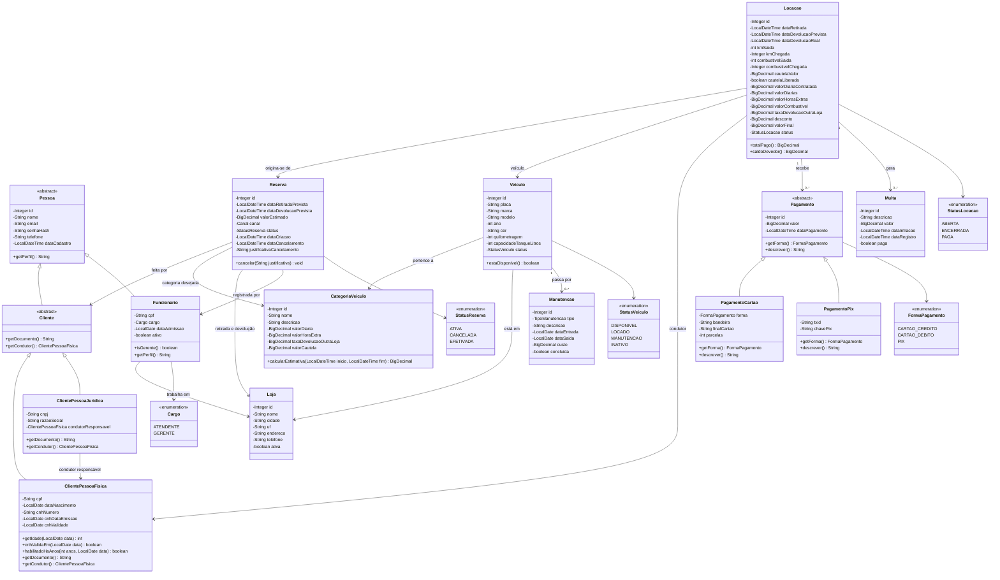

# Diagrama de Classes — Next Drive (RF20)

Modelo de domínio em Java (pacote `br.edu.unoesc.nextdrive.model`), consistente com o banco de dados
(RNF09). As duas hierarquias de herança pedidas no RF20 são destacadas:

- **Pessoa** → `Cliente` → `ClientePessoaFisica` / `ClientePessoaJuridica`, e **Pessoa** → `Funcionario`;
- **Pagamento** → `PagamentoCartao` / `PagamentoPix`.

## Conceitos de POO aplicados

| Conceito | Onde aparece |
|---|---|
| **Encapsulamento** | Todos os atributos são `private`, acessados por getters e setters. Regras como `Reserva.cancelar` e `Locacao.saldoDevedor` ficam dentro das classes. |
| **Herança** | `Pessoa` → `Cliente` → `ClientePessoaFisica`/`ClientePessoaJuridica`; `Pessoa` → `Funcionario`; `Pagamento` → `PagamentoCartao`/`PagamentoPix`. |
| **Polimorfismo** | `Cliente.getDocumento()` devolve CPF ou CNPJ conforme a subclasse; `Cliente.getCondutor()` devolve a própria pessoa física ou o condutor responsável da empresa; `Pagamento.descrever()` e `getForma()` mudam em cada tipo de pagamento. |
| **Classe abstrata** | `Pessoa`, `Cliente` e `Pagamento` não são instanciadas diretamente. |
| **Enumerações** | `Cargo`, `StatusVeiculo`, `StatusReserva`, `StatusLocacao`, `FormaPagamento` (além de `Canal`, `TipoManutencao` etc.). |

## Correspondência com o banco de dados

| Classe | Tabela |
|---|---|
| `Pessoa` + `Funcionario` | `pessoa` + `funcionario` |
| `Cliente` + `ClientePessoaFisica` / `ClientePessoaJuridica` | `pessoa` + `cliente` + `cliente_pf` / `cliente_pj` |
| `Pagamento` + `PagamentoCartao` / `PagamentoPix` | `pagamento` + `pagamento_cartao` / `pagamento_pix` |
| `Loja`, `CategoriaVeiculo`, `Veiculo`, `Reserva`, `Locacao`, `Multa`, `Manutencao` | `loja`, `categoria_veiculo`, `veiculo`, `reserva`, `locacao`, `multa`, `manutencao` |

Os métodos abstratos (`getPerfil`, `getDocumento`, `getCondutor`, `getForma`, `descrever`) são implementados nas
subclasses indicadas no diagrama. As classes de acesso a dados (DAO) e de serviço aparecem no diagrama de sequência.
