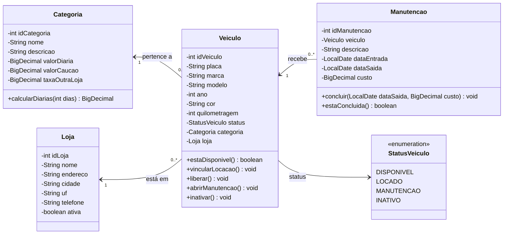

# Diagrama de Classes — Next Drive

## Módulo de Frota

Classes responsáveis pelos veículos, categorias, lojas e manutenções. Os métodos de `Veiculo` correspondem às ações do diagrama de estados do veículo.

