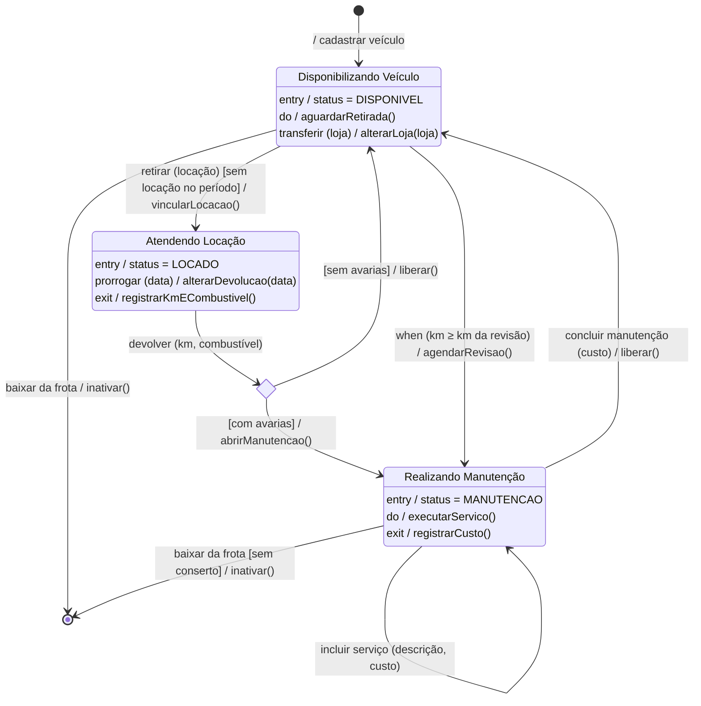

| Estado | Descrição |
|:---|:---|
| Disponível | Veículo na loja, pronto para ser locado. |
| Locado | Veículo em uso por um cliente. |
| Em manutenção | Veículo em revisão ou conserto; não pode ser locado. |
| Inativo | Veículo retirado da frota; não pode ser locado nem voltar a operar. |

| De | Para | Evento | Condição |
|:---|:---|:---|:---|
| (início) | Disponível | cadastrar veículo | |
| Disponível | Locado | registrar retirada | sem locação conflitante |
| Locado | Disponível | registrar devolução | sem avarias |
| Locado | Em manutenção | registrar devolução | com avarias |
| Disponível | Em manutenção | enviar para manutenção | |
| Em manutenção | Disponível | registrar retorno da manutenção | |
| Disponível | Inativo | inativar veículo | |
| Em manutenção | Inativo | inativar veículo | sem conserto |
| Inativo | (fim) | | |
