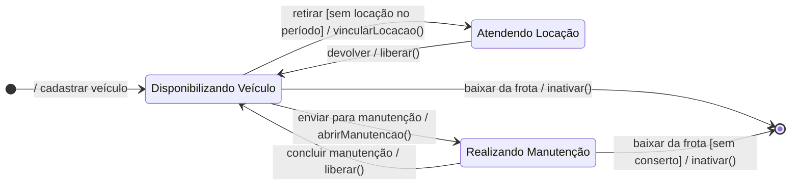

# Diagramas de Estados — Next Drive

## Classe Veiculo

Mostra os estados por que passa um veículo, do cadastro até a baixa da frota. As transições seguem a notação `evento [condição de guarda] / ação`.

| Estado | Status no banco | Descrição |
|:---|:---|:---|
| Disponibilizando Veículo | `DISPONIVEL` | Veículo na loja, pronto para ser retirado. |
| Atendendo Locação | `LOCADO` | Veículo em uso por um cliente. |
| Realizando Manutenção | `MANUTENCAO` | Veículo em revisão ou conserto; não pode ser locado. |
| Estado final | `INATIVO` | Veículo baixado da frota. |
