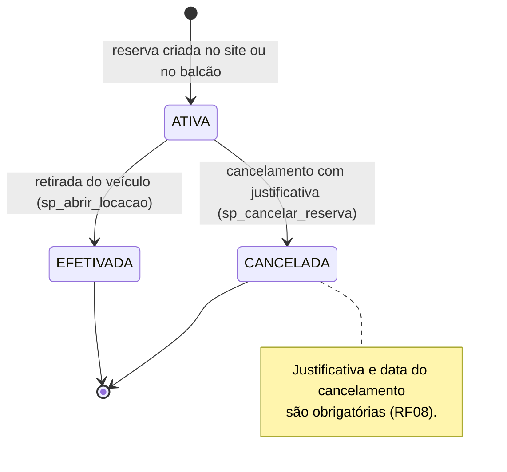
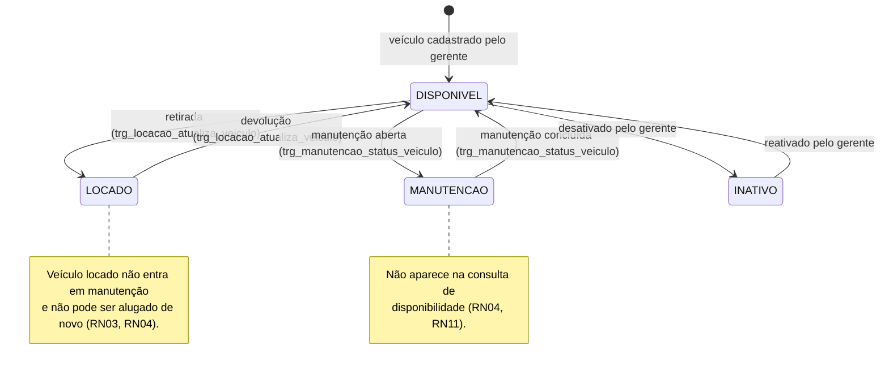
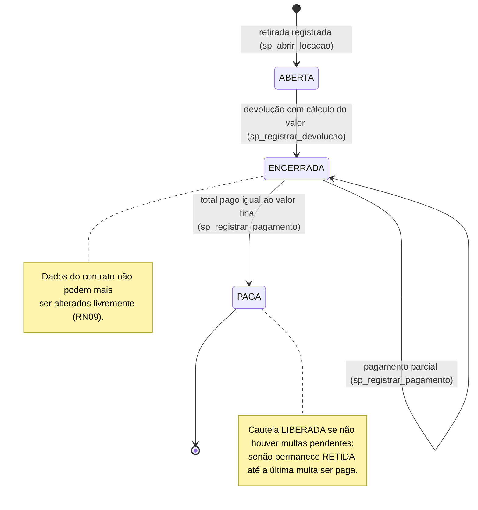

# Diagramas de Estados — Reserva, Veículo e Locação (RF23)

Cada transição indica o evento que a provoca e, entre parênteses, a procedure ou o trigger responsável.
Os estados correspondem exatamente aos valores das colunas `status` do banco.

## Reserva (`reserva.status`)

## Veículo (`veiculo.status`)

## Locação (`locacao.status`)

## Resumo das transições permitidas

| Entidade | De | Para | Evento |
|---|---|---|---|
| Reserva | ATIVA | CANCELADA | Cancelamento com justificativa |
| Reserva | ATIVA | EFETIVADA | Retirada do veículo |
| Veículo | DISPONIVEL | LOCADO | Abertura da locação |
| Veículo | LOCADO | DISPONIVEL | Devolução |
| Veículo | DISPONIVEL | MANUTENCAO | Manutenção aberta |
| Veículo | MANUTENCAO | DISPONIVEL | Manutenção concluída |
| Veículo | DISPONIVEL, INATIVO | INATIVO, DISPONIVEL | Desativação e reativação pelo gerente |
| Locação | ABERTA | ENCERRADA | Devolução |
| Locação | ENCERRADA | PAGA | Quitação do valor final |

Qualquer outra transição é bloqueada pelo banco (por exemplo, alterar uma locação paga, ou colocar em manutenção um veículo locado).
