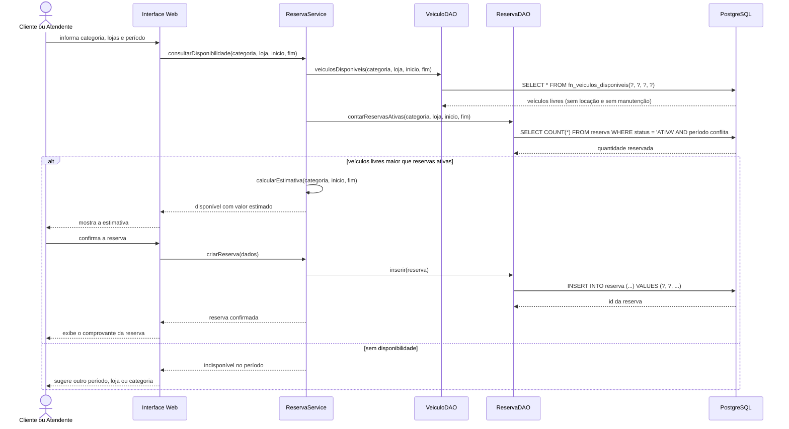
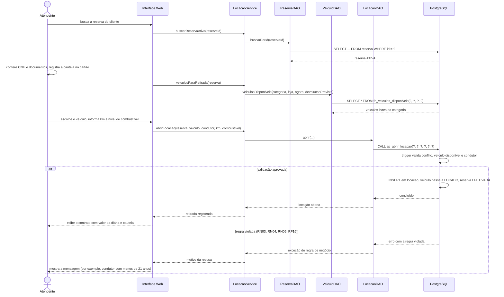
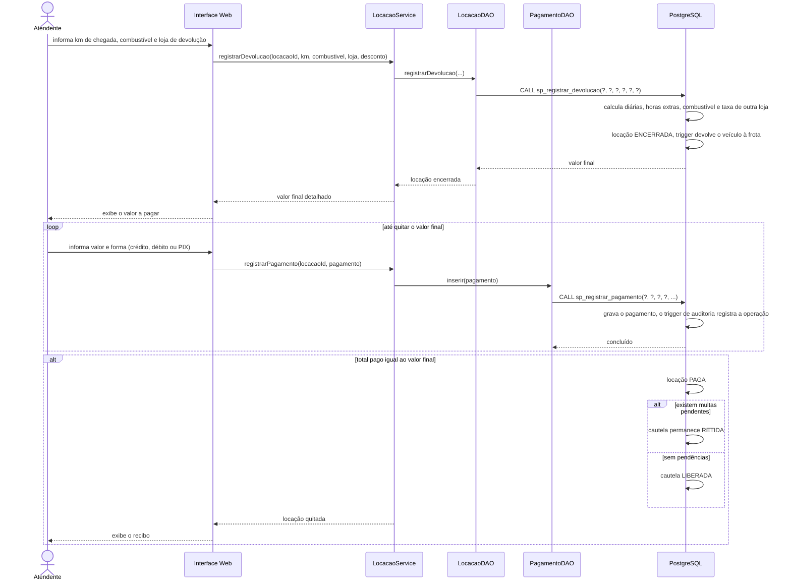

# Diagramas de Sequência — Next Drive (RF21)

Fluxos de **reserva**, **retirada** e **devolução**. As camadas seguem a arquitetura do código Java:
interface web → `Service` (regras de negócio) → `DAO` (JDBC, consultas parametrizadas) → PostgreSQL
(procedures e triggers dos scripts `09` e `08`).

## 1. Reserva (pelo site ou balcão) — RF06, RF07

## 2. Retirada do veículo (abertura da locação) — RF09, RF15, RF16

## 3. Devolução e pagamento — RF10, RF11

**Observações**
- Regras críticas (conflito de locação, idade e CNH, cálculo do valor, cautela) ficam no banco, por triggers e procedures; o Java apenas chama as procedures e traduz os erros em mensagens (RNF04, consultas parametrizadas).
- Toda comunicação com o banco usa `PreparedStatement` e `CallableStatement`.
